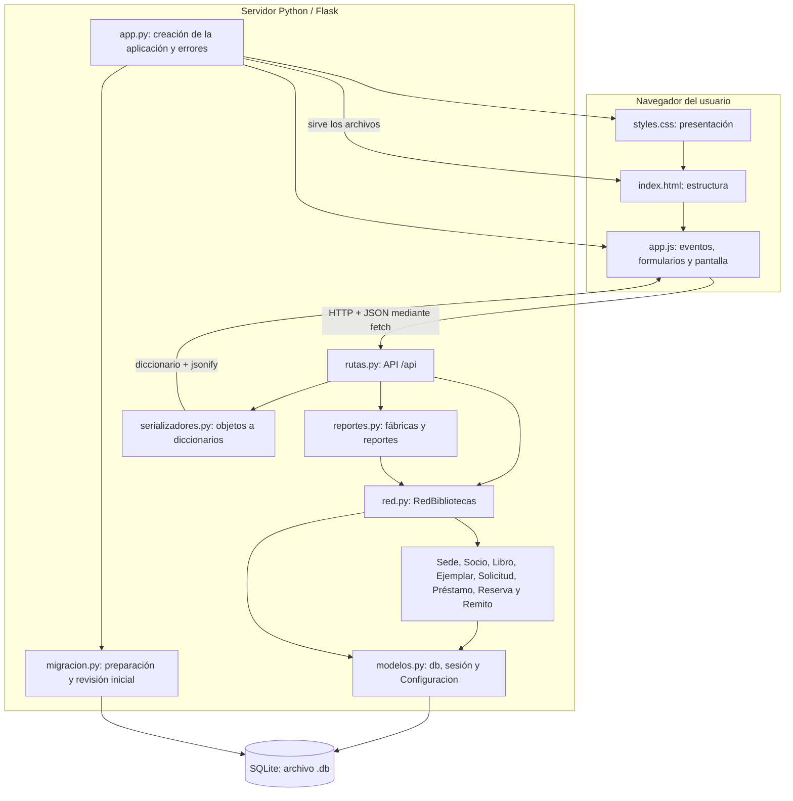
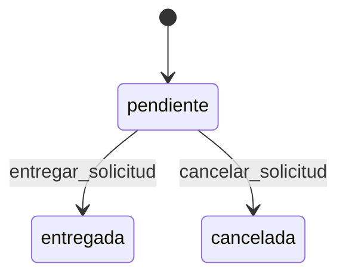
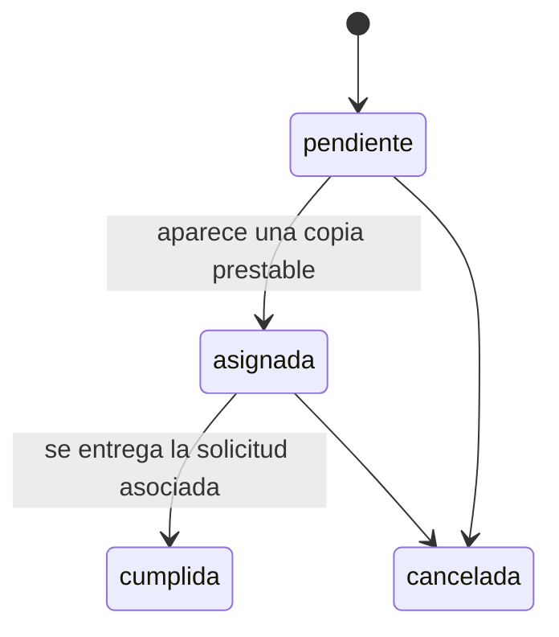
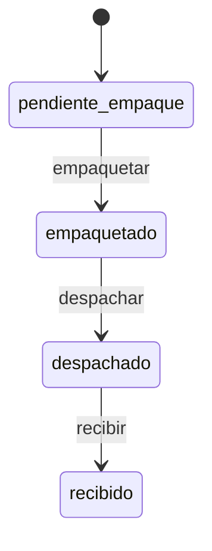
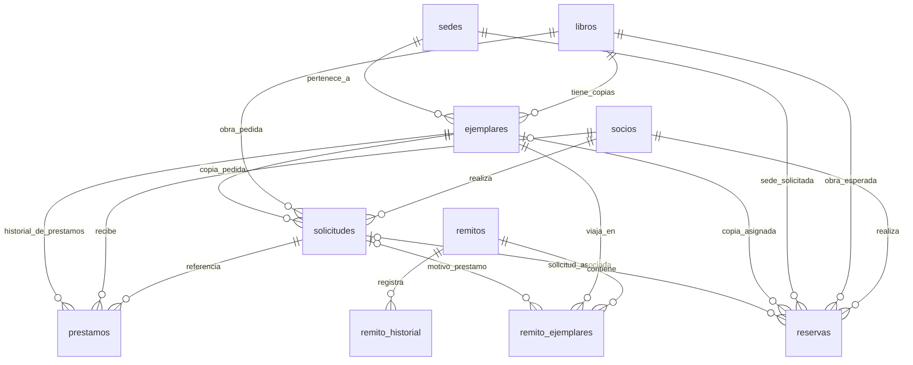
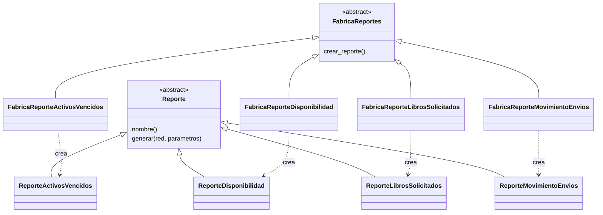
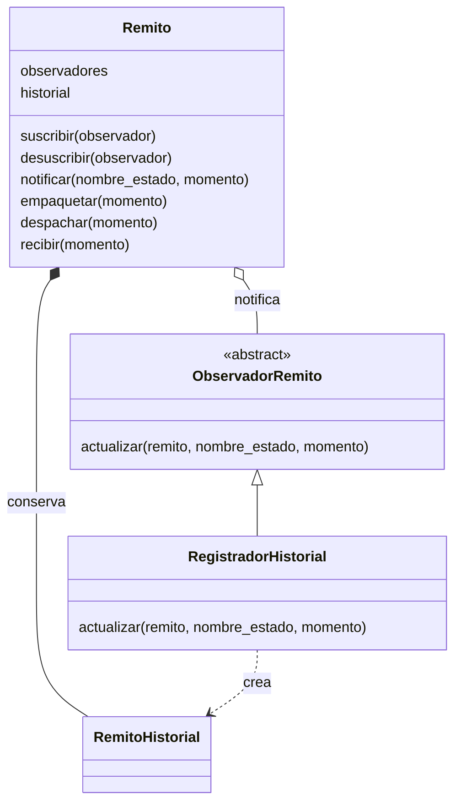
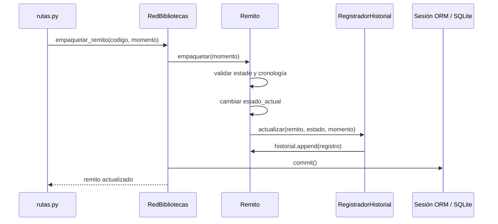
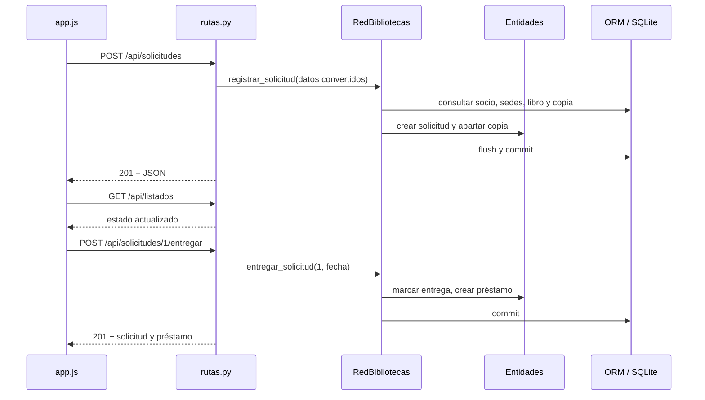

# Exploración del sistema de préstamos interbibliotecarios

Este documento explica la resolución a partir del código existente: qué representa cada clase, qué aporta cada archivo, dónde se aplican los patrones y cómo una acción del navegador termina modificando SQLite.

Se revisaron los 36 archivos originales del proyecto: código, pruebas, documentación, configuración y la base demo. También se extrajo el texto de las dos páginas de `tema1.pdf`, ubicado en la carpeta superior, y se contrastó con `ENUNCIADO.md`. El PDF se utilizó como consigna del TP. Esta exploración no modifica la implementación, la base ni la documentación anterior.

La fase registrada en `FASES.md` es **revisión final y entrega**. Aquí se amplía la explicación de lo implementado y se señalan algunas precisiones necesarias para defenderlo sin atribuirle capacidades que el código no tiene.

## 1. Qué sistema se construyó

La aplicación administra una **red de sedes** que comparten un catálogo y pueden enviarse copias físicas. Un socio solicita un ejemplar, lo recibe como préstamo y después lo devuelve. Si la copia debe viajar, el traslado se documenta con un remito. Si no hay una copia prestable, el socio puede esperar mediante una reserva.

Los conceptos que conviene distinguir desde el principio son:

| Concepto | Qué representa | Ejemplo |
|---|---|---|
| `Libro` | Una obra del catálogo | El principito, identificado como L2 |
| `Ejemplar` | Una copia física de una obra | E4 y E5 son dos copias de L2 |
| `SolicitudPrestamo` | El pedido de una copia concreta | Un socio pide E5 desde S2 para retirarla en S1 |
| `Prestamo` | La entrega efectiva de la copia al socio | Se entrega E5 y se fija su vencimiento |
| `Reserva` | La espera por un libro en una sede | Un socio espera cualquier copia prestable de L2 en S1 |
| `Remito` | El traslado de una copia entre sedes | E5 viaja desde S2 hasta S1 |

Una solicitud ya aparta la copia, pero todavía no constituye un préstamo. Un remito recibido indica que la copia llegó a la sede; la entrega posterior al socio crea el préstamo. Una reserva inicialmente puede existir sin tener una copia asignada.

### Relación con la consigna

| Proceso obligatorio del PDF | Dónde se resuelve |
|---|---|
| Administrar sedes | `Sede`, operaciones de `RedBibliotecas`, rutas `/api/sedes` y sección Sedes |
| Administrar socios | `Socio`, operaciones de `RedBibliotecas`, rutas `/api/socios` y sección Socios |
| Administrar catálogo y ejemplares por sede | `Libro`, `Ejemplar`, rutas de libros y ejemplares, sección Catálogo |
| Solicitudes locales e interbibliotecarias | `SolicitudPrestamo` y `registrar_solicitud()` |
| Empaquetar, despachar, recibir y mantener trazabilidad | `Remito`, su historial, Observer y operaciones logísticas del coordinador |
| Consultar disponibilidad | Listado de ejemplares, serialización y `ReporteDisponibilidad` |
| Gestionar reservas | `Reserva`, cola por libro y sede, asignación y cancelación |
| Registrar devoluciones y estado físico | `Prestamo.registrar_devolucion()` y coordinación con `Ejemplar` |

Los dos patrones explícitos son **Factory Method**, para crear reportes, y **Observer**, para registrar los eventos del remito. Hay cuatro reportes concretos con agrupaciones, proporciones, filtros o promedios; no son solamente listados de tablas.

## 2. Arquitectura general: navegador, servidor y archivo de datos

La aplicación tiene una separación de responsabilidades en capas, dentro de un único proyecto y un único servidor Flask.



El diagrama combina dependencias y circulación de información. El ORM no envía directamente una respuesta al navegador: la ruta obtiene los objetos, los serializa y Flask produce el JSON.

### Qué corre en cada lugar

- **En el navegador:** HTML, CSS y JavaScript. El navegador conserva datos de pantalla en memoria y hace peticiones HTTP.
- **En el servidor:** Flask, las rutas, `RedBibliotecas`, las entidades, los patrones y SQLAlchemy. Allí se deciden las reglas de negocio.
- **En el disco del servidor:** un archivo SQLite. No hay que iniciar un servidor de base de datos separado.

Flask sirve tanto la página como la API en `http://127.0.0.1:5000`. Por eso JavaScript usa rutas relativas como `/api/socios`: apuntan al mismo origen desde el que se cargó la página.

El código Python no importa `frontend/app.js` ni ejecuta funciones JavaScript. La conexión entre ambas partes es el protocolo HTTP. Tampoco se comparte una instancia Python de `Socio` con el navegador: se envía una representación JSON y allí se obtiene un objeto JavaScript con esos datos.

## 3. Mapa completo de archivos

Las rutas de esta sección son relativas a la raíz del proyecto.

### Raíz

| Archivo | Responsabilidad y conexiones |
|---|---|
| [main.py](../main.py) | Punto de entrada. Importa `crear_aplicacion()`, muestra la base utilizada y los problemas heredados, y arranca Flask. No decide préstamos ni reservas. |
| [crear_base_demo.py](../crear_base_demo.py) | Cargador de ejemplos. Crea la aplicación y usa `RedBibliotecas` para generar casos locales, reservas y traslados. Si se ejecuta, reemplaza la demo anterior. No se ejecutó durante esta exploración. |
| [biblioteca_demo.db](../biblioteca_demo.db) | Archivo SQLite versionado con datos ficticios. Es una alternativa a la base local, seleccionable mediante `BIBLIOTECA_DB`. |
| [requirements.txt](../requirements.txt) | Declara Flask, Flask-SQLAlchemy y SQLAlchemy, con versiones fijadas. `unittest` y `sqlite3` pertenecen a la biblioteca estándar de Python. |
| [.gitignore](../.gitignore) | Excluye bases locales, respaldos, cachés, entornos virtuales y otros archivos generados. Hace una excepción para versionar `biblioteca_demo.db`. |
| [AGENTS.md](../AGENTS.md) | Define estilo, responsabilidades y criterios de trabajo. No es un módulo ejecutado por Flask. |

### Backend

| Archivo | Clases o funciones centrales | Para qué se conecta con los demás |
|---|---|---|
| [backend/__init__.py](../backend/__init__.py) | Marcador de paquete | Permite importar módulos de `backend`; contiene un comentario y no agrega comportamiento. |
| [backend/app.py](../backend/app.py) | `crear_aplicacion()` | Inicializa el ORM, registra las rutas, prepara la base, sirve el frontend y traduce errores a HTTP. |
| [backend/modelos.py](../backend/modelos.py) | `db`, `Configuracion`, `activar_claves_foraneas()` | Proporciona la infraestructura ORM común y activa la integridad referencial de SQLite. |
| [backend/sede.py](../backend/sede.py) | `Sede` | Representa una sede y valida sus datos y modificaciones. |
| [backend/socio.py](../backend/socio.py) | `Socio` | Representa al socio, sus datos y su habilitación. |
| [backend/catalogo.py](../backend/catalogo.py) | `Libro`, `Ejemplar` | Separa obra y copia física; registra pertenencia, ubicación, condición y asignaciones. |
| [backend/prestamos.py](../backend/prestamos.py) | `SolicitudPrestamo`, `Prestamo`, `Reserva` | Modela pedido, entrega, devolución, vencimiento y espera. |
| [backend/remito.py](../backend/remito.py) | `Remito`, `RemitoEjemplar`, `RemitoHistorial`, `ObservadorRemito`, `RegistradorHistorial` | Modela el traslado y aplica Observer para conservar sus eventos. |
| [backend/red.py](../backend/red.py) | `RedBibliotecas` | Coordina casos de uso que involucran varias entidades y confirma las operaciones. |
| [backend/reportes.py](../backend/reportes.py) | `Reporte`, `FabricaReportes` y sus ocho clases concretas | Crea los cuatro reportes mediante Factory Method y calcula sus filas. |
| [backend/rutas.py](../backend/rutas.py) | Blueprint `api`, funciones de endpoints | Recibe HTTP/JSON, llama al coordinador o a los reportes y arma respuestas. |
| [backend/serializadores.py](../backend/serializadores.py) | Funciones `*_a_diccionario()` | Convierte modelos y algunos datos derivados en estructuras transportables por JSON. |
| [backend/validaciones.py](../backend/validaciones.py) | Funciones `validar_*()` | Comparte controles de formato y valores entre entidades, coordinador y revisión heredada. |
| [backend/errores.py](../backend/errores.py) | Jerarquía de excepciones | Permite expresar errores del dominio sin construir respuestas Flask dentro de las entidades. |
| [backend/migracion.py](../backend/migracion.py) | `preparar_base()`, migración y revisión | Crea tablas faltantes, agrega una columna heredada con respaldo y señala datos problemáticos. |

### Frontend

| Archivo | Responsabilidad |
|---|---|
| [frontend/__init__.py](../frontend/__init__.py) | Marcador de paquete con un comentario. No conecta el navegador con Python. |
| [frontend/index.html](../frontend/index.html) | Esqueleto: encabezado, estado de conexión, menú de nueve secciones, contenedor `#contenido` y zona de mensajes. Carga CSS y JavaScript. |
| [frontend/styles.css](../frontend/styles.css) | Colores, grillas, formularios, tablas, insignias, mensajes y adaptación a pantallas de menos de 900 px. |
| [frontend/app.js](../frontend/app.js) | Estado de la interfaz, peticiones `fetch`, renderizado de secciones, manejo de formularios y botones, filtros y presentación de reportes. |

### Pruebas

| Archivo | Qué prepara o verifica |
|---|---|
| [tests/__init__.py](../tests/__init__.py) | Marcador del paquete de pruebas. |
| [tests/apoyo.py](../tests/apoyo.py) | `PruebaBase`: aplicación, cliente HTTP y SQLite temporal por prueba; métodos para crear datos y recorrer operaciones. |
| [tests/test_api.py](../tests/test_api.py) | 15 casos declarados: API básica, préstamos locales, circuito interbibliotecario y reservas. |
| [tests/test_orm.py](../tests/test_orm.py) | 7 casos declarados: configuración, claves foráneas, persistencia, Observer tras recuperar un remito y modificaciones atómicas. |
| [tests/test_patrones.py](../tests/test_patrones.py) | 9 casos declarados: contratos abstractos, fábricas, reportes vacíos y comportamiento de Observer. |
| [tests/test_reportes.py](../tests/test_reportes.py) | 5 casos declarados: cálculos, inventario sin duplicación, filtros, tiempos y filtros inválidos. |
| [tests/test_migracion.py](../tests/test_migracion.py) | 4 casos declarados: respaldo y columna nueva, reapertura, datos heredados sin corrección y configuración inicial. |

### Documentación original

| Archivo | Función |
|---|---|
| [Documentacion/ENUNCIADO.md](ENUNCIADO.md) | Transcripción de la consigna del PDF. |
| [Documentacion/FASES.md](FASES.md) | Decisiones de implementación, fases y comprobaciones registradas anteriormente. |
| [Documentacion/README.md](README.md) | Uso, dependencias, arranque, estructura, API y reglas principales. |
| [Documentacion/GUIA_DEFENSA.md](GUIA_DEFENSA.md) | Guía previa del mapa del código y de preguntas para la defensa. |

`biblioteca.db` es el nombre por defecto de la base local que la aplicación puede crear. No formaba parte de los archivos presentes en esta exploración. El sistema usa **una base seleccionada por aplicación**; no sincroniza automáticamente una base local y otra demo.

## 4. Qué sucede al ejecutar `python main.py`

El recorrido de inicialización se puede seguir en este orden:

1. `main.py` importa `crear_aplicacion` desde `backend/app.py`.
2. `app.py` importa el objeto ORM `db`, el blueprint de `rutas.py` y la preparación de `migracion.py`.
3. Las importaciones de entidades registran sus tablas en los metadatos de SQLAlchemy. Las clases se definen antes de ejecutar `db.create_all()`.
4. `crear_aplicacion()` elige la ruta: argumento explícito, variable `BIBLIOTECA_DB` o `biblioteca.db` en la raíz.
5. Se crea Flask y se configura `SQLALCHEMY_DATABASE_URI` con la ruta absoluta de SQLite.
6. `db.init_app(aplicacion)` vincula la extensión ORM con esa aplicación.
7. Se registra el blueprint `api`, cuyo prefijo es `/api`.
8. Dentro de `aplicacion.app_context()`, se llama a `preparar_base()`.
9. La preparación migra la columna conocida si hace falta, crea tablas ausentes, siembra configuración y revisa datos heredados.
10. Los resultados se guardan en `PROBLEMAS_BASE`, `RESPALDO_BASE` y `CAMBIOS_BASE` de la configuración Flask.
11. Se registran las rutas de archivos y los manejadores de errores.
12. `main()` imprime información y ejecuta el servidor en `127.0.0.1:5000`, con depuración y recarga automática desactivadas.

Un **contexto de aplicación** permite que Flask-SQLAlchemy sepa qué aplicación y qué conexión/configuración corresponden a la operación. Una petición HTTP dispone de ese contexto; los scripts y las pruebas lo abren explícitamente.

La función se llama fábrica de aplicación porque construye y configura un objeto Flask. Esa técnica de inicialización es distinta de la jerarquía **Factory Method de reportes**, que es el patrón creacional elegido para la defensa.

## 5. Las entidades y sus responsabilidades

Todas las entidades persistentes heredan de `db.Model`. Por eso cada clase combina datos y comportamiento del dominio con su mapeo a una tabla. El dominio está separado de HTTP y del frontend, aunque sus entidades sí dependen de la infraestructura ORM.

### 5.1 `Sede`: dónde se opera

Definida en `backend/sede.py`, representa una biblioteca integrante de la red.

Sus atributos persistentes son `codigo`, `nombre`, `direccion`, `telefono`, `horario` y `activa`. El código es su clave primaria.

- El constructor valida los datos y crea una sede activa.
- `modificar_datos()` valida primero todos los valores nuevos y recién después asigna los atributos.
- `dar_de_baja()` y `reactivar()` cambian `activa`.
- `esta_activa()` permite consultar su situación.

Dar de baja una sede conserva sus ejemplares y operaciones anteriores. La prohibición de iniciar operaciones con ella se aplica desde `RedBibliotecas.exigir_sede_activa()`.

La clase no contiene una lista propia de ejemplares. La relación se expresa mediante los códigos de sede almacenados en otras tablas y las consultas del coordinador.

### 5.2 `Socio`: quién solicita y recibe material

Definida en `backend/socio.py`, tiene `numero`, `nombre`, `email`, `telefono` y `habilitado`.

El constructor valida número positivo, texto, correo y teléfono. `modificar_datos()` valida todo antes de asignar. `habilitar()`, `inhabilitar()` y `esta_habilitado()` gestionan su condición operativa.

La unicidad del número está respaldada por la clave primaria. La regla de no repetir el correo, sin distinguir mayúsculas, se implementa en `RedBibliotecas.agregar_socio()` y `modificar_socio()`.

Un socio no tiene una sede propia en este modelo: se vincula con sedes a través de solicitudes, préstamos y reservas. Inhabilitarlo también hace que el coordinador revise sus reservas y la cola afectada.

### 5.3 `Libro`: la obra bibliográfica

Definida en `backend/catalogo.py`, almacena `isbn`, `titulo`, `autor`, `anio` y `genero`.

El identificador llamado `isbn` es un **código interno**. El proyecto acepta valores como L1 y no valida el dígito verificador de un ISBN editorial real.

El constructor y `modificar_datos()` validan sus datos. El año admitido va desde 1000 hasta el año en curso. El libro no guarda disponibilidad: esta depende de cada copia física.

`Libro` y `Ejemplar` se relacionan por asociación. Un ejemplar no hereda de libro: una copia física **corresponde a** una obra.

### 5.4 `Ejemplar`: la copia que se presta y se transporta

También definida en `backend/catalogo.py`, tiene:

| Atributo | Sentido |
|---|---|
| `codigo` | Identidad de la copia física |
| `libro_isbn` | Obra a la que corresponde |
| `sede_pertenencia` | Sede dueña de la copia |
| `ubicacion_actual` | Sede de referencia operativa; `None` durante un traslado |
| `estado_disponibilidad` | Situación operativa de la copia |
| `estado_fisico` | Condición de conservación |
| `solicitud_asignada` | Número del pedido para el que está apartada |
| `reserva_asignada` | Número de la reserva para la que está apartada |

La pertenencia se mantiene durante un préstamo interbibliotecario. La ubicación cambia con el traslado y la devolución. Cuando la copia está prestada al socio, el campo sigue indicando la sede de entrega: no representa una geolocalización del material fuera de la biblioteca.

Los dos grupos de estados responden preguntas distintas:

| Disponibilidad | Significado |
|---|---|
| `disponible` | Candidata a un nuevo préstamo, sujeta a las demás comprobaciones |
| `apartado` | Comprometida por solicitud, reserva o preparación de retorno |
| `prestado` | Entregada a un socio |
| `en_transito` | Despachada entre sedes; ubicación `None` |
| `en_reparacion` | Bloqueada hasta su reparación |
| `pendiente_retorno` | Devuelta fuera de su sede de pertenencia |

| Estado físico | Consecuencia actual |
|---|---|
| `bueno` | No bloquea por daño |
| `deteriorado` | Registra desgaste; no bloquea automáticamente el préstamo |
| `requiere_reparacion` | Se considera dañada y bloquea el préstamo |

Los métodos `apartar_para_solicitud()`, `apartar_para_reserva()`, `marcar_prestado()`, `marcar_en_transito()`, `marcar_pendiente_retorno()`, `marcar_en_reparacion()` y `reparar()` expresan cambios con nombres del negocio. `mover_a()` cambia la ubicación y `registrar_revision_fisica()` valida y registra la conservación.

`esta_disponible()` solo compara el estado con `disponible`. La aptitud completa para prestar también depende de la sede, ubicación, estado físico y asignaciones; esas comprobaciones las coordina `RedBibliotecas`.

Los punteros de solicitud y reserva son enteros, **no claves foráneas**. El comentario del modelo explica que se evita un ciclo entre ejemplares y solicitudes. El dominio y la revisión heredada controlan su coherencia. Pueden coexistir cuando una reserva asignada ya tiene una solicitud asociada; al entregar, `marcar_prestado()` limpia ambos.

### 5.5 `SolicitudPrestamo`: pedir una copia concreta

Definida en `backend/prestamos.py`, conserva número, socio, libro, ejemplar, sedes de origen y destino, fecha, tipo y estado.

Sus tipos son `local` e `interbibliotecario`. No existen subclases distintas para cada tipo: se usa un atributo y condiciones en el coordinador.



El constructor valida valores y establece `pendiente`. `es_interbibliotecaria()` consulta el tipo; `marcar_entregada()` y `cancelar()` cambian el estado. Las restricciones de cuándo se permite hacerlo están principalmente en el coordinador.

Una solicitud local exige origen igual a destino. Una interbibliotecaria exige sedes diferentes. En ambos casos la copia debe pertenecer al origen y encontrarse allí al registrar el pedido.

### 5.6 `Prestamo`: la entrega y su vencimiento

Definida en el mismo módulo, enlaza solicitud, socio y ejemplar, y conserva las sedes de origen/destino. Almacena fecha de préstamo, vencimiento, devolución, sede de devolución, estado físico devuelto, multa y estado.

Sus estados persistidos son `activo` y `devuelto`. **Vencido es una condición calculada**, no un tercer estado almacenado.

- `esta_activo()` consulta el estado.
- `esta_vencido(fecha_referencia)` requiere que siga activo y que la fecha supere el vencimiento.
- `dias_atraso()` calcula la diferencia de días para un activo vencido; en los demás casos devuelve cero.
- `multa_acumulada()` multiplica el atraso por la tarifa recibida.
- `registrar_devolucion()` valida fecha, sede, estado físico y multa, y registra la devolución.
- `tiene_multa()` indica si el importe guardado es positivo.

El vencimiento lo calcula el coordinador a partir de la configuración. Con plazo de 14 días, un préstamo del 10 de enero vence el 24. Si se devuelve el 30, hay 6 días de atraso y, con tarifa de 100, se guardan 600 de multa.

Mientras está activo, la interfaz muestra una multa estimada calculada al consultar. Al devolverlo, se guarda el importe definitivo en `Prestamo.multa`. Esto no implementa cobro ni pagos de multas.

### 5.7 `Reserva`: esperar por obra y sede

Definida en `backend/prestamos.py`, almacena número, socio, libro, sede, fecha y estado. `ejemplar_codigo` y `solicitud_numero` pueden ser nulos.



`esta_activa()` incluye pendiente y asignada. `marcar_asignada()` vincula la copia; `marcar_cumplida()` registra que se entregó al socio; `cancelar()` cierra la espera.

La reserva no crea automáticamente un préstamo. Si se asigna una copia, todavía debe registrarse la solicitud correspondiente y entregarla. La cola FIFO está en `RedBibliotecas`, porque asignar requiere consultar socios, sedes y ejemplares.

### 5.8 `Remito`: el traslado trazable

Definida en `backend/remito.py`, guarda código, origen, destino, fecha de creación, motivo y estado actual. Los motivos son `prestamo` y `retorno`.



El remito valida sedes diferentes, motivo admitido, secuencia de estados y cronología. Se aceptan momentos iguales al último evento, pero se rechazan momentos anteriores. No hay estados implementados de cancelación, extravío o destrucción.

La clase tiene dos colecciones ORM:

- `historial`: filas `RemitoHistorial`, ordenadas por `orden`.
- `asignaciones`: filas `RemitoEjemplar`, ordenadas por código de ejemplar.

En el código actual, `agregar_ejemplar()` y `agregar_ejemplar_de_retorno()` permiten **una copia por remito** y solamente antes de empaquetarlo. Aunque el esquema y la lista permiten representar varias filas, los métodos del dominio limitan el uso a una.

`fecha_de(estado)` busca el momento de un evento en el historial. `codigos_ejemplares()` y `numeros_solicitud()` extraen identificadores de las asignaciones. Las operaciones de suscripción y notificación se explican en la sección de Observer.

### 5.9 `RemitoEjemplar`: qué se transportó

Es una entidad asociativa, también en `backend/remito.py`. Su clave primaria es compuesta: `remito_codigo` + `ejemplar_codigo`.

Además de esos dos vínculos, guarda `numero_solicitud`, opcional para los retornos, y `estado_fisico_recepcion`, que conserva el valor registrado al recibir. Así un reporte no necesita inferir el estado de una recepción antigua mirando la condición actual de la copia.

Su constructor realiza asignaciones simples; las validaciones del flujo habitual están en `Remito` y `RedBibliotecas`. Conviene distinguirla de una clase que pudiera validar por sí sola todas sus combinaciones de datos.

### 5.10 `RemitoHistorial`: un evento persistente

Representa una fila del historial con `id`, código de remito, orden, nombre del estado y momento. La primera entrada tiene orden 0.

La crea `RegistradorHistorial`. No es el observador: es **el registro de datos producido por el observador**. Su constructor también realiza asignaciones simples.

### 5.11 `Configuracion`: decisiones persistentes

Definida en `backend/modelos.py`, guarda pares `clave` / `valor` como texto. Se siembran `plazo_dias = "14"` y `multa_por_dia = "100"`.

Las propiedades de `RedBibliotecas` convierten esos valores a entero o decimal y validan sus límites. Cambiar las propiedades guarda la configuración con una transacción. No existe un formulario ni un endpoint específico para editarla en la interfaz actual.

## 6. Relaciones entre las clases y las tablas

La mayor parte de las asociaciones se guarda como identificadores y claves foráneas. Por ejemplo, `Ejemplar` tiene `libro_isbn`, pero no una propiedad ORM `libro` declarada con `relationship()`. Para obtener el título, el serializador llama a `red.buscar_libro(ejemplar.libro_isbn)`.

El siguiente diagrama muestra los principales vínculos del esquema. Se omiten algunas flechas de sede y datos repetidos para que sea legible; la tabla posterior completa los roles.



Las cardinalidades representan lo que permiten las claves foráneas del esquema, no todas las restricciones adicionales del coordinador. Por ejemplo, el esquema permite varias referencias de préstamos a una solicitud; el caso de uso evita una segunda entrega al exigir que la solicitud siga pendiente. La configuración es una tabla independiente.

| Clase/tabla que referencia | Vínculos persistidos |
|---|---|
| `Ejemplar` / `ejemplares` | Libro; sede de pertenencia; sede de ubicación, opcional |
| `SolicitudPrestamo` / `solicitudes` | Socio, libro, ejemplar, sede origen y sede destino |
| `Prestamo` / `prestamos` | Solicitud, socio, ejemplar, origen, destino y sede de devolución opcional |
| `Reserva` / `reservas` | Socio, libro, sede; ejemplar y solicitud opcionales |
| `Remito` / `remitos` | Sede origen y sede destino |
| `RemitoEjemplar` / `remito_ejemplares` | Remito, ejemplar y solicitud opcional |
| `RemitoHistorial` / `remito_historial` | Remito |

Las relaciones explícitas `db.relationship()` están en `Remito`. Con `cascade="all, delete-orphan"`, el ORM gestiona sus filas hijas como parte de la colección del remito. `lazy="selectin"` permite cargar las colecciones relacionadas mediante consultas adicionales agrupadas.

Desde el diseño de objetos, puede explicarse como composición del remito con sus registros de historial y asignación. La copia física, en cambio, tiene identidad e historia propias y existe antes y después de un envío.

## 7. `RedBibliotecas`: coordinar una operación completa

`RedBibliotecas`, en `backend/red.py`, es el punto de entrada a los casos de uso. La ruta HTTP no debería ir cambiando campos de un préstamo y de un ejemplar por separado: llama a una operación que coordina todo.

Su constructor no guarda listas de entidades. Las propiedades `sedes`, `socios`, `libros`, `ejemplares`, `solicitudes`, `prestamos`, `reservas` y `remitos` ejecutan consultas ordenadas al ORM. Los métodos `buscar_*()` usan `db.session.get()`.

| Grupo de métodos | Qué coordina |
|---|---|
| `agregar_sede`, `modificar_sede`, `dar_baja_sede`, `reactivar_sede` | Identidad, datos y actividad de sedes |
| `agregar_socio`, `modificar_socio`, `habilitar_socio`, `inhabilitar_socio` | Datos, duplicados de email y habilitación; revisión de reservas al inhabilitar |
| `agregar_libro`, `modificar_libro`, `agregar_ejemplar`, `reparar_ejemplar` | Catálogo, existencia de relaciones, reparación y atención de reservas |
| `registrar_solicitud`, `cancelar_solicitud`, `entregar_solicitud` | Apartado, liberación y creación del préstamo |
| `registrar_reserva`, `cancelar_reserva`, `atender_cola_reservas` | Cola y asignación de copias |
| `registrar_devolucion` | Cierre del préstamo, multa, ubicación, estado físico y posible retorno/reparación |
| `crear_remito_para_solicitud`, `crear_remito_retorno` | Asociación del envío con el negocio que lo origina |
| `empaquetar_remito`, `despachar_remito`, `recibir_remito` | Transición del remito y efectos sobre la copia |
| `resumen` | Cantidades para el tablero inicial |

Otros métodos ayudan a consultar relaciones: `prestamo_activo_por_ejemplar()`, `remito_activo_por_ejemplar()`, `buscar_remito_por_solicitud()`, `buscar_reserva_por_solicitud()` y `ultima_devolucion_de_ejemplar()`.

### Por qué las reglas se reparten entre entidades y coordinador

Una sede puede validar su propio teléfono. Un préstamo puede calcular su atraso. Un remito puede decidir si está permitido pasar de empaquetado a despachado.

En cambio, saber si un ejemplar puede entregarse requiere verificar **varios objetos**: socio habilitado, sedes activas, solicitud pendiente, copia asignada, ubicación correcta y, cuando corresponde, remito recibido. Esa tarea pertenece al coordinador.

Se puede describir como una **capa de servicios de aplicación** y como una entrada que simplifica el acceso al negocio. No hace falta contabilizarla como un tercer patrón GoF: los dos patrones deliberados del TP están en reportes y remitos.

En `rutas.py` existe una variable de módulo `red = RedBibliotecas()`. Eso reutiliza un coordinador sin datos propios; no implementa Singleton. Las pruebas y el cargador demo crean otras instancias libremente.

## 8. Factory Method: creación de los cuatro reportes

Todo el patrón está en `backend/reportes.py`; sus clientes HTTP están al final de `backend/rutas.py`.

### El problema que resuelve

Los reportes calculan cosas distintas, pero todos deben ofrecer `nombre()` y `generar(red, parametros)`. La API necesita solicitar un reporte y ejecutarlo de una manera uniforme. La decisión concreta de qué producto construir se delega a una fábrica especializada.

| Papel del patrón | Clase del proyecto | Responsabilidad |
|---|---|---|
| Producto abstracto | `Reporte` | Declara `nombre()` y `generar()` mediante `ABC` y `abstractmethod` |
| Producto concreto | `ReporteActivosVencidos` | Calcula activos, vencidos, proporción, atraso y multa por sede |
| Producto concreto | `ReporteDisponibilidad` | Cuenta inventario por sede y libro |
| Producto concreto | `ReporteLibrosSolicitados` | Construye un ranking de demanda interbibliotecaria |
| Producto concreto | `ReporteMovimientoEnvios` | Agrupa envíos y calcula tiempos y tasas |
| Creador abstracto | `FabricaReportes` | Declara el método de creación `crear_reporte()` |
| Creador concreto | `FabricaReporteActivosVencidos` | Devuelve `ReporteActivosVencidos()` |
| Creador concreto | `FabricaReporteDisponibilidad` | Devuelve `ReporteDisponibilidad()` |
| Creador concreto | `FabricaReporteLibrosSolicitados` | Devuelve `ReporteLibrosSolicitados()` |
| Creador concreto | `FabricaReporteMovimientoEnvios` | Devuelve `ReporteMovimientoEnvios()` |



### Recorrido concreto

En la ruta de disponibilidad se hace:

```python
fabrica = FabricaReporteDisponibilidad()
reporte = fabrica.crear_reporte()
filas = reporte.generar(red, {"sede": argumento("sede"), "isbn": argumento("isbn")})
```

La fábrica concreta conoce el constructor del producto. Después, el cliente trabaja con las operaciones comunes del reporte. La llamada `generar()` se resuelve polimórficamente: el mismo nombre de método ejecuta el cálculo propio de cada clase.

Esta implementación es una forma mínima de Factory Method: el creador abstracto solo declara la operación de creación y sus subclases deciden qué instanciar. No tiene un algoritmo adicional en el creador base que utilice ese producto.

La API **sí conoce las fábricas concretas**: las importa y elige una para cada endpoint. El desacoplamiento se refiere al constructor del reporte y a su uso mediante un contrato común; no significa que se puedan agregar reportes sin modificar ninguna ruta o elemento de la interfaz.

Tampoco es Abstract Factory: no se construyen familias de productos relacionados. Cada creador concreto construye un tipo de reporte.

### Qué habría que hacer para agregar otro reporte

Crear una subclase de `Reporte`, implementar sus dos métodos y crear su subclase de `FabricaReportes`. Para publicarlo habría que sumar su endpoint y, si se desea verlo desde el navegador, su opción en la interfaz. La generación de los cuatro reportes actuales conserva el mismo contrato.

## 9. Observer: el remito notifica y el historial registra

El patrón está en `backend/remito.py`.

### El problema que resuelve

Cada cambio válido de estado debe dejar evidencia de cuándo ocurrió. La transición del remito y la reacción de registrar ese cambio son responsabilidades relacionadas, pero separables.

| Papel del patrón | Pieza del proyecto | Función |
|---|---|---|
| Sujeto observable | `Remito` | Mantiene observadores y emite eventos |
| Interfaz del observador | `ObservadorRemito` | Declara `actualizar(remito, nombre_estado, momento)` |
| Observador concreto | `RegistradorHistorial` | Construye una fila y la agrega al historial |
| Resultado persistente | `RemitoHistorial` | Almacena código, orden, estado y momento |



### Cómo funciona una transición

Al construir el remito, se crea la lista de observadores, se suscribe un `RegistradorHistorial` y se notifica `pendiente_empaque`. Así aparece el registro inicial.

Para empaquetar:

1. `Remito.empaquetar()` verifica que el estado actual sea `pendiente_empaque`.
2. `_preparar_transicion()` asegura el observador de historial, valida el momento y comprueba la cronología.
3. Se asigna `estado_actual = "empaquetado"`.
4. `notificar()` recorre los observadores e invoca `actualizar()`.
5. `RegistradorHistorial` calcula el orden con `len(remito.historial)`, crea `RemitoHistorial` y lo agrega a la colección.
6. `RedBibliotecas.empaquetar_remito()` confirma la transacción que guarda estado e historial.



Si falla la secuencia o la cronología, el método rechaza la transición antes de cambiar el estado y antes de notificar. Las pruebas comprueban tanto el estado como la cantidad de entradas y los eventos observados.

### Qué ocurre al recuperar el remito desde SQLite

El ORM reconstruye las instancias sin ejecutar el constructor normal. Los observadores son objetos transitorios de Python: no se guardan como filas.

Por eso `_asegurar_observador_historial()` comprueba la lista antes de las transiciones y vuelve a agregar el registrador si falta. Se recupera el historial persistido, pero no se vuelve a emitir el evento inicial. `test_orm.py` contiene un caso que cierra la sesión, recupera el remito, lo empaqueta y comprueba que el historial sigue funcionando.

### Qué aporta y qué alcance tiene

Se puede suscribir otro observador que implemente `actualizar()` sin insertar esa reacción en cada método de transición. Las pruebas usan `ObservadorDePrueba`, que acumula eventos en una lista y demuestra esa extensión. Esa clase usa el contrato por sus métodos aunque no hereda de `ObservadorRemito`.

El observador de producción actual solo agrega historial. No envía correos, no actualiza el navegador y no mueve ejemplares. El movimiento de las copias se coordina en `RedBibliotecas`.

Las fechas de empaque, despacho y recepción se obtienen buscando registros mediante `fecha_de()`; no hay tres columnas independientes actualizadas por el observador. La persistencia ocurre en el `commit` del coordinador, no dentro de `RegistradorHistorial`.

## 10. Qué principios de orientación a objetos aparecen

| Principio | Evidencia concreta |
|---|---|
| Identidad y estado | Cada sede, socio, ejemplar, solicitud o remito tiene una identidad y atributos que describen su situación |
| Encapsulación mediante comportamiento | Operaciones como `modificar_datos()`, `registrar_devolucion()` o `empaquetar()` expresan cambios y controles con nombres del negocio |
| Abstracción | `Reporte`, `FabricaReportes` y `ObservadorRemito` declaran contratos |
| Herencia | Reportes, fábricas y observadores concretos heredan de sus abstracciones; los modelos heredan de `db.Model` |
| Polimorfismo | El cliente llama a `generar()` sin repetir cada algoritmo; `notificar()` llama al mismo `actualizar()` para cada observador |
| Asociación | Una solicitud referencia socio, ejemplar y sedes; un ejemplar referencia una obra |
| Composición | El remito administra sus asignaciones y registros de historial como colecciones hijas |
| Colaboración entre objetos | El coordinador obtiene entidades, invoca sus métodos y mantiene consistencia entre ellas |

Los atributos de los modelos son públicos, como es habitual en este estilo ORM. La encapsulación depende de usar las operaciones previstas; no hay una prohibición técnica de asignar directamente `ejemplar.estado_disponibilidad` desde otro código Python.

Conviene distinguir los dos patrones elegidos de otras técnicas del proyecto:

- Los estados del remito se representan con cadenas y condiciones. Eso modela una máquina de estados, pero no implementa el patrón GoF **State** con una clase por estado.
- El objeto global `db` es una extensión ORM compartida y configurable por aplicación; no es un Singleton de negocio creado por el proyecto.
- `red` es una instancia reutilizada, pero la clase permite otras instancias.
- La organización puede relacionarse con separación de presentación, control y modelo. La descripción más precisa de este código es una interfaz web que consume una API por capas; no necesita afirmarse un MVC estricto.
- El historial no reconstruye todo el estado del sistema a partir de eventos. No es una implementación de Event Sourcing.
- No hay una capa propia de repositorios ni objetos DAO independientes. El coordinador consulta los modelos y la sesión de SQLAlchemy directamente.

## 11. Frontend: cómo una pantalla se convierte en una petición

### Estructura y estado de interfaz

`index.html` contiene un menú con nueve secciones. Sus botones usan `data-seccion`, y el contenido de la sección se genera dentro de `#contenido`.

En `app.js`, el objeto `estado` conserva los listados obtenidos, salud de la API, sección actual, identificadores en edición, filtros y resultado del reporte. Es una copia temporal de datos para dibujar la pantalla; no sustituye a SQLite ni implementa persistencia en el navegador.

Al dispararse `DOMContentLoaded`, se ejecuta `conectarEventos()` y después `refrescar()`. Este último solicita `/api/listados` y `/api/salud`, guarda `respuesta.datos`, actualiza el indicador de conexión y llama a `render()`.

`render()` elige entre `renderInicio()`, `renderSedes()`, `renderSocios()`, `renderCatalogo()`, `renderSolicitudes()`, `renderReservas()`, `renderPrestamos()`, `renderRemitos()` y `renderReportes()`.

### La única función que envía peticiones

`pedir(metodo, ruta, cuerpo)`, desde la línea 328 de `app.js`, centraliza el transporte:

1. Arma el método HTTP.
2. Si hay cuerpo, declara `Content-Type: application/json` y aplica `JSON.stringify()`.
3. Ejecuta `fetch(API + ruta, opcionesPeticion)`, con `API = "/api"`.
4. Lee la respuesta JSON.
5. Si el HTTP indica error, toma `cuerpoRespuesta.error` y lanza un error JavaScript.
6. Si fue correcto, devuelve el cuerpo completo.

La respuesta normal del backend tiene esta forma:

```json
{
  "datos": {"codigo": "S1", "activa": true},
  "mensaje": "Sede creada."
}
```

Un error usa otra estructura:

```json
{
  "error": "La sede esta dada de baja: S1"
}
```

### Formularios, botones y renderizado dinámico

`conectarEventos()` registra manejadores en `document` para escritura, clics y envío de formularios. Se usa delegación de eventos: mediante `closest()` se identifica el elemento con `data-form`, `data-accion` o `data-reporte`. Así los controles siguen funcionando aunque `render()` reemplace el HTML de una sección.

`manejarFormulario()` construye datos con `FormData`, convierte números cuando hace falta y elige el endpoint. Por ejemplo, el formulario de entrega toma el número de solicitud para la URL y envía la fecha en el cuerpo.

`manejarAccion()` atiende botones de baja/reactivación, habilitación, reparación, cancelación y movimiento de remitos. Algunas acciones piden confirmación al usuario dentro de la propia interfaz.

Después de una modificación exitosa se llama a `refrescar()`. Esto vuelve a pedir los listados y refleja los efectos relacionados: por ejemplo, entregar una solicitud también cambia el ejemplar y la reserva asociada.

Ante un error, el manejador muestra el mensaje con `avisar()`. No todas las ramas de error vuelven a consultar automáticamente la API: el refresco general está en los caminos exitosos.

### Qué cálculos hace el navegador

La interfaz filtra listados, ordena remitos, elige qué botones mostrar, formatea moneda, convierte proporciones en porcentajes y completa el formato del horario. Son tareas de presentación y ayuda de entrada.

`formatearHorario()` convierte `08001800` en `08:00-18:00`; las funciones auxiliares mantienen la posición del cursor. El backend sigue comprobando que las horas existan y que el cierre sea posterior a la apertura.

`esc()` escapa caracteres HTML antes de incorporarlos a los fragmentos generados. `avisar()` usa `textContent` para el mensaje. `styles.css` define cómo se ven esos elementos y las insignias de estado.

Las condiciones que ocultan un botón o filtran sedes activas no autorizan el negocio por sí mismas. La API vuelve a exigir las condiciones necesarias aunque se la invoque sin pasar por la pantalla.

### Reportes en el navegador

`RUTAS_REPORTES` traduce las opciones visibles a los cuatro endpoints. `cargarReporte()` construye los parámetros con `URLSearchParams` y pide el resultado. `pintarReporte()` toma las claves de la primera fila para crear columnas y usa `ETIQUETAS_REPORTE` para sus nombres.

El navegador recibe filas calculadas: no ejecuta las fábricas Python ni recalcula los promedios de negocio. `formatearValorReporte()` solamente los presenta, por ejemplo multiplicando una proporción por 100 para mostrarla como porcentaje.

## 12. API: traducir HTTP a operaciones del sistema

El blueprint se crea con prefijo `/api`. Hay **46 declaraciones de rutas de API** en `rutas.py`. Las rutas de la página y los archivos estáticos se declaran en `app.py`.

### Familias de endpoints

| Método y ruta | Destino principal |
|---|---|
| `GET /api/salud` | Configuración Flask: ruta de base y problemas detectados al abrirla |
| `GET /api/resumen` | `red.resumen()` |
| `GET /api/listados` | Colecciones del coordinador, serializadores y resumen |
| `GET/POST /api/sedes` y `GET/PUT /api/sedes/<codigo>` | Consultar, agregar o modificar sedes |
| `POST /api/sedes/<codigo>/baja` y `/reactivacion` | Cambiar actividad de una sede |
| `GET/POST /api/socios` y `GET/PUT /api/socios/<numero>` | Consultar, agregar o modificar socios |
| `POST /api/socios/<numero>/habilitar` y `/inhabilitar` | Cambiar habilitación |
| `GET/POST /api/libros` y `GET/PUT /api/libros/<isbn>` | Catálogo bibliográfico |
| `GET/POST /api/ejemplares` y `GET /api/ejemplares/<codigo>` | Copias físicas y consulta de disponibilidad |
| `POST /api/ejemplares/<codigo>/reparar` | Reparación y posible atención de reservas |
| `GET/POST /api/solicitudes` y `GET /api/solicitudes/<numero>` | Registrar o consultar pedidos |
| `POST /api/solicitudes/<numero>/cancelar` | Cancelación permitida de un pedido |
| `POST /api/solicitudes/<numero>/entregar` | Crear el préstamo a partir de la solicitud |
| `GET/POST /api/reservas` y `POST /api/reservas/<numero>/cancelar` | Espera, asignación y cancelación |
| `GET /api/prestamos` y `GET /api/prestamos/<numero>` | Consultar entregas y devoluciones |
| `POST /api/prestamos/<numero>/devolucion` | Registrar devolución y multa |
| `GET /api/remitos`, `GET /api/remitos/<codigo>` y `/historial` | Consultar traslados y eventos |
| `POST /api/remitos/prestamo` y `/retorno` | Crear el traslado correspondiente |
| `POST /api/remitos/<codigo>/empaquetar`, `/despachar` y `/recibir` | Avanzar la logística |
| `GET /api/reportes/activos-vencidos` | Fábrica y reporte de activos/vencidos |
| `GET /api/reportes/disponibilidad` | Fábrica y reporte de inventario |
| `GET /api/reportes/libros-solicitados` | Fábrica y ranking interbibliotecario |
| `GET /api/reportes/movimiento` | Fábrica y reporte logístico |

Se agrupan rutas equivalentes en la tabla; cada combinación de método y endpoint declarada cuenta por separado. No hay endpoints `DELETE`: las bajas y los cambios de estado preservan las operaciones históricas. No existe una baja específica de libros o ejemplares en la API actual.

### Validación de entrada y serialización

`leer_json()` exige un objeto JSON. `obtener_campo()`, `obtener_texto()` y `obtener_entero()` comprueban presencia y tipos generales. `parsear_fecha()` convierte `AAAA-MM-DD` en `datetime.date`; `parsear_momento()` admite fecha o fecha/hora.

Después se llama al coordinador. La ruta no decide, por ejemplo, si se puede prestar a un socio inhabilitado: esa regla está en `exigir_socio_habilitado()`.

Los serializadores reciben los modelos y devuelven diccionarios con cadenas, números, booleanos, listas y nulos. Agregan información útil para la pantalla: título del libro, nombre del socio, motivo de indisponibilidad, multa estimada o historial. Las fechas se convierten a texto ISO.

Finalmente, `jsonify()` transforma el diccionario en una respuesta HTTP JSON. La **serialización es transporte**, mientras que la **persistencia es ORM + SQLite**.

### Jerarquía de errores

`ErrorAplicacion` hereda de `ValueError`. Sus tres subclases permiten distinguir causas:

| Excepción o condición | HTTP | Ejemplo |
|---|---|---|
| `ErrorDatosInvalidos` | 400 | Fecha imposible, formato inválido o transición no admitida por el remito |
| `ErrorNoEncontrado` | 404 | Código de ejemplar inexistente |
| `ErrorConflicto` | 409 | Socio inhabilitado, copia ocupada o identificador duplicado |
| `IntegrityError` de SQLAlchemy | 409 | Restricción relacional incumplida |
| Ruta inexistente / método no permitido | 404 / 405 | URL ausente o verbo HTTP incorrecto |
| Error interno del servidor | 500 | Fallo no manejado como una condición del dominio |

Los manejadores están en `app.py` y revierten la sesión en los errores de dominio, integridad e internos. Las clases del negocio lanzan excepciones sin importar `request` ni construir respuestas HTTP.

## 13. ORM y SQLite: cómo los objetos se guardan de verdad

### Las tres piezas de persistencia

1. **Flask-SQLAlchemy** integra el ORM con el contexto de aplicación de Flask y expone `db`.
2. **SQLAlchemy** conoce las tablas, construye consultas SQL, sigue los cambios de objetos y administra la sesión/transacción.
3. **SQLite** ejecuta las operaciones y conserva las filas en el archivo `.db`.

`db = SQLAlchemy()` es el punto común importado por los modelos y el coordinador. No contiene una lista global de socios o libros. La sesión puede reutilizar instancias dentro de su contexto, pero las entidades se consultan mediante el ORM y persisten en SQLite.

### De una instancia a una fila

Por ejemplo, al agregar un libro:

1. Se consulta si ya existe su código.
2. Se construye `Libro(...)`; el constructor valida los atributos.
3. `db.session.add(libro)` registra la instancia en la sesión.
4. `_confirmar()` llama a `db.session.commit()`.
5. SQLAlchemy emite las operaciones necesarias y SQLite guarda la fila.

Al modificar una entidad consultada, el ORM detecta los atributos cambiados. No hace falta escribir una sentencia `UPDATE` en el coordinador.

### `flush`, `commit` y `rollback`

| Operación | Qué significa aquí |
|---|---|
| `flush()` | Envía los cambios pendientes a la base dentro de la transacción actual; todavía pueden revertirse |
| `commit()` | Confirma la transacción y hace persistentes los cambios |
| `rollback()` | Revierte la transacción pendiente y descarta sus cambios no confirmados |

Un detalle concreto está en `registrar_solicitud()`: primero se agrega la solicitud y se hace `flush()`. Después se vincula la reserva con su número. Ese orden permite que la clave foránea de la reserva encuentre la solicitud ya insertada dentro de la misma transacción.

Al entregar, el cambio de ejemplar a prestado, el cambio de solicitud a entregada, el posible cumplimiento de reserva y la creación de `Prestamo` se confirman juntos.

`_confirmar()` revierte si falla el `commit`. Los manejadores HTTP también revierten los errores que ocurren antes. Algunos métodos incluyen bloques adicionales de reversión. Esta es la protección del recorrido web; no conviene afirmar que todo error en cualquier llamada directa de Python queda revertido por `_confirmar()`, porque ese método solo actúa cuando se llega a invocarlo.

### Dos tipos de atomicidad

La modificación de `Sede`, `Socio` y `Libro` valida todos los valores antes de asignarlos. Eso protege al **objeto en memoria** de una actualización parcial por validación.

La transacción del ORM protege la **persistencia** de una operación que actualiza varias filas. Son controles complementarios, con alcances distintos.

### Restricciones y claves foráneas

Los modelos declaran claves primarias, campos obligatorios y claves foráneas. En cada conexión SQLite, `activar_claves_foraneas()` ejecuta `PRAGMA foreign_keys = ON`. Así no se puede persistir, por ejemplo, un ejemplar que apunte a un libro inexistente mediante esas conexiones.

El esquema no expresa todas las reglas del negocio. El correo único se revisa en el coordinador y no tiene una restricción SQL `UNIQUE`. Los punteros de asignación no tienen FK. Tampoco hay una restricción `UNIQUE` para garantizar un único préstamo por solicitud: lo controla el estado en el caso de uso.

Los números de solicitudes, préstamos y reservas se calculan como máximo actual + 1 después de las validaciones principales. Los remitos siguen el formato R-1, R-2, etc. Eso mantiene una numeración simple para este TP; no es un mecanismo de reserva de identificadores diseñado para alta concurrencia.

### Preparación de una base existente

`preparar_base()` realiza esta secuencia:

1. Si el archivo existe, `_migrar_columnas()` inspecciona el esquema.
2. Si `remito_ejemplares` existe y le falta `estado_fisico_recepcion`, copia el archivo a un respaldo con fecha/hora y agrega esa columna mediante `ALTER TABLE`.
3. `db.create_all()` crea tablas faltantes. No es una migración general de cualquier cambio de columnas.
4. `_sembrar_configuracion()` inserta solamente las claves de configuración ausentes.
5. `revisar_datos_heredados()` lee las tablas y acumula problemas de datos, relaciones y algunas coherencias de estado.
6. La aplicación conserva esa lista para mostrarla en `/api/salud`.

La revisión no modifica silenciosamente un teléfono o un estado inválido. Tampoco se repite automáticamente en cada consulta HTTP: `/api/salud` expone el resultado calculado al abrir la aplicación.

Una precisión respecto de la documentación anterior: `migracion.py` concentra las conexiones manuales y las consultas de revisión, pero **`modelos.py` también importa `sqlite3` y usa un cursor** para activar las claves foráneas. Las entidades y el coordinador siguen usando el ORM para sus operaciones habituales.

## 14. Recorridos completos de negocio

### 14.1 Préstamo local, de la pantalla a la base

Supongamos que E1 pertenece a S1, está en S1 y el socio 1 está habilitado.

1. El usuario completa el formulario de Solicitudes en el navegador.
2. `manejarFormulario()` envía `POST /api/solicitudes` con socio, libro, ejemplar, sedes, fecha y tipo `local`.
3. `crear_solicitud()` en `rutas.py` convierte los datos y llama a `red.registrar_solicitud()`.
4. El coordinador exige sedes activas, socio habilitado, libro y copia existentes, correspondencia entre libro/copia, pertenencia y ubicación correctas y disponibilidad.
5. Se crea la solicitud pendiente y se aparta E1. Todo se confirma.
6. El serializador genera la respuesta; la interfaz refresca los listados.
7. Más tarde el usuario envía `POST /api/solicitudes/1/entregar` con la fecha.
8. El coordinador vuelve a comprobar las condiciones, cambia E1 a prestado, marca la solicitud entregada y crea el préstamo con vencimiento.
9. El `commit` conserva todos esos cambios y la API devuelve solicitud y préstamo.



La consulta inicial no basta para autorizar una entrega posterior: entre ambas acciones el socio pudo ser inhabilitado o una sede pudo darse de baja. Por eso se vuelven a verificar condiciones al entregar.

### 14.2 Préstamo interbibliotecario

Supongamos que E2 pertenece a S2 y debe entregarse al socio en S1.

| Paso | Solicitud | Remito | Disponibilidad de E2 | Ubicación de E2 |
|---|---|---|---|---|
| Antes de pedir | No existe | No existe | `disponible` | S2 |
| Registrar solicitud | `pendiente` | No existe | `apartado` | S2 |
| Crear remito | `pendiente` | `pendiente_empaque` | `apartado` | S2 |
| Empaquetar | `pendiente` | `empaquetado` | `apartado` | S2 |
| Despachar | `pendiente` | `despachado` | `en_transito` | `None` |
| Recibir en S1 | `pendiente` | `recibido` | `apartado` | S1 |
| Entregar al socio | `entregada` | `recibido` | `prestado` | S1 como sede de entrega |

En todos esos pasos, la pertenencia continúa siendo S2.

`crear_remito_para_solicitud()` exige un pedido interbibliotecario pendiente, sin otro remito y con la copia aún asignada. Valida que el remito no sea anterior a la solicitud.

`despachar_remito()` exige origen y destino activos, avanza el remito y pone la copia en tránsito. `recibir_remito()` avanza el remito, registra el valor físico actual en la asignación y mueve la copia a destino. El historial de cada avance lo agrega Observer.

La entrega posterior exige un remito recibido y que la fecha del préstamo no sea anterior a la recepción. Las fechas de solicitud, entrega y devolución tienen precisión de día; los eventos del remito tienen fecha y hora. Por eso la comparación de entrega con recepción se hace por fecha.

Una sede dada de baja no inicia solicitudes, reservas, remitos ni despachos. La recepción de un envío ya despachado se permite, porque `recibir_remito()` no exige que siga activa. Esto conserva la posibilidad de cerrar una logística que ya había comenzado.

### 14.3 Devolución y retorno a la sede dueña

Al devolver, el usuario informa fecha, sede y estado físico mediante `/api/prestamos/<numero>/devolucion`.

`registrar_devolucion()` exige préstamo activo y sede de devolución activa. Calcula la multa antes de marcar el préstamo devuelto, actualiza la ubicación del ejemplar y registra su condición física.

Después decide:

| Situación de la copia devuelta | Resultado |
|---|---|
| Se devuelve fuera de su sede de pertenencia | `pendiente_retorno`, incluso si requiere reparación |
| Se devuelve en su sede y requiere reparación | `en_reparacion` |
| Se devuelve en su sede y está apta | `disponible`; se intenta atender la cola de reservas |

Una copia pendiente de retorno no se presta desde la sede donde se devolvió. `crear_remito_retorno()` comprueba que no tenga préstamo activo, asignaciones ni otro envío activo y que haya una devolución previa compatible con la fecha.

El retorno usa como origen la ubicación actual y como destino la sede de pertenencia. Al crearlo queda apartada; al despacharlo queda en tránsito. Al recibirlo en su sede, vuelve a disponible o pasa a reparación. Si queda disponible, se puede asignar a una reserva pendiente.

Reparar una copia también es una operación del coordinador: exige estado de reparación y ausencia de préstamo, envío y asignaciones. Si estuviera fuera de su sede de pertenencia, aún debe retornar.

### 14.4 Reserva FIFO y conversión en solicitud

La cola se organiza por combinación **libro + sede**. El orden utiliza primero `fecha_reserva` y después número de reserva para desempatar.

1. `registrar_reserva()` exige socio habilitado, sede activa, libro existente y ausencia de otra reserva activa idéntica.
2. Se crea una reserva pendiente y se intenta atender la cola.
3. `atender_cola_reservas()` revisa reservas asignadas y obtiene las pendientes ordenadas.
4. Las reservas de socios inexistentes o inhabilitados que se recorren se cancelan.
5. `copia_prestable_en_sede()` busca una copia de ese libro, perteneciente y ubicada en esa sede, disponible y sin daño bloqueante.
6. Se aparta esa copia para la reserva y la reserva pasa a asignada.
7. El socio favorecido puede registrar la solicitud sobre esa copia. El coordinador permite esa excepción al estado apartado si la reserva corresponde al mismo socio, libro y sede.
8. La solicitud queda vinculada con la reserva. La entrega posterior marca la reserva cumplida.

La cola se atiende al registrar una reserva y en operaciones que pueden liberar material: alta de una copia, devolución apta, reparación, cancelación de una asignación o recepción de un retorno, entre otras.

La implementación ordena las reservas mediante recorridos explícitos, sin una estructura externa de colas. FIFO se refiere aquí a la fecha informada y al número de desempate de las pendientes, no a una planificación global de todas las operaciones históricas.

### 14.5 Cancelaciones

Una solicitud entregada o cancelada no vuelve a cancelarse. Una solicitud que ya tiene remito tampoco se cancela mediante el flujo actual.

Si la solicitud pendiente ocupaba una copia sin reserva, se libera y puede atenderse la cola. Si provenía de una reserva, al cancelarla se quita el vínculo con la solicitud y se conserva el apartado de esa reserva.

Una reserva activa con solicitud asociada no se cancela directamente: primero debe resolverse esa solicitud. Así se evita liberar una copia que sigue comprometida por otro registro.

## 15. Qué calcula cada reporte y cómo interpretarlo

Los reportes no tienen tablas propias. Consultan los objetos disponibles a través de `RedBibliotecas`, hacen recorridos, agrupaciones y cálculos, y devuelven listas de diccionarios.

### 15.1 `ReporteActivosVencidos`

Agrupa por **sede de destino del préstamo**, que es donde se hizo la entrega al socio.

Calcula activos, vencidos, proporción de vencidos, promedio de atraso entre los vencidos y multa estimada acumulada de los activos vencidos.

```text
proporción = vencidos / activos
promedio de atraso = suma de días de atraso / cantidad de vencidos
multa total = suma de días de atraso de cada activo vencido × tarifa actual
```

Se comprueban denominadores antes de dividir. La fecha de referencia es opcional y por defecto se usa hoy. Los préstamos devueltos quedan excluidos: el reporte no suma las multas históricas ya guardadas de todos los préstamos devueltos.

La fecha de referencia permite valorar el atraso de los préstamos que **actualmente** están activos. No reconstruye automáticamente cuáles estaban activos en una fecha histórica, ni filtra explícitamente los préstamos todavía no iniciados respecto de esa referencia.

### 15.2 `ReporteDisponibilidad`

Agrupa por sede efectiva y libro, y cuenta total, disponibles, prestados, tránsito, reparación, apartados, pendientes de retorno y reservas activas.

Para no contar dos veces una copia:

1. Usa `ubicacion_actual` si existe.
2. Si está en tránsito, la atribuye al origen de su remito activo.
3. Si no tiene ubicación ni remito activo, la atribuye a su sede de pertenencia.

Una combinación sin copias ni reservas activas se omite. Puede filtrarse por sede e ISBN.

El filtro de sede de este reporte representa la sede efectiva del inventario. En cambio, el filtro de `/api/ejemplares?sede=...` y el de la tabla de ejemplares usan **sede de pertenencia**. Son consultas con significados diferentes.

### 15.3 `ReporteLibrosSolicitados`

Cuenta solicitudes interbibliotecarias por libro. Admite filtros inclusivos desde/hasta y por origen/destino. Ordena de mayor a menor cantidad y, ante empate, por ISBN.

Mide pedidos registrados, no préstamos efectivamente entregados. El código no excluye solicitudes canceladas, de modo que estas también forman parte del conteo si cumplen los filtros.

### 15.4 `ReporteMovimientoEnvios`

Agrupa los remitos por pareja origen/destino y calcula cantidad total, préstamos, retornos, recibidos, pendientes, copias con reparación requerida registrada al recibir y tasa de recepción.

Para remitos recibidos con eventos suficientes, calcula:

```text
horas de tránsito = recepción - despacho
horas totales = recepción - creación
promedio en días = promedio en horas / 24
tasa de éxito = cantidad de remitos recibidos / cantidad total de remitos
```

Las duraciones se obtienen con `total_seconds()`, evitando truncar días completos. Los promedios se dividen por la cantidad de remitos que cuentan con las fechas necesarias.

La tasa denominada de éxito mide **recepción**, incluso si existe daño registrado. Los daños se cuentan aparte. Tampoco demuestra que el transporte haya causado el daño: el dato conserva el estado físico registrado al recibir, que podría provenir de una devolución previa.

`parametros` forma parte del contrato común, pero el reporte de movimiento actual no implementa filtros.

## 16. Las pruebas como explicación del comportamiento

La suite contiene **40 métodos de prueba**, distribuidos en cinco archivos. Ese número se comprobó leyendo la estructura Python; no debe confundirse con una ejecución exitosa en esta exploración.

`PruebaBase`, en `tests/apoyo.py`, hereda de `unittest.TestCase`. Su `setUp()` crea una carpeta temporal, una base nueva, una aplicación Flask y un cliente HTTP. Abre un contexto de aplicación y crea un coordinador para inspeccionar los resultados.

En `tearDown()` se retira la sesión, se libera el motor, se cierra el contexto y se elimina la carpeta temporal. Esto es especialmente relevante en Windows, donde una conexión abierta puede impedir borrar SQLite.

| Clases de prueba | Qué demuestran los casos escritos |
|---|---|
| `PruebaApiBasica` | Salud, resumen, errores JSON, sedes, socios y catálogo |
| `PruebaPrestamos` | Entrega local, devolución, multa, rechazo por inhabilitación y numeración tras rechazo |
| `PruebaInterbibliotecaria` | Remito, tránsito, recepción, entrega, devolución dañada, retorno y reparación |
| `PruebaReservas` | Asignación FIFO, cancelación, inhabilitación y atención de cola con una copia nueva |
| `PruebaOrm` | Persistencia real, configuración, claves foráneas y modificaciones atómicas |
| `PruebaFactory` | Abstracciones no instanciables, tipo de producto de cada fábrica y reportes vacíos |
| `PruebaObserver` | Evento inicial, notificación, desuscripción y rechazo sin mutar estado/historial |
| `PruebaReportes` | Resultados numéricos y filtros en datos preparados por API |
| `PruebaMigracion` | Evolución de esquema y conservación de datos heredados |

`ObservadorDePrueba` es un colaborador auxiliar de `test_patrones.py`; no es una entidad productiva ni tiene tabla.

Buena parte de los casos son pruebas de integración: atraviesan rutas, coordinador, entidades y una SQLite temporal. El cliente de Flask hace las peticiones sin necesitar iniciar un navegador ni escuchar en el puerto 5000.

## 17. Qué contiene la base demo inspeccionada

Se abrió `biblioteca_demo.db` mediante una conexión SQLite de **solo lectura**. Su tamaño era de 81.920 bytes y contenía:

| Tabla | Filas |
|---|---:|
| `configuracion` | 2 |
| `sedes` | 4 |
| `socios` | 6 |
| `libros` | 6 |
| `ejemplares` | 16 |
| `solicitudes` | 14 |
| `prestamos` | 8 |
| `reservas` | 4 |
| `remitos` | 9 |
| `remito_ejemplares` | 9 |
| `remito_historial` | 28 |

Las 16 copias se distribuyen en 5 disponibles, 6 apartadas, 2 prestadas, 1 en tránsito, 1 en reparación y 1 pendiente de retorno. Las reservas incluyen un caso de cada estado. Los remitos incluyen 1 pendiente de empaque, 2 empaquetados, 1 despachado y 5 recibidos.

`crear_base_demo.py` prepara esos casos a través del coordinador y del ORM. Las funciones se organizan en datos básicos, casos locales, casos interbibliotecarios y un auxiliar para avanzar remitos hasta su recepción.

La demo usa fechas fijas. Al **1 de noviembre de 2026**, sus dos préstamos activos ya tienen vencimientos anteriores: E4 vence el 29 de septiembre y E10 vence el 29 de octubre. La descripción previa que presenta E10 como todavía en plazo corresponde a una fecha de demostración anterior; el resultado depende de cuándo se consulte o de la fecha de referencia elegida.

## 18. Precisiones para explicar fielmente la implementación

Estas observaciones delimitan lo que hace el código actual. No se aplicaron correcciones.

### Recepción y estado físico

La API de recepción recibe el momento, pero no un nuevo estado físico observado. `recibir_remito()` asigna `estado_fisico_recepcion = ejemplar.estado_fisico`.

Por lo tanto, se guarda una instantánea del valor que la copia ya tenía. El formulario de devolución sí permite informar estado físico. La recepción actual no tiene un formulario de inspección independiente que permita declarar un daño nuevo ocurrido durante el transporte. Tampoco hay un flujo de extravío o destrucción; son opciones de la consigna que no deben darse por implementadas.

### Validación al recuperar objetos

Los constructores y las modificaciones principales validan datos. Al abrir una base, `revisar_datos_heredados()` realiza una revisión amplia. Sin embargo, `buscar_sede()`, `buscar_prestamo()` y las demás búsquedas devuelven lo recuperado por el ORM sin volver a ejecutar una validación integral de la entidad.

No hay validadores de carga que garanticen automáticamente todas las invariantes después de cada recuperación. Además, algunos constructores auxiliares y métodos que cambian estados hacen asignaciones simples y dependen del coordinador. La revisión heredada tampoco reproduce todas las comprobaciones de cada caso de uso.

La regla general de `AGENTS.md` exige validar también al recuperar. Es más preciso explicar la protección existente y este límite que afirmar que cada reconstrucción del ORM ejecuta el constructor o revalida por completo todos los datos.

### Patrones, infraestructura y acoplamiento

La creación de Flask, la extensión ORM y los manejadores de eventos del navegador no agregan automáticamente patrones GoF al trabajo. Los dos elegidos tienen participantes concretos reconocibles: producto/creador en reportes y sujeto/observador en remitos.

La API no instancia los productos concretos de reporte, pero conoce sus fábricas. Las entidades no dependen de HTTP, aunque sí del ORM. Esa separación es suficiente para entender la arquitectura actual sin describirla como un dominio completamente independiente de la persistencia.

### Revisión inicial y alcance de los datos

`PROBLEMAS_BASE` se calcula en el arranque. La respuesta `estado: "ok"` de `/api/salud` puede coexistir con una lista de problemas heredados; no certifica por sí sola que todas las reglas del dominio estén satisfechas.

No hay autenticación, roles de personal/lector, notificaciones externas, historial de lecturas ni recomendaciones. El catálogo implementado se centra en libros y copias; no hay una jerarquía de otros tipos de material.

## 19. Comprobaciones realizadas en esta exploración

| Comprobación | Resultado y alcance |
|---|---|
| Texto de `tema1.pdf` | Se extrajo el contenido de las dos páginas y se contrastó con la consigna transcrita. No se renderizó el PDF; no había herramientas de renderizado disponibles. |
| Análisis sintáctico de Python | Los 25 archivos `.py` se pudieron analizar con `ast.parse()`, sin generar bytecode ni modificar fuentes. Esto no ejecuta las reglas de negocio. |
| `node --check frontend/app.js` | Terminó correctamente, sin errores de sintaxis. No equivale a una prueba de navegación. |
| `PRAGMA integrity_check` en la demo, solo lectura | Resultado `ok`. |
| `PRAGMA foreign_key_check` en la demo, solo lectura | Sin referencias inválidas informadas. No comprueba todas las reglas del dominio. |
| Conteo de tablas y filas | Se inspeccionaron las 11 tablas y las cantidades consignadas arriba. |
| `python -B -m unittest discover -s tests -v` | No llegó a ejecutar los 40 casos: falló la importación de los cinco módulos de pruebas por ausencia de Flask y Flask-SQLAlchemy en el intérprete disponible. |

No se instalaron dependencias, no se inició la aplicación ni se regeneró la base demo. Las comprobaciones exitosas anteriores registradas en `FASES.md` pertenecen al historial del proyecto; no se presentan aquí como pruebas repetidas en esta sesión.

## 20. Cómo recorrer el proyecto para estudiarlo

Una lectura útil empieza por una operación concreta y después profundiza en las piezas reutilizables:

1. `main.py` y `backend/app.py`: cómo nace la aplicación.
2. `frontend/index.html` y `app.js`, especialmente `pedir()`, `refrescar()` y `manejarFormulario()`: cómo una intención del usuario se vuelve HTTP.
3. `backend/rutas.py`, buscando `crear_solicitud()` y `entregar_solicitud()`: cómo se transforma una petición en una llamada Python.
4. `backend/red.py`, desde `registrar_solicitud()` hasta `entregar_solicitud()`: las comprobaciones y cambios coordinados.
5. `catalogo.py` y `prestamos.py`: qué estado cambia en cada objeto.
6. `modelos.py` y las columnas de esas clases: cómo se persiste cada relación.
7. `remito.py` junto con las operaciones logísticas de `red.py`: estados, Observer y movimiento de copias.
8. `reportes.py` y los cuatro endpoints de reportes: Factory Method y cálculos.
9. `serializadores.py`, `validaciones.py` y `errores.py`: transporte, controles reutilizables y traducción de fallos.
10. `migracion.py`, la base demo y las pruebas: preparación, ejemplos y evidencia del comportamiento esperado.

Para contar el diseño en una defensa, se puede seguir este hilo: **la interfaz expresa la acción; la API traduce la petición; el coordinador verifica y organiza; las entidades representan y ejecutan el comportamiento; el ORM conserva los cambios; los serializadores devuelven datos que la interfaz vuelve a mostrar**. Factory Method organiza la creación de reportes y Observer conserva el historial del remito dentro de ese mismo recorrido.
