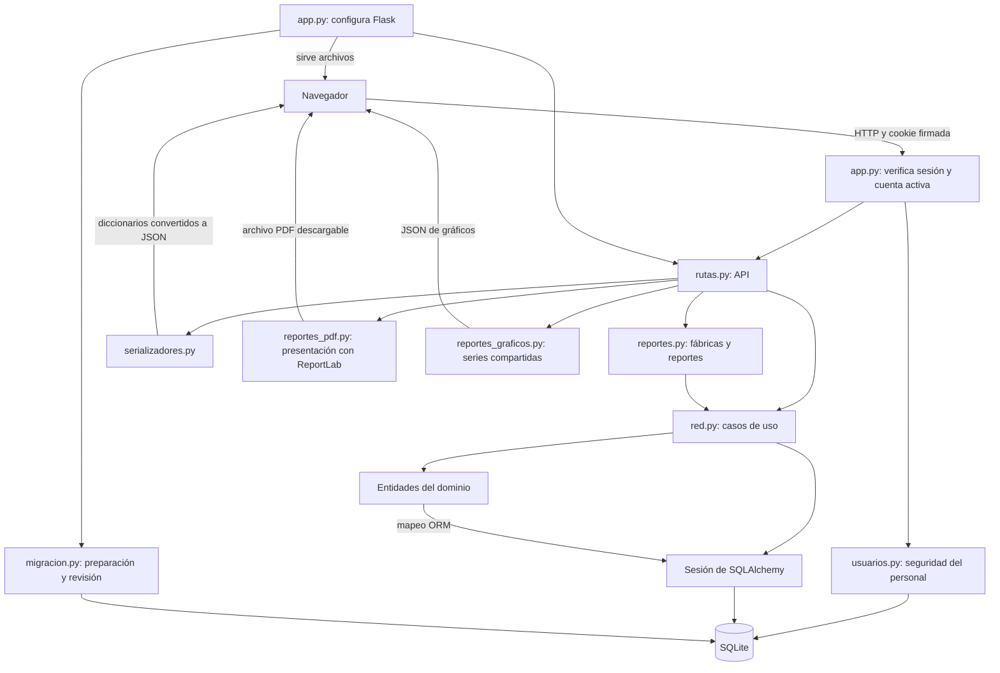
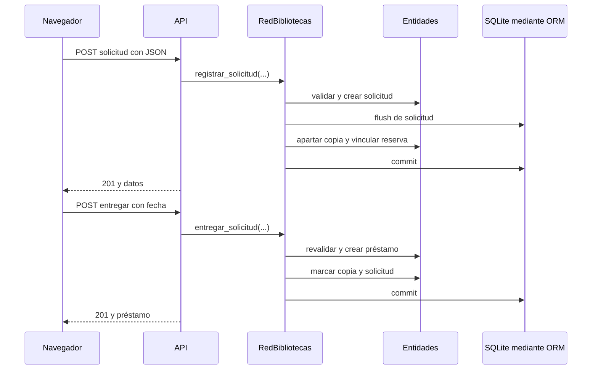
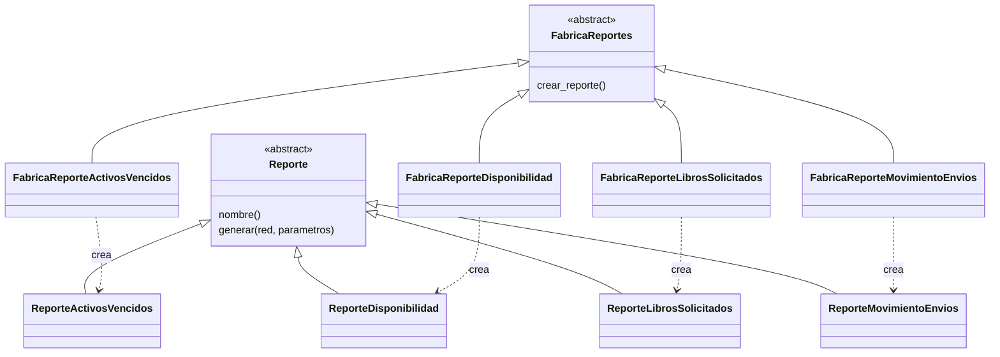
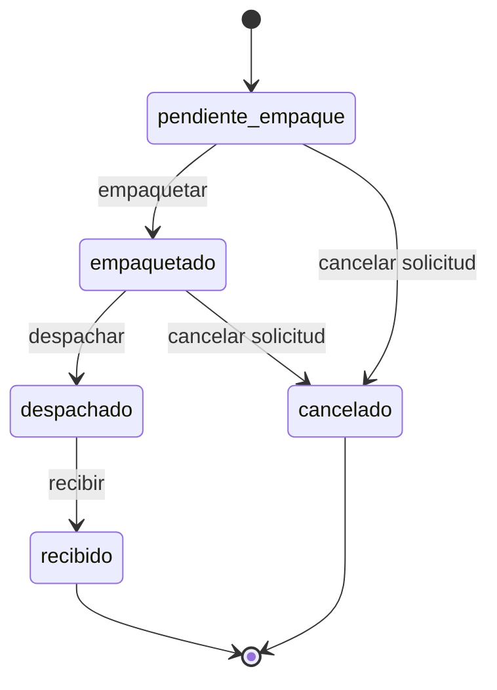
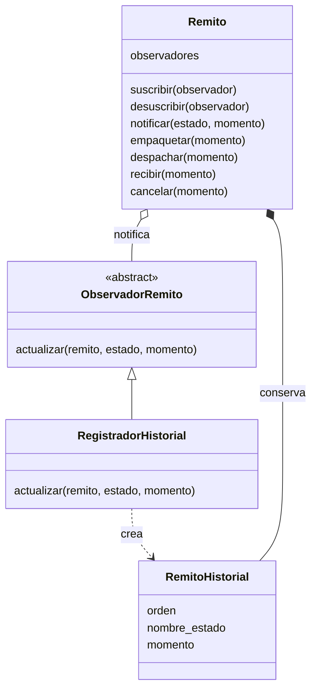
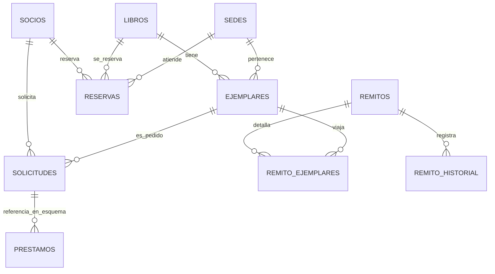

# Informe de estudio para la defensa del TP de bibliotecas

Exploración del código y de la base demo realizada el **16 de noviembre de 2026**. Preparado para empezar desde cero y poder explicar la implementación en la presentación del 17 de noviembre. El foco es el backend y la base de datos; del frontend se explica únicamente su comunicación con el servidor.

**Actualizado el 17 de noviembre de 2026:** incluye el login del personal, los gráficos en pantalla y PDF, y las tres cuentas cargadas tanto en la demo como en la base de práctica.

La fuente principal de este informe es el código actual. Se contrastó con las dos páginas de `tema1.pdf`, con [ENUNCIADO.md](ENUNCIADO.md) y con [FASES.md](FASES.md). Las exigencias de la cátedra se distinguen de las decisiones tomadas por el proyecto. La exploración inicial fue de lectura; después se incorporaron las descargas PDF, los gráficos y la tabla de seguridad `usuarios`. Las entidades y los dos patrones del dominio conservan sus responsabilidades.

**Cómo usarlo:** primero leé los capítulos 1 a 4 para ubicarte; después seguí el préstamo completo del capítulo 7. Estudiá especialmente Factory Method y Observer, capítulos 8 y 9. Cerrá con la base de datos, los reportes y las preguntas de defensa. El capítulo 17 propone un recorrido de repaso de tres horas.

**Para preparar una defensa principalmente hablada con el sistema en pantalla**, empezá por la [sección 17.5](#defensa-hablada): reúne el recorrido desde el alta del libro hasta la devolución, las decisiones de diseño, los patrones y la interpretación de reportes según los temas mencionados por el otro grupo.

**Reportes para la entrega:** según el testimonio completo del otro grupo, el profesor exigió generar los reportes en PDF y justificar su utilidad para el responsable del negocio. **Los cuatro reportes tienen gráficos y tablas en la app y en su PDF**, con los mismos cálculos y filtros. La [sección 13.6](#reportes-pdf) explica la exportación y la sección 13.7 detalla las series de cada gráfico.

**Acceso para practicar:** `CamiloMartin`, `CatalinaZapata` y `MelinaGigena` están activos en `biblioteca_demo.db` y `biblioteca_practica.db`, con las contraseñas indicadas para cada cuenta, guardadas como hashes. El comando de arranque con la base de práctica está en la [sección 15.4](#arranque-practica).

**Sobre los datos históricos de documentación:** las referencias a 40, 60 y 68 pruebas corresponden a versiones anteriores. La suite ampliada tiene 84 pruebas Python y dos comprobaciones de interfaz con Node; la evidencia ejecutada está en el capítulo 14. Para explicar el funcionamiento actual, usá este informe junto con el código.

<a id="capitulo-1"></a>

## 1. Qué problema resuelve y qué pidió la cátedra

El sistema administra una **red de bibliotecas**. Una persona se inscribe como socio y puede pedir una copia de un libro. Si la copia pertenece a otra sede, hay que transportarla, controlar su recorrido y recién entonces entregársela. Después hay que registrar la devolución, el posible atraso y el estado físico. Si se devuelve en una sede distinta de su dueña, debe retornar.

Ejemplo que usaremos: el libro `L1` tiene una copia `E2`, que pertenece a la sede Norte `S2`. Ana quiere retirarla en la sede Central `S1`. Primero se registra una solicitud; después se envía E2 con un remito; cuando llega a S1 se puede entregar a Ana y nace el préstamo. La llegada a S1 y la entrega a Ana son hechos diferentes.

### 1.1 Correspondencia entre la consigna y el código

| Proceso obligatorio del PDF | Implementación que debés poder señalar | Explicación para la defensa |
|---|---|---|
| Administrar sedes, contacto, horario y baja | `Sede` en `sede.py`; operaciones de sedes de `RedBibliotecas` | Se crea y modifica la sede. La baja cambia un booleano y conserva su historia. |
| Administrar socios | `Socio` en `socio.py`; altas, modificaciones y habilitación en `red.py` | Se identifica al socio por número y se controla su habilitación. |
| Catálogo y ejemplares con sede propia | `Libro` y `Ejemplar` en `catalogo.py` | La obra bibliográfica se separa de cada copia física y de su pertenencia. |
| Solicitudes locales e interbibliotecarias | `SolicitudPrestamo`; `registrar_solicitud()` | El pedido contiene socio, libro, copia, origen, destino, fecha y tipo. |
| Empaquetar, despachar y recibir con trazabilidad | `Remito`, `RemitoHistorial`, Observer; logística de `red.py` | Cada transición válida deja un evento con fecha y hora. |
| Consultar disponibilidad | `disponibilidad_detallada()`, `motivo_no_disponible()` y `ReporteDisponibilidad` | Se distingue una copia disponible de una apartada, prestada, en tránsito o bloqueada. |
| Gestionar reservas | `Reserva`; `registrar_reserva()` y `atender_cola_reservas()` | Se espera por un libro en una sede y se asigna una copia por orden de prioridad. |
| Devolución y condición física | `registrar_devolucion()` de la red y del préstamo | Se cierra el préstamo, se guarda la condición observada y se decide disponibilidad, reparación o retorno. |

| Validación obligatoria | Dónde se aplica y qué evita |
|---|---|
| No prestar ejemplares no disponibles | `registrar_solicitud()` y `entregar_solicitud()` revisan estado, asignación, ubicación y daño. |
| No prestar a socios inhabilitados | `exigir_socio_habilitado()` se usa al pedir y se vuelve a usar al entregar. |
| Controlar vencimientos | Se calcula vencimiento al entregar; `Prestamo.esta_vencido()`, `dias_atraso()` y `multa_acumulada()` permiten controlarlo. |
| Mantener trazabilidad del remito | El remito valida secuencia y cronología; Observer incorpora eventos persistentes. |
| Evitar duplicados | La red comprueba identificadores y email de socio; las claves primarias refuerzan la unicidad de identificadores. |
| La copia debe pertenecer al origen | Se compara `ejemplar.sede_pertenencia` con `sede_origen` al registrar la solicitud. No alcanza con que esté físicamente allí. |
| No iniciar operaciones con sedes de baja | `exigir_sede_activa()` protege solicitudes, entregas, reservas, creación de remitos y despachos. |

El PDF exige **al menos dos patrones y al menos cuatro reportes no triviales**. Aquí se implementan Factory Method y Observer, y cuatro reportes con agrupaciones, filtros, conteos, proporciones o promedios. La lista de seis reportes del PDF es una sugerencia, no la obligación de tener seis pantallas separadas.

El enunciado escrito revisado no especifica un formato de exportación. Sin embargo, el otro grupo informa que en su evaluación se exigieron PDF y que mostrar resultados únicamente en pantalla se consideró insuficiente. La salida PDF se agregó para los cuatro reportes; su recorrido y alcance están en 13.6.

### 1.2 Qué decisiones son propias del proyecto

La consigna no establece 14 días de préstamo, 100 pesos de multa diaria ni una cola FIFO. Son reglas elegidas y registradas en `FASES.md`:

- Plazo predeterminado de **14 días corridos** desde la entrega.
- Multa de **100 por día de atraso**, configurable.
- Reservas por **libro y sede**, ordenadas por fecha y, ante empate, por número.
- La solicitud aparta una copia desde que se registra.
- Un remito transporta **un solo ejemplar**, tanto en préstamo como en retorno.
- La devolución fuera de la sede dueña exige retorno antes de volver a prestar.
- El estado físico `requiere_reparacion` bloquea el préstamo; `deteriorado` no lo bloquea por sí solo.
- Se permite recibir un envío ya despachado aunque su sede se haya dado de baja. Es una excepción para cerrar una operación en curso.
- Se usan fechas y horas locales sin zona horaria para la logística.

Se agregó autenticación del personal a pedido de la cátedra; se explica en 12.6. Los socios no ingresan al sistema. No se implementaron recomendaciones, notificaciones a personas ni un módulo de historial de lecturas. Hay registros de préstamos que conservan historia, pero eso no equivale a un módulo específico de lecturas. La revisión física al recibir y la identificación de copias por código cubren parte de los procesos opcionales. Extravío y destrucción no tienen un flujo propio.

<a id="capitulo-2"></a>

## 2. Vocabulario mínimo para entender el código

| Concepto | Significado en este proyecto |
|---|---|
| Clase | Definición de los datos y comportamientos de un tipo de objeto. `Socio` es una clase. |
| Objeto o instancia | Un caso concreto de esa clase. El socio número 1 es una instancia. |
| Atributo | Un dato del objeto, como `socio.habilitado`. |
| Método | Una operación del objeto, como `socio.inhabilitar()`. |
| Dominio | Las reglas y conceptos del problema de bibliotecas. |
| Caso de uso | Una acción completa: entregar, devolver, reservar o despachar. |
| API | Los puntos de entrada HTTP que permiten operar el backend. |
| Ruta o endpoint | Una dirección y un método HTTP, por ejemplo `POST /api/solicitudes`. |
| JSON | Formato de intercambio de datos entre navegador y servidor. No es la base de datos. |
| ORM | Herramienta que relaciona objetos Python con tablas y genera operaciones SQL. |
| Sesión del ORM | Área de trabajo que sigue objetos consultados, nuevos y modificados y participa en la transacción. |
| Transacción | Conjunto de cambios que se confirman o se revierten juntos. |
| Clave primaria, PK | Identificador único de una fila. Ejemplo: `ejemplares.codigo`. |
| Clave foránea, FK | Columna que referencia una fila de otra tabla. Ejemplo: `ejemplares.libro_isbn`. |
| Invariante | Condición que debe mantenerse: una copia disponible no puede estar en tránsito ni asignada. |
| Excepción | Forma de interrumpir una operación inválida y comunicar el motivo. |

`self` es el objeto sobre el que se ejecuta un método. En `self.habilitado = False`, se modifica ese socio. `__init__` inicializa objetos nuevos. `return` devuelve un resultado y `raise` comunica un error. `None` representa ausencia de un dato y normalmente se guarda como `NULL` cuando la columna lo admite.

`@property` permite leer un método como atributo: `red.sedes` ejecuta una consulta. Un nombre que empieza por `_`, como `_confirmar`, indica uso interno por convención; no vuelve inaccesible al método. Las constantes en mayúsculas nombran estados para evitar repetir textos sin significado.

<a id="capitulo-3"></a>

## 3. Arquitectura: qué hace cada capa

El proyecto es una aplicación web que corre en un proceso Python. Flask recibe HTTP, el dominio aplica reglas y SQLite conserva datos en un archivo. El navegador ejecuta JavaScript y se comunica con Flask.



**`rutas.py` traduce una petición; `red.py` organiza una operación; las entidades representan los conceptos y ejecutan comportamiento; el ORM persiste.** Esa frase es el eje de la defensa.

La separación tiene un límite concreto: las entidades heredan de `db.Model`, por lo que sí dependen del ORM. No dependen de `request`, del navegador ni de formularios. No corresponde describirlas como un dominio completamente independiente de la persistencia.

La red tiene una instancia de módulo en `rutas.py`: `red = RedBibliotecas()`. No almacena colecciones propias. Su constructor está vacío y sus propiedades consultan la sesión. Esa instancia compartida no constituye una implementación del patrón Singleton: se pueden crear otras redes, como hacen las pruebas.

### 3.1 Relación frontend-backend, sin estudiar la interfaz

En [frontend/app.js](../frontend/app.js), `pedir()` usa `fetch` y el prefijo `/api`. Si manda datos, los convierte con `JSON.stringify` y declara `Content-Type: application/json`. Lee la respuesta JSON y, si el código HTTP indica error, muestra el mensaje del servidor. La cookie de sesión acompaña las peticiones al mismo servidor; JavaScript no lee su contenido. Ante un 401, se limpian los datos privados mostrados y se vuelve al ingreso.

`consultarSesion()` pide primero `/api/sesion`. Tras ingresar, `manejarFormulario()` transforma la acción del usuario en una llamada HTTP y `refrescar()` consulta `/api/listados` y `/api/salud`. La copia de datos del navegador sirve para mostrar información; SQLite y las operaciones del backend siguen siendo la referencia para aceptar o rechazar acciones.

Flask sirve la página en `/`, y los recursos en `/app.js` y `/styles.css`. Aunque el comentario inicial de `app.py` menciona `/frontend`, **esas son las URLs que realmente usa `index.html`**. Se sirven desde la carpeta `frontend`, que no es lo mismo que un prefijo de URL.

Una validación o sugerencia de pantalla no sustituye la validación de la red. El socio puede quedar inhabilitado después de cargar la página. Por eso el backend vuelve a verificarlo al entregar. El navegador no ejecuta SQL, no hace `commit` y no decide una transición válida del remito.

<a id="capitulo-4"></a>

## 4. Mapa de todos los archivos

Las carpetas `.git` y los archivos generados no son módulos de negocio. El siguiente inventario cubre los archivos del proyecto encontrados durante esta exploración.

| Archivo | Responsabilidad y relación principal |
|---|---|
| [main.py](../main.py) | Entrada ejecutable. Llama a `crear_aplicacion()` y arranca el servidor. |
| [crear_base_demo.py](../crear_base_demo.py) | Carga casos ficticios usando la misma red y ORM que la aplicación. |
| [biblioteca_demo.db](../biblioteca_demo.db) | Archivo binario SQLite versionado con ejemplos. No se interpreta como Python. |
| [requirements.txt](../requirements.txt) | Declara Flask 3.1.3, Flask-SQLAlchemy 3.1.1, SQLAlchemy 2.1.5 y ReportLab 5.1.0, instalado para generar los PDF. |
| [.gitignore](../.gitignore) | Excluye bases locales, cachés, entornos y logs; exceptúa la demo para incluirla en Git. |
| [AGENTS.md](../AGENTS.md) | Reglas de trabajo y diseño. No se ejecuta. |
| [backend/__init__.py](../backend/__init__.py) | Marca el paquete backend; solo contiene un comentario. |
| [backend/app.py](../backend/app.py) | Crea Flask, conecta ORM, prepara base, registra rutas, sirve archivos y maneja errores. |
| [backend/modelos.py](../backend/modelos.py) | Extensión `db`, activación de FK y tabla `Configuracion`. |
| [backend/usuarios.py](../backend/usuarios.py) | Cuentas persistentes del personal, hashes y validaciones de acceso, separadas del dominio. |
| [backend/sede.py](../backend/sede.py) | Modelo `Sede`, validación, modificación y baja lógica. |
| [backend/socio.py](../backend/socio.py) | Modelo `Socio`, datos de contacto y habilitación. |
| [backend/catalogo.py](../backend/catalogo.py) | Modelos `Libro` y `Ejemplar`, estados de copia y movimiento. |
| [backend/prestamos.py](../backend/prestamos.py) | Modelos `SolicitudPrestamo`, `Prestamo` y `Reserva`. |
| [backend/remito.py](../backend/remito.py) | Remito, detalle, historial, transiciones y Observer. |
| [backend/red.py](../backend/red.py) | Coordina validaciones entre entidades y transacciones de cada caso de uso. |
| [backend/reportes.py](../backend/reportes.py) | Cuatro algoritmos de reporte y sus fábricas. |
| [backend/reportes_pdf.py](../backend/reportes_pdf.py) | Presenta los resultados ya calculados como documentos PDF, con filtros, alcance, gráficos vectoriales y tablas legibles. |
| [backend/reportes_graficos.py](../backend/reportes_graficos.py) | Prepara etiquetas, series y valores compartidos por la app y el PDF. |
| [backend/validaciones.py](../backend/validaciones.py) | Funciones de validación reutilizables, independientes de HTTP y del ORM. |
| [backend/errores.py](../backend/errores.py) | Tipos de error que separan entrada inválida, inexistencia y conflicto. |
| [backend/serializadores.py](../backend/serializadores.py) | Convierte objetos y datos derivados en diccionarios transportables. |
| [backend/rutas.py](../backend/rutas.py) | Adapta HTTP a llamadas a la red o a las fábricas de reportes. En reportes devuelve JSON o descarga PDF según `formato`. |
| [backend/migracion.py](../backend/migracion.py) | Migración específica, respaldo, configuración inicial y revisión de datos heredados. |
| [frontend/index.html](../frontend/index.html) | Documento que Flask entrega al navegador; carga JS y CSS. |
| [frontend/app.js](../frontend/app.js) | Cliente HTTP de la API. Se estudia aquí solo el contrato con el backend. |
| [frontend/styles.css](../frontend/styles.css) | Presentación visual; no interviene en las reglas ni en la persistencia. |
| [tests/__init__.py](../tests/__init__.py) | Marca el paquete de pruebas; solo contiene un comentario. |
| [tests/apoyo.py](../tests/apoyo.py) | Crea aplicación, base temporal, cliente HTTP y datos comunes de prueba. |
| [tests/test_api.py](../tests/test_api.py) | 19 casos de API, operaciones y validaciones de la consigna. |
| [tests/test_orm.py](../tests/test_orm.py) | 7 casos de persistencia, FK, configuración, Observer recuperado y modificaciones atómicas. |
| [tests/test_patrones.py](../tests/test_patrones.py) | 9 casos de Factory Method y Observer. |
| [tests/test_reportes.py](../tests/test_reportes.py) | 5 casos de cálculos y filtros de reportes. |
| [tests/test_reportes_pdf.py](../tests/test_reportes_pdf.py) | 8 casos de descarga PDF, igualdad con los resultados JSON, filtros, errores, ausencia de datos y varias páginas. |
| [tests/test_migracion.py](../tests/test_migracion.py) | Creación, respaldo, columna nueva, tabla de usuarios y conservación de datos inválidos. |
| [tests/test_usuarios.py](../tests/test_usuarios.py) | Acceso del personal, sesión, hashes, altas, bajas, persistencia y bloqueo del registro inicial. |
| [tests/test_reportes_graficos.py](../tests/test_reportes_graficos.py) | Series de gráficos, agrupaciones, filtros y resultados vacíos. |
| [tests/test_acceso_frontend.js](../tests/test_acceso_frontend.js) | Contrato de sesión, limpieza de datos ante 401 y presentación de barras. |
| [tests/test_regresiones.py](../tests/test_regresiones.py) | 16 casos que protegen correcciones: cancelaciones, fechas, daño, rollback y recuperación inválida. |
| [tests/test_frontend.js](../tests/test_frontend.js) | Comprueba, entre otras cosas, que la recepción envía el estado físico exigido por la API. |
| [Documentacion/ENUNCIADO.md](ENUNCIADO.md) | Transcripción de la consigna, contrastada con el PDF. |
| [Documentacion/FASES.md](FASES.md) | Decisiones, evolución y comprobaciones históricas. Fase actual: revisión final y entrega. |
| [Documentacion/README.md](README.md) | Instrucciones de uso, API y resumen de cumplimiento. |
| [Documentacion/GUIA_DEFENSA.md](GUIA_DEFENSA.md) | Guía previa más breve; útil como mapa, con algunas simplificaciones. |
| [Documentacion/EXPLICACION_ARQUITECTURA.md](EXPLICACION_ARQUITECTURA.md) | Exploración previa; incluye una actualización de alcance sobre acceso y gráficos. |
| `Documentacion/INFORME_ESTUDIO_BACKEND.md` | Este informe nuevo, basado en el código inspeccionado. |

<a id="capitulo-5"></a>

## 5. Arranque e infraestructura

### 5.1 `main.py`: cómo empieza todo

Al ejecutar `python main.py`, la condición `if __name__ == "__main__"` llama a `main()`. Importar el módulo desde otro código no dispara ese bloque.

`main()` crea la aplicación, imprime la ruta de SQLite y los problemas heredados detectados, y arranca Flask en `127.0.0.1:5000`, con depuración y recarga automática desactivadas. No contiene operaciones de préstamos.

### 5.2 `app.py`: cómo se arma la aplicación

`crear_aplicacion(ruta_base=None, configuracion_extra=None)` hace lo siguiente:

1. Elige la ruta: argumento explícito, variable de entorno `BIBLIOTECA_DB` o `biblioteca.db` en la raíz, en ese orden.
2. Convierte la ruta a absoluta y crea la carpeta si falta.
3. Crea Flask sin carpeta estática automática y configura la URI de SQLite.
4. Configura la cookie de sesión con `HttpOnly` y `SameSite=Lax`, y permite configuración extra para pruebas.
5. Si no recibió una clave explícita, `cargar_clave_secreta()` crea o lee `instance/clave_secreta`. Se genera una vez y se reutiliza al reiniciar.
6. Ejecuta `db.init_app(aplicacion)` y registra el blueprint de la API.
7. Dentro de `app_context()`, llama a `preparar_base()` y conserva problemas, respaldo y cambios detectados.
8. Registra `comprobar_acceso()` con `before_request` y las rutas de sesión y usuarios. El control se ejecuta al recibir cada petición, antes de la operación solicitada.
9. Define cómo servir la página y sus archivos.
10. Registra manejadores de errores y devuelve la aplicación.

El **contexto de aplicación** permite que Flask-SQLAlchemy sepa qué aplicación y configuración usar. Por eso también se abre un contexto en scripts y pruebas que acceden a la base fuera de una petición normal.

`crear_aplicacion` es una función de construcción de la aplicación. El Factory Method elegido para la cátedra está en los reportes: no conviene usar esta función como ejemplo de ese patrón.

### 5.3 `modelos.py`: infraestructura del ORM

`db = SQLAlchemy()` crea la extensión compartida por los modelos. Después `init_app` la vincula con una aplicación concreta. `db` no es una lista de todas las entidades ni significa que haya una sola conexión permanente.

El evento `activar_claves_foraneas()` se ejecuta al abrir una conexión del motor. Si la conexión es SQLite, ejecuta `PRAGMA foreign_keys = ON;` y cierra el cursor. Así las FK se hacen cumplir en las conexiones de la aplicación.

Una precisión respecto de los documentos: **`modelos.py` también importa `sqlite3` y usa un cursor**, para identificar la conexión y activar ese PRAGMA. `migracion.py` concentra el SQL manual de migración y revisión; no es literalmente el único archivo que toca `sqlite3`. Las pruebas también usan SQL directo para preparar o corromper escenarios deliberadamente.

`Configuracion` tiene `clave` como PK y `valor` textual. La red convierte el plazo a entero y la multa a número, validando sus rangos cuando los usa. No existe una ruta HTTP ni pantalla para editar esta configuración; los setters Python sí permiten hacerlo.

<a id="capitulo-6"></a>

## 6. Entidades: qué representa cada clase y qué hacen sus métodos

### 6.1 `Sede`, en `sede.py`

Representa una biblioteca de la red. Guarda `codigo`, `nombre`, `direccion`, `telefono`, `horario` y `activa`.

El constructor valida los datos y la crea activa. `dar_de_baja()` y `reactivar()` cambian el booleano. `esta_activa()` consulta ese estado. `validar_datos()` revisa código, textos, teléfono y horario cuando la red recupera la entidad.

`modificar_datos()` primero valida todos los valores nuevos en variables locales; solo después los asigna. Si el teléfono es inválido, no queda cambiado el nombre mientras el teléfono conserva el valor viejo. Es atomicidad de la modificación del objeto, incluso antes de pensar en la base.

La entidad no busca solicitudes ni decide si una nueva operación puede usar esa sede. Eso corresponde a `RedBibliotecas.exigir_sede_activa()`, que conoce el caso de uso.

### 6.2 `Socio`, en `socio.py`

Guarda número positivo, nombre, email, teléfono y booleano `habilitado`. El constructor lo crea habilitado. `habilitar()`, `inhabilitar()` y `esta_habilitado()` gestionan ese estado. La modificación valida antes de asignar, como en `Sede`.

La unicidad del email se comprueba en `RedBibliotecas`, comparando sin distinguir mayúsculas y minúsculas. La clase aislada no puede decidir si otro socio ya tiene el mismo email. En SQLite el email no tiene una restricción `UNIQUE`; la PK es el número.

Inhabilitar al socio no borra préstamos históricos. La red revisa sus reservas activas para liberar turnos que correspondan. Una solicitud existente no se convierte automáticamente en préstamo: la entrega vuelve a comprobar la habilitación.

### 6.3 `Libro`, en `catalogo.py`

Es la ficha bibliográfica: `isbn`, `titulo`, `autor`, `anio` y `genero`. No indica si una copia está prestada, porque puede haber varias copias del mismo libro con estados diferentes.

`__init__`, `modificar_datos()` y `validar_datos()` controlan campos. El año debe estar entre 1000 y el año en curso. `isbn` es el nombre usado por el modelo, pero su validación es la de un **código interno**: `L1` es válido. No se comprueba longitud ni dígito verificador de un ISBN editorial real.

### 6.4 `Ejemplar`, en `catalogo.py`

Es la copia física que se puede apartar, prestar o transportar. Guarda:

| Atributo | Significado |
|---|---|
| `codigo` | Identidad de esa copia, distinta del libro. |
| `libro_isbn` | Libro al que corresponde. |
| `sede_pertenencia` | Sede dueña de la copia; los envíos no la cambian. |
| `ubicacion_actual` | Sede de referencia actual; `None` mientras está en tránsito. |
| `estado_disponibilidad` | Situación operativa: disponible, apartado, prestado, tránsito, reparación o retorno pendiente. |
| `estado_fisico` | Condición: bueno, deteriorado o requiere reparación. |
| `solicitud_asignada` | Número del pedido que tiene apartada la copia, si existe. |
| `reserva_asignada` | Número de la reserva favorecida, si existe. |

No confundas los dos estados. Una copia puede tener condición física `bueno` y disponibilidad `prestado`. Otra puede estar físicamente dañada y operativamente `pendiente_retorno` porque primero debe volver a su sede.

`esta_danado()` comprueba exactamente `requiere_reparacion`. No considera bloqueante el valor `deteriorado`. `esta_disponible()` solo consulta el estado operativo; una operación completa añade controles de sede, socio y asignaciones.

| Métodos | Cambios o consultas |
|---|---|
| `esta_disponible()`, `esta_apartado()`, `esta_danado()` | Consultan condiciones sin guardar nada. |
| `apartar_para_solicitud(n)` | Pone `apartado` y asigna solicitud. Puede conservar el vínculo con una reserva relacionada. |
| `apartar_para_reserva(n)` | Pone `apartado` y asigna reserva. |
| `mantener_apartado()` | Mantiene el bloqueo sin borrar asignaciones. Se usa, por ejemplo, al recibir un préstamo. |
| `liberar_asignacion()`, `marcar_disponible()` | Ponen disponible y limpian ambos punteros. Su uso correcto depende del coordinador. |
| `marcar_prestado()` | Pone prestado y limpia punteros; la vinculación histórica queda en el préstamo y la solicitud. |
| `marcar_en_transito()` | Pone en tránsito y deja `ubicacion_actual = None`. |
| `marcar_pendiente_retorno()` | Bloquea para retorno y limpia asignaciones. |
| `marcar_en_reparacion()` | Cambia disponibilidad y condición física a reparación. |
| `reparar()` | Restablece condición buena, disponibilidad y punteros. La red puede volver a poner pendiente de retorno si está fuera de su sede. |
| `registrar_revision_fisica()` | Valida uno de los tres valores permitidos y lo asigna. |
| `mover_a()` | Cambia la ubicación sin cambiar la pertenencia. |
| `validar_datos()` | Controla códigos, estados y coherencia básica de ubicación/asignación. |

Una copia disponible debe estar en su sede, sin daño bloqueante y sin asignaciones. En tránsito debe carecer de ubicación; fuera de tránsito debe tenerla.

**Matiz importante:** al entregar al lector, `ubicacion_actual` no pasa a una dirección del socio. Conserva la sede de entrega como referencia operativa y `prestado` indica que está en poder del lector. El sistema no registra ubicación física exacta durante la lectura.

### 6.5 `SolicitudPrestamo`, en `prestamos.py`

Es el pedido de una copia concreta. Incluye número, socio, libro, ejemplar, sedes de origen y destino, fecha, tipo y estado. Puede ser `local` o `interbibliotecario` y estar `pendiente`, `entregada` o `cancelada`.

`es_interbibliotecaria()` consulta el tipo. `marcar_entregada()` y `cancelar()` cambian el estado. `validar_datos()` controla campos y que local corresponda a sedes iguales e interbibliotecario a sedes distintas.

La solicitud no tiene fecha de vencimiento: todavía no se entregó material al socio. Desde su registro la copia está apartada, pero todavía no existe un `Prestamo`.

### 6.6 `Prestamo`, en `prestamos.py`

Representa la entrega efectiva al socio. Referencia su solicitud y conserva socio, copia, origen, destino, fecha de préstamo y vencimiento. Al devolver, incorpora fecha y sede de devolución, estado físico observado y multa. Sus estados persistidos son **`activo` y `devuelto`**.

**Vencido no es un tercer estado guardado.** Se calcula para un préstamo activo cuando `fecha_referencia > fecha_vencimiento`. En el día del vencimiento todavía no está vencido.

`dias_atraso()` devuelve cero si no está vencido; si lo está, resta fechas. `multa_acumulada()` multiplica esos días por la tarifa. El préstamo devuelto ya no acumula atraso por estos métodos; su multa definitiva queda en `multa`.

`registrar_devolucion()` valida que siga activo, la fecha, la sede, la condición y una multa finita no negativa. Valida todo antes de asignar los datos y ponerlo devuelto. La red, que coordina otras entidades, decide el destino operativo de la copia y confirma la transacción.

`validar_datos()` también detecta vencimiento anterior al préstamo, devolución anterior a entrega, estados desconocidos o un préstamo activo con datos de devolución.

### 6.7 `Reserva`, en `prestamos.py`

Es la espera de un socio por **un libro en una sede**, sin exigir una copia concreta al crearla. Guarda número, socio, libro, sede, fecha y estado. Los campos `ejemplar_codigo` y `solicitud_numero` son inicialmente nulos.

```text
pendiente -> asignada -> cumplida
pendiente o asignada -> cancelada, bajo las condiciones del coordinador
```

`esta_activa()` acepta pendiente o asignada. `marcar_asignada()` vincula una copia; `marcar_cumplida()` se usa cuando se entrega el préstamo; `cancelar()` cierra la reserva. `validar_datos()` exige copia para asignada/cumplida y solicitud para cumplida.

Una reserva asignada todavía no es un préstamo. Falta registrar la solicitud asociada y entregarla. La diferencia práctica es: reserva pide prioridad sobre una obra; solicitud compromete una copia; préstamo registra su entrega.

### 6.8 `Remito`, `RemitoEjemplar` y `RemitoHistorial`

`Remito` identifica un envío entre sedes distintas: código, origen, destino, fecha y hora de creación, motivo y estado actual. El motivo es `prestamo` o `retorno`; ambos usan el mismo ciclo logístico.

`RemitoEjemplar` representa el detalle del envío: qué copia transportó, para qué solicitud —nulo si es retorno— y qué condición física se observó al recibir. Su PK compuesta es remito + ejemplar.

`RemitoHistorial` representa un evento: ID, remito, orden desde cero, estado y momento. La fecha de un estado se obtiene recorriendo estos eventos con `fecha_de()`. No hay una columna separada para cada momento dentro de `Remito`.

`historial` y `asignaciones` son relaciones ORM de Remito con sus hijos. `codigos_ejemplares()` reúne los códigos transportados y `es_retorno()` consulta el motivo. `agregar_ejemplar()` y `agregar_ejemplar_de_retorno()` exigen pendiente de empaque y rechazan agregar una segunda copia. El esquema permite modelar detalles, pero la regla actual limita cada envío a uno.

Los constructores de las dos clases auxiliares hacen asignaciones simples; sus `validar_datos()` revisan los valores. No afirmes que absolutamente todos los constructores validan exhaustivamente: las garantías se reparten entre las clases y el coordinador.

El ciclo de vida y Observer se desarrollan por separado en el capítulo 9, porque la consigna avisa expresamente que los profesores evaluarán ese ciclo.

<a id="capitulo-7"></a>

## 7. `RedBibliotecas`: seguir la ejecución de los casos de uso

Referencia: [backend/red.py](../backend/red.py). Conviene entender este archivo por grupos de operaciones, no memorizarlo de arriba abajo. Su responsabilidad es reunir información que una entidad aislada no tiene y hacer que los cambios relacionados se guarden juntos.

### 7.1 Consultas, configuración y métodos auxiliares

Las propiedades `sedes`, `socios`, `libros`, `ejemplares`, `solicitudes`, `prestamos`, `reservas` y `remitos` consultan el ORM, ordenan por identificador y llaman a `_validar_coleccion()`. Los métodos `buscar_sede()`, `buscar_socio()` y equivalentes usan `db.session.get()` por PK y `_validar_recuperado()`. Si no encuentran el objeto, devuelven `None`; la operación que necesita su existencia decide lanzar `ErrorNoEncontrado`.

SQLAlchemy puede devolver un objeto que ya conoce la sesión: consultar mediante ORM no significa que toda lectura haga necesariamente otro viaje físico al archivo. Lo que se evita es una segunda colección global administrada manualmente por `RedBibliotecas`.

`_leer_configuracion()` y `_guardar_configuracion()` acceden a la tabla correspondiente. Las propiedades `plazo_dias` y `multa_por_dia` convierten y validan los valores; sus setters guardan y confirman. La configuración se valida antes de cambiar entidades en las operaciones que la necesitan.

`_confirmar()` llama a `commit()`. Si falla, ejecuta `rollback()` y vuelve a lanzar el error. Los casos que modifican varias entidades también envuelven su bloque de trabajo en `try/except`, para revertir fallos que ocurran antes de llegar a `_confirmar()`.

`_siguiente_numero(modelo)` consulta el máximo número y suma uno; empieza en 1 si no hay filas. `_siguiente_codigo_remito()` recorre códigos `R-n` y genera el siguiente. No es un servicio externo de numeración ni una reserva anticipada de números.

`a_fecha()` convierte un `datetime` a `date` cuando una regla compara por día. `buscar_remito_por_solicitud()` recorre asignaciones y `buscar_reserva_por_solicitud()` recorre reservas para localizar relaciones indirectas.

### 7.2 Altas y cambios administrativos

Los métodos `agregar_*` comprueban identificadores y relaciones, construyen la entidad, la agregan a la sesión y confirman. Los `modificar_*` recuperan el objeto y delegan su modificación validada.

`dar_baja_sede()`, `reactivar_sede()`, `habilitar_socio()` e `inhabilitar_socio()` rechazan repetir una acción que ya está aplicada. `exigir_sede_activa()` y `exigir_socio_habilitado()` son controles reutilizados por operaciones posteriores.

`agregar_ejemplar()` verifica libro existente y sede activa. Inicializa pertenencia y ubicación en la misma sede y atiende la cola de reservas: una nueva copia puede quedar apartada inmediatamente para alguien que ya esperaba.

`inhabilitar_socio()` revisa los pares libro/sede de sus reservas activas. Libera o cancela reservas que corresponda y vuelve a atender esas colas. Las reservas ya ligadas a solicitudes se tratan con cautela: no se libera una copia por encima de una solicitud que todavía la compromete.

### 7.3 Disponibilidad: una pregunta con varias condiciones

`copia_prestable_en_sede()` busca una copia del libro que pertenezca a la sede, esté allí, esté disponible y no requiera reparación. Es la búsqueda usada por las reservas.

`disponibilidad_detallada()` filtra copias por libro y **sede de pertenencia**; devuelve copias de distintos estados, no solo las prestables. `motivo_no_disponible()` explica el bloqueo: solicitud, reserva, préstamo, tránsito, retorno o reparación.

`prestamo_activo_por_ejemplar()` busca un préstamo activo. `remito_activo_por_ejemplar()` considera activos los remitos que no están recibidos ni cancelados. Un remito pendiente de empaque también bloquea logísticamente la copia, aunque todavía no viaje.

`ultima_devolucion_de_ejemplar()` obtiene la devolución más reciente. `validar_fecha_de_ejemplar()` impide registrar solicitudes o entregas anteriores a devoluciones o recepciones ya existentes. Evita narrar una historia imposible de la misma copia.

### 7.4 Préstamo local, paso por paso

Supongamos una copia E1 de L1, perteneciente y ubicada en S1, disponible, y un socio 1 habilitado.

La petición de registro tiene esta forma:

```http
POST /api/solicitudes
Content-Type: application/json
```

```json
{
  "socio_numero": 1,
  "libro_isbn": "L1",
  "ejemplar_codigo": "E1",
  "sede_origen": "S1",
  "sede_destino": "S1",
  "fecha_solicitud": "2026-11-01",
  "tipo": "local"
}
```

El ejemplo ilustra el contrato; supone datos básicos ya creados. No se ejecutó sobre la demo durante esta exploración.

1. `rutas.crear_solicitud()` —línea 344— lee campos y transforma la fecha textual en una fecha Python.
2. Llama a `red.registrar_solicitud()` —línea 503—. Esta operación valida sedes, socio, libro y ejemplar.
3. Verifica que libro y copia coincidan, que la sede dueña y ubicación sean el origen y que local use sedes iguales.
4. Rechaza daño bloqueante, copia ya asignada a otra solicitud y fechas incompatibles.
5. Acepta copia disponible o la excepción de una copia apartada para una reserva válida del mismo socio, libro y sede. No permite apropiarse de la reserva de otra persona.
6. Genera el número y construye `SolicitudPrestamo` pendiente.
7. Agrega la solicitud y hace `flush()`: la inserta dentro de la transacción para que una reserva pueda referenciarla por FK.
8. Aparta la copia y vincula la reserva si la hay; hace `commit()`.
9. La API serializa y responde HTTP 201.

Hasta acá no existe préstamo ni corre un plazo de devolución. La copia pasó de disponible a apartada.

Para entregar se manda `POST /api/solicitudes/1/entregar` con `{"fecha_prestamo":"2026-11-01"}`. La ruta llama a `entregar_solicitud()` —línea 572—, que vuelve a comprobar sede y socio, solicitud pendiente, asignación correcta, copia apartada, condición física y fechas.

Después lee el plazo, calcula vencimiento, crea el préstamo y realiza tres cambios relacionados: solicitud entregada, ejemplar prestado y préstamo activo. Si había reserva, la marca cumplida. Todo se confirma en una transacción. Para entrega el 1 de noviembre con 14 días, el vencimiento es el 15 de noviembre.



### 7.5 Préstamo interbibliotecario: el recorrido que más conviene dominar

E2 pertenece a S2 y se solicita para retirar en S1. La solicitud usa `tipo = interbibliotecario`. El registro aparta E2 en S2, igual que el caso local. La diferencia es lo que debe ocurrir antes de entregar.

| Paso | Método de `RedBibliotecas` | Solicitud | Remito de ida | Copia | Ubicación | Pertenencia |
|---|---|---|---|---|---|---|
| Inicio | — | No existe | No existe | disponible | S2 | S2 |
| Registrar pedido | `registrar_solicitud` | pendiente | No existe | apartado | S2 | S2 |
| Crear envío | `crear_remito_para_solicitud` | pendiente | pendiente_empaque | apartado | S2 | S2 |
| Empaquetar | `empaquetar_remito` | pendiente | empaquetado | apartado | S2 | S2 |
| Despachar | `despachar_remito` | pendiente | despachado | en_transito | `None` | S2 |
| Recibir apto | `recibir_remito` | pendiente | recibido | apartado | S1 | S2 |
| Entregar al socio | `entregar_solicitud` | entregada | recibido | prestado | S1 como sede de referencia | S2 |

`crear_remito_para_solicitud()` —línea 825— exige solicitud pendiente e interbibliotecaria, sedes activas, copia asignada a ese pedido y ausencia de otro remito para él. La fecha de creación no puede ser anterior al día de la solicitud. Crea `R-n`, agrega la asignación y confirma.

`empaquetar_remito()` delega la transición al remito y confirma. `despachar_remito()` —línea 911— comprueba sedes activas y copias existentes, cambia el remito y marca las copias en tránsito dentro del mismo bloque transaccional.

`recibir_remito()` —línea 932— exige un estado físico permitido. Cambia el remito a recibido, registra esa observación tanto en la copia como en la asignación histórica y mueve la copia al destino. Si está apta, conserva su apartado para la solicitud.

Finalmente, `entregar_solicitud()` exige remito recibido, ubicación en destino y fecha de entrega no anterior a la recepción. La comparación de la entrega usa precisión de día; los eventos del remito sí conservan hora.

**Respuesta oral clave:** “Recibir confirma el traslado entre bibliotecas. Entregar confirma que el socio recibió el ejemplar. Por eso son operaciones distintas y el plazo de préstamo empieza al entregar”.

### 7.6 Devolución, multa, reparación y retorno

La ruta `POST /api/prestamos/<numero>/devolucion` pide fecha, sede y condición física. `red.registrar_devolucion()` —línea 790— verifica préstamo activo, sede de devolución activa, estado permitido y fecha no anterior al préstamo.

Calcula la multa **antes de cambiar el estado a devuelto**, porque el cálculo de atraso trabaja sobre préstamos activos. Luego registra la devolución en el préstamo, mueve la copia y aplica la condición física.

```text
Si se devuelve fuera de su sede dueña:
    pendiente_retorno
Si está en su sede y requiere reparación:
    en_reparacion
Si está en su sede y está apta:
    disponible y revisión de la cola de reservas
```

Ejemplo: entrega el 1 de noviembre, vencimiento el 15, devolución el 18. Son 3 días de atraso y multa de 300 con tarifa 100. Devolver el propio día 15 da multa cero. No se registra un pago: el sistema calcula y guarda el importe, pero no tiene gestión de cobros.

Una devolución en otra sede cierra el préstamo igualmente. Lo que sigue pendiente es la logística de la copia. `crear_remito_retorno()` —línea 854— exige que esté fuera de su sede, pendiente de retorno, sin préstamo activo, sin asignaciones y sin otro envío activo. Revisa que exista una devolución previa o el caso de una solicitud cancelada después de recibir el envío.

El remito de retorno usa ubicación actual como origen y pertenencia como destino. Desde su creación la copia queda apartada; al despachar pasa a tránsito; al recibir en su sede queda disponible o en reparación. Si queda disponible, se intenta atender una reserva.

`reparar_ejemplar()` —línea 391— exige estado de reparación y ausencia de préstamo, remito activo o asignaciones. Restablece el estado físico y atiende reservas si corresponde. Si la copia sigue fuera de su sede, la deja pendiente de retorno.

### 7.7 Qué pasa si el envío llega dañado

Al recibir, el estado `requiere_reparacion` tiene efectos distintos según el motivo:

- **Remito de préstamo:** se registra la recepción, se cancela la solicitud y se deja la copia pendiente de retorno. No se entrega un préstamo con esa copia.
- **Remito de retorno:** se registra la recepción y la copia queda en reparación en su sede dueña.

El detalle del remito guarda `estado_fisico_recepcion`. Si después se repara la copia, la observación histórica no cambia. El reporte logístico puede seguir contando ese daño sin confundirlo con el estado actual.

Registrar daño observado no demuestra automáticamente que lo haya causado el transporte. Por ejemplo, una devolución pudo salir de otra sede ya dañada. El sistema conserva la observación, no una investigación de responsabilidad.

### 7.8 Reservas FIFO

`registrar_reserva()` —línea 672— valida fecha, socio, sede y libro. Rechaza otra reserva activa igual para la combinación socio/libro/sede. Crea una reserva pendiente y llama a `atender_cola_reservas()`.

La atención de cola —línea 764— primero revisa reservas asignadas de socios inhabilitados. Obtiene pendientes ordenadas mediante `reservas_ordenadas_de_libro()`: elige repetidamente la menor fecha y usa número para desempatar. Es una implementación explícita con listas y recorridos, no una biblioteca de colas.

Para cada reserva pendiente, comprueba socio habilitado y sede activa, busca una copia prestable y la aparta. La reserva pasa a asignada. Cuando no hay copia, el resto sigue esperando.

Ejemplo: Ana espera L1/S1 desde el día 1 y Luis desde el día 2. Se devuelve una copia apta de L1 a S1. La operación de devolución atiende la cola y la aparta para Ana. Luis no puede pedir esa copia mientras esté asignada a Ana.

Cuando Ana registra su solicitud, `registrar_solicitud()` reconoce que el apartado le corresponde, vincula la reserva con el pedido y conserva la relación. Al entregar, la reserva pasa a cumplida.

`revisar_reservas_asignadas()` cancela las asignadas a socios inhabilitados cuando todavía no tienen solicitud asociada y libera la copia si corresponde. `cancelar_reserva()` rechaza reservas cerradas o con solicitud asociada; primero debe resolverse esa solicitud. Si libera una copia, vuelve a atender la cola.

**Alcance de FIFO:** ordena las reservas pendientes por fecha informada. No revoca una asignación ya realizada si alguien carga después una reserva con fecha más antigua. La cola es local por libro y sede: no genera automáticamente pedidos a otra biblioteca.

### 7.9 Cancelaciones sin perder la trazabilidad

`cancelar_solicitud()` —línea 632— solo acepta solicitudes pendientes.

| Situación | Resultado |
|---|---|
| Sin remito | Cancela el pedido. Libera la copia y atiende la cola, salvo que conserve una reserva asociada. |
| Remito pendiente de empaque o empaquetado | Cancela también el remito, con evento histórico, y resuelve la asignación de la copia. |
| Remito despachado | Rechaza. Primero hay que recibir: una cancelación no puede fingir que la copia reapareció en origen. |
| Remito recibido | Cancela la solicitud, mantiene el remito recibido y deja la copia pendiente de retorno. Puede no haber existido nunca un préstamo. |
| Solicitud entregada o ya cancelada | Rechaza. Un préstamo entregado se resuelve mediante devolución. |

Si la solicitud provenía de una reserva, la cancelación sin retorno puede desvincular el pedido y mantener el apartado para esa reserva. Cancelar una solicitud no implica siempre volver la copia a libre disposición.

La API no tiene una operación independiente para cancelar cualquier remito. La cancelación disponible pasa por la solicitud; un remito de retorno no tiene actualmente un flujo de cancelación.

### 7.10 Resumen del sistema

`resumen()` —línea 972— hace conteos ORM de sedes, socios, libros, ejemplares, solicitudes pendientes, préstamos activos, reservas activas y remitos activos. Los remitos recibidos y cancelados quedan fuera de activos.

Es una consulta de cantidades para el uso general de la aplicación. No reemplaza los cuatro reportes no triviales y no reconstruye todos los objetos para validar cada fila.

<a id="capitulo-8"></a>

## 8. Factory Method: creación de reportes

Referencias: [reportes.py](../backend/reportes.py), clases abstractas en líneas 11 y 299; uso en [rutas.py](../backend/rutas.py), desde línea 514; pruebas en [test_patrones.py](../tests/test_patrones.py).

### 8.1 Problema que resuelve

Existen cuatro reportes con algoritmos diferentes, pero la API necesita usarlos con el mismo procedimiento: obtener un reporte, generar filas y devolver nombre y resultado. La decisión sobre qué clase concreta construir se coloca en fábricas especializadas.

Factory Method es un patrón **creacional**: define un método de creación en una abstracción y deja que sus subclases decidan el producto concreto que devuelven.

| Participante del patrón | Clase real | Responsabilidad |
|---|---|---|
| Producto abstracto | `Reporte(ABC)` | Exige `nombre()` y `generar(red, parametros)`. |
| Productos concretos | `ReporteActivosVencidos`, `ReporteDisponibilidad`, `ReporteLibrosSolicitados`, `ReporteMovimientoEnvios` | Implementan los cuatro algoritmos. |
| Creador abstracto | `FabricaReportes(ABC)` | Exige `crear_reporte()`. |
| Creadores concretos | Las cuatro clases `FabricaReporte...` | Cada una instancia su producto correspondiente. |
| Cliente | Endpoints de reportes en `rutas.py` | Elige fábrica, pide producto y lo usa por su contrato. |



### 8.2 Leer el código esencial

Código existente:

```python
class FabricaReportes(ABC):
    @abstractmethod
    def crear_reporte(self):
        pass


class FabricaReporteActivosVencidos(FabricaReportes):
    def crear_reporte(self):
        return ReporteActivosVencidos()
```

`ABC` permite definir clases abstractas. `@abstractmethod` impide instanciar una clase mientras no implemente los métodos exigidos. `pass` deja vacío el cuerpo porque la abstracción expresa el contrato, no el algoritmo concreto.

La subclase sobrescribe el método de creación y elige el producto. Las otras tres fábricas tienen la misma estructura y devuelven sus reportes respectivos.

El endpoint de activos y vencidos hace:

```python
fabrica = FabricaReporteActivosVencidos()
reporte = fabrica.crear_reporte()
filas = reporte.generar(red, {"fecha_referencia": fecha})
return respuesta({"reporte": reporte.nombre(), "filas": filas})
```

La llamada `generar()` se resuelve según el objeto concreto obtenido: eso es **polimorfismo**. El cliente utiliza el contrato común aunque cada reporte recorra y calcule datos diferentes.

### 8.3 Qué aporta y qué no conviene exagerar

La ruta conoce la fábrica concreta que selecciona. No instancia directamente la clase del producto ni implementa su algoritmo. Por tanto, hay separación de creación y uso, pero no desconocimiento absoluto de todas las variantes del sistema.

Esta es una implementación pequeña del patrón: `FabricaReportes` solo define el método de creación. No tiene un proceso general adicional que lo invoque internamente. El beneficio inmediato es modesto porque cada fábrica construye un único tipo sin parámetros, pero los participantes y la sobrescritura del método de creación están presentes.

Para agregar un quinto reporte se escribirían un nuevo `Reporte`, su fábrica y una ruta que lo exponga; si debe aparecer en la pantalla, también se incorporaría al cliente. No hace falta cambiar el algoritmo de los cuatro existentes. No sería correcto afirmar que ampliar todo el sistema requiere cero cambios de integración.

**Frase para decir:** “Uso Factory Method para delegar la construcción de cada reporte en una fábrica concreta. Todos cumplen `Reporte`, por eso la API puede ejecutar `generar()` de la misma forma aunque los cálculos sean diferentes”.

<a id="capitulo-9"></a>

## 9. Observer y ciclo de vida del remito

Referencia: [remito.py](../backend/remito.py). `ObservadorRemito` empieza en línea 22, `RegistradorHistorial` en 28 y `Remito` en 35. Las transiciones empiezan en línea 163.

### 9.1 Primero entendé el ciclo, después el patrón



No se puede recibir sin despachar, despachar sin empaquetar ni repetir una transición ya realizada. Tampoco se retrocede de recibido a despachado. Para volver una copia se crea otro remito con motivo retorno.

`_validar_cronologia()` exige que un nuevo momento no sea anterior al último evento; acepta momentos iguales. `validar_historial_remito()` verifica además secuencia completa, orden consecutivo desde cero, evento inicial coincidente con creación y último evento coincidente con el estado actual. Una cancelación solo puede ser el último evento y aparecer antes del despacho.

Los estados se implementan con constantes, condiciones y métodos. **No hay una implementación del patrón State**: no existen clases de estado que deleguen entre sí. Tener estados de negocio no equivale a aplicar State.

### 9.2 El problema que resuelve Observer

Cada cambio válido del remito debe producir una reacción: registrar historia. Si cada transición escribiera directamente el detalle del historial, mezclaría la decisión de cambiar de estado con la reacción al cambio.

Observer es un patrón **de comportamiento**. Un sujeto mantiene observadores y les comunica eventos mediante un contrato común. Cada observador reacciona según su responsabilidad.

| Participante | Código del proyecto |
|---|---|
| Sujeto observable | `Remito`, con su lista `observadores`. |
| Operaciones de suscripción | `suscribir()` y `desuscribir()`. |
| Operación de notificación | `notificar(nombre_estado, momento)`. |
| Contrato del observador | `ObservadorRemito.actualizar(remito, nombre_estado, momento)`. |
| Observador concreto | `RegistradorHistorial`. |
| Efecto de la reacción | Crear `RemitoHistorial` y agregarlo a la relación `remito.historial`. |



### 9.3 Una transición real, instrucción por instrucción

Tomá `remito.empaquetar(momento)`:

1. Revisa `estado_actual`. Solo admite pendiente de empaque.
2. Llama a `_preparar_transicion()`.
3. Ese método asegura que exista un registrador de historial, toma la hora actual si no se informó, valida el tipo de momento y revisa cronología.
4. Solo después cambia `estado_actual` a empaquetado.
5. Ejecuta `notificar()`.
6. `notificar()` recorre los observadores y llama a `actualizar()` en cada uno.
7. El registrador crea y agrega un evento; la red confirma la transacción que lo persiste.

El núcleo del observador concreto es:

```python
def actualizar(self, remito, nombre_estado, momento):
    orden = len(remito.historial)
    registro = RemitoHistorial(remito.codigo, orden, nombre_estado, momento)
    remito.historial.append(registro)
```

El orden es la cantidad de eventos anteriores: primer evento 0, segundo 1, etc. `append()` agrega un objeto a una relación ORM; no es escribir un JSON. SQLAlchemy lo guarda como una fila cuando se confirma la operación.

Ejemplo de historial persistido:

| orden | nombre_estado | momento |
|---:|---|---|
| 0 | pendiente_empaque | 2026-11-01 09:00:00 |
| 1 | empaquetado | 2026-11-01 10:00:00 |
| 2 | despachado | 2026-11-01 11:00:00 |
| 3 | recibido | 2026-11-01 15:00:00 |

`fecha_de("despachado")` devuelve el momento del tercer registro. El reporte logístico obtiene de ahí las duraciones.

### 9.4 Qué pasa ante una transición inválida

Si intentás despachar estando pendiente de empaque, falla la validación antes de cambiar estado y antes de notificar. No aparece un evento falso de despacho. Si el momento es anterior al último evento, ocurre lo mismo.

Las pruebas agregan `ObservadorDePrueba`, que guarda notificaciones en una lista. Comprueban tanto que el historial no crezca como que el observador de prueba no reciba eventos inválidos. Así se verifica el contrato del patrón, no solo el texto del estado.

Esta garantía se refiere a validaciones fallidas. No conviene extenderla sin matices a cualquier observador futuro que haga efectos externos: una transacción de SQLite no puede deshacer un correo ya enviado. En el proyecto actual el observador productivo registra historia dentro del mismo trabajo ORM.

### 9.5 Qué pasa al recuperar el remito de SQLite

El ORM reconstruye objetos persistidos sin volver a ejecutar su constructor normal. Por eso la lista de observadores, que vive en memoria y no tiene columna, podría no existir en un remito recuperado.

`_asegurar_lista_observadores()` la crea si falta. `_asegurar_observador_historial()` busca un registrador y agrega uno si no lo hay. Se ejecuta antes de las transiciones.

El evento inicial se emite en `__init__` al crear un remito nuevo. Al recuperar uno existente no se emite de nuevo: el historial ya está guardado. Esto evita duplicar el evento de creación cada vez que se abre la aplicación.

### 9.6 Alcance y respuesta oral

La notificación es una llamada Python síncrona a objetos observadores. No es un mensaje al usuario ni un correo. Suscribir más observadores permitiría otras reacciones, aunque el remito actual conoce expresamente al registrador para garantizar que siempre exista historial.

**Frase para decir:** “Remito es el sujeto; valida estado y cronología, cambia y notifica. RegistradorHistorial es el observador que reacciona creando un evento persistente. Las reglas de transición quedan en Remito; el registro de la reacción queda en el observador”.

<a id="capitulo-10"></a>

## 10. SQLite y ORM: del objeto a la fila

### 10.1 Tres herramientas con responsabilidades distintas

- **SQLite** es el motor relacional que guarda tablas en el archivo `.db`.
- **SQLAlchemy** mapea clases a tablas, construye consultas y administra objetos y transacciones.
- **Flask-SQLAlchemy** integra SQLAlchemy con la configuración y el contexto de Flask.

No hay un servidor de base separado que haya que arrancar. Tampoco se guarda todo como un único objeto serializado o como archivos JSON. La demo tiene once tablas reales, inspeccionadas en modo de solo lectura.

Una declaración de modelo se interpreta así:

```python
class Ejemplar(db.Model):
    __tablename__ = "ejemplares"
    codigo = db.Column(db.String(40), primary_key=True)
    libro_isbn = db.Column(db.String(40), db.ForeignKey("libros.isbn"), nullable=False)
```

`db.Model` incorpora el mapeo. `__tablename__` elige la tabla. `Column` define un atributo persistente y su tipo. `primary_key=True` establece identidad. La FK exige que el libro referenciado exista cuando las restricciones están activas. `nullable=False` prohíbe `NULL`, pero no prohíbe por sí mismo un texto vacío: esa validación es del dominio.

### 10.2 Las doce tablas y sus relaciones

| Tabla | Clave primaria | Referencias y contenido |
|---|---|---|
| `configuracion` | `clave` | Parámetros textuales de plazo y tarifa. |
| `usuarios` | `id` | Cuenta del personal: usuario único, nombre, hash y activa; independiente de los socios. |
| `sedes` | `codigo` | Datos de la biblioteca y su actividad. |
| `socios` | `numero` | Datos del lector y habilitación. |
| `libros` | `isbn` | Ficha bibliográfica. |
| `ejemplares` | `codigo` | FK a libro y a sedes de pertenencia/ubicación; estados y punteros. |
| `solicitudes` | `numero` | FK a socio, libro, copia y sedes. Describe el pedido. |
| `prestamos` | `numero` | FK a solicitud, socio, copia y sedes. Entrega, vencimiento y devolución. |
| `reservas` | `numero` | FK a socio, libro, sede; copia y solicitud opcionales. |
| `remitos` | `codigo` | FK a sedes origen/destino; motivo y estado logístico. |
| `remito_ejemplares` | `(remito_codigo, ejemplar_codigo)` | FK a remito, copia y solicitud opcional; observación de recepción. |
| `remito_historial` | `id` | FK a remito; orden, estado y momento. |

Diagrama parcial de las relaciones principales; las referencias múltiples a sede están resumidas para facilitar la lectura:



Un libro puede tener muchas copias. Una copia puede aparecer en muchas solicitudes y préstamos **a lo largo del tiempo**, sin estar prestada a dos personas simultáneamente por los flujos admitidos. Un remito tiene varios eventos de historial.

La relación solicitud-préstamo merece precisión: **el flujo de negocio genera como máximo un préstamo por solicitud**, porque la solicitud deja de estar pendiente. Pero `prestamos.solicitud_numero` no tiene `UNIQUE`. El esquema aislado permitiría varias filas referenciando la misma solicitud. El diagrama refleja esa diferencia entre FK y regla de negocio.

### 10.3 Lo que está normalizado y lo que tiene redundancia

Separar libros de ejemplares evita repetir título, autor y género por cada copia. Separar historial evita columnas como evento1, evento2 y evento3. Las tablas referencian identidades y mantienen relaciones explícitas.

Sin embargo, no conviene afirmar una tercera forma normal estricta de todo el esquema. Por ejemplo, el préstamo guarda socio, copia y sedes además de la FK a solicitud, de donde también podrían derivarse. La solicitud guarda libro además de copia, y el ejemplar tiene punteros de asignación hacia relaciones representadas en otras tablas.

Son datos que deben mantenerse coherentes; la revisión heredada compara parte de esas relaciones. La explicación defendible es: “Es un esquema relacional separado por entidades, con algunas redundancias controladas por el dominio y la revisión de consistencia”.

### 10.4 FK y punteros sin FK

`solicitud_asignada` y `reserva_asignada` son enteros opcionales de `ejemplares`, **sin `ForeignKey`**. El comentario del código explica que se eligió así para evitar un ciclo entre ejemplares y solicitudes. No significa que SQLite sea incapaz de representar ciclos; fue una simplificación de esta implementación.

La contrapartida es que el motor no puede impedir por sí solo que un puntero apunte a un número inexistente. La red y la revisión heredada verifican su coherencia. Puede haber ambos punteros si la solicitud proviene de esa misma reserva; no deben representar dos compromisos independientes.

Otras reglas tampoco están expresadas como restricciones SQL: email único sin distinguir mayúsculas, catálogo de estados, una sola copia por remito, secuencia de historial y un solo préstamo activo por copia. Se protegen en Python, con pruebas para varios casos.

### 10.5 `add`, `flush`, `commit`, `rollback` y consultas

| Operación ORM | Qué significa |
|---|---|
| `db.session.add(objeto)` | Incorpora un objeto nuevo al trabajo de la sesión. |
| Cambiar un atributo mapeado | La sesión puede detectar que debe actualizar esa fila. |
| `db.session.flush()` | Envía cambios pendientes a la base dentro de la transacción, sin confirmarla definitivamente. |
| `db.session.commit()` | Confirma la transacción; también descarga cambios pendientes. |
| `db.session.rollback()` | Revierte la transacción pendiente y descarta o invalida cambios de la sesión según el estado de los objetos. |
| `db.session.get(Clase, pk)` | Recupera una entidad por su identidad, o `None`. |
| `query.filter_by(...).first()` | Obtiene el primer resultado con esas condiciones. |
| `query.order_by(...).all()` | Devuelve todos los resultados ordenados como lista. |
| `query.count()` | Obtiene una cantidad sin construir una lista de todas las entidades. |

SQLAlchemy puede hacer `flush` automático antes de determinadas consultas. “Todavía no llamé a commit” no significa que nada haya llegado al motor: significa que la transacción aún no está confirmada.

El `flush` explícito de `registrar_solicitud()` tiene un motivo concreto: insertar primero la solicitud antes de actualizar la FK de una reserva que la referencia. Si la operación posterior falla, sigue siendo posible revertir porque `flush` no es `commit`.

### 10.6 Dos niveles de atomicidad

**En el objeto:** `Sede.modificar_datos()` valida todo antes de asignar. Un dato inválido no deja campos parcialmente cambiados.

**En la operación persistente:** devolver puede cambiar préstamo, copia y reserva. Si falla atender la cola después de modificar la copia, el bloque de la red hace rollback. `test_fallo_despues_de_mutar_la_devolucion_revierte_toda_la_operacion` introduce precisamente ese fallo y verifica el resultado esperado.

Los manejadores HTTP también hacen rollback, pero la protección de operaciones compuestas no descansa únicamente en ellos: los métodos de la red se usan directamente en la demo y en pruebas.

### 10.7 Relaciones ORM del remito

`db.relationship()` permite trabajar con objetos hijos en `remito.historial` y `remito.asignaciones`. La FK es la restricción de la base; `relationship` es la navegación y gestión de objetos en Python. La mayoría de las otras entidades usan directamente sus IDs y búsquedas de la red en vez de definir relaciones navegables para todo.

`order_by` hace que el historial se recupere por `orden` y las asignaciones por código de copia. `lazy="selectin"` carga colecciones con consultas asociadas que agrupan las claves de los padres. `cascade="all, delete-orphan"` hace que los hijos participen en el ciclo ORM del padre y que retirar un hijo de esa relación pueda eliminarlo al guardar.

Esa cascada de ORM no significa que la aplicación tenga una pantalla para borrar remitos ni que haya una cláusula SQL `ON DELETE CASCADE`. Son conceptos distintos.

### 10.8 Recuperación y validación

Como el ORM no llama al constructor normal al recuperar filas, validar solo en `__init__` no alcanza. La red llama a `validar_datos()` en sus búsquedas principales y propiedades de colecciones. Un vencimiento incoherente puede hacer que una consulta de préstamos falle con HTTP 400.

Esto no convierte toda lectura en una auditoría integral. `resumen()` cuenta filas y `prestamo_activo_por_ejemplar()` usa una consulta directa; no todos los accesos ejecutan todos los validadores. Además, algunos chequeos de coherencia entre tablas pertenecen a la revisión inicial. Las garantías deben explicarse con ese alcance.

### 10.9 Concurrencia y dinero: límites de la implementación

`max + 1` y los controles “consultar y después escribir” son fáciles de seguir para este TP. No constituyen por sí solos una solución robusta a múltiples solicitudes simultáneas. Las PK impiden ciertos duplicados, pero podrían producir conflictos que habría que manejar con una estrategia más fuerte de concurrencia.

La multa se guarda como `Float` y la tarifa se interpreta con `float`. Es la elección del código. Para un sistema contable más exigente se evaluaría representar dinero en centavos enteros o con precisión decimal. No se implementó ese cambio en esta exploración.

<a id="capitulo-11"></a>

## 11. Preparación, migración y revisión de datos

Referencia: [migracion.py](../backend/migracion.py), especialmente `preparar_base()`, `_migrar_columnas()` y `revisar_datos_heredados()`.

Este archivo resuelve un problema diferente del préstamo diario: que la aplicación pueda abrir una base ya existente, incorporar un cambio conocido del esquema y avisar si los datos viejos incumplen reglas actuales.

### 11.1 Orden real del arranque de la base

`preparar_base()` construye un resultado con `respaldo`, `cambios` y `problemas`:

1. Si el archivo existe, ejecuta `_migrar_columnas()`.
2. Llama a `db.create_all()` para crear tablas faltantes.
3. Ejecuta `_sembrar_configuracion()` para agregar claves predeterminadas ausentes.
4. Abre una conexión `sqlite3`, lee las filas con `sqlite3.Row` y ejecuta la revisión heredada.
5. Cierra la conexión en un `finally` y devuelve el resultado.

`db.create_all()` conoce las clases que se importaron y sus metadatos. No es un sistema general que compare cualquier esquema viejo y lo transforme automáticamente.

### 11.2 La migración implementada es concreta

`_migrar_columnas()` comprueba dos cambios conocidos:

- si existe `remito_ejemplares` y falta `estado_fisico_recepcion`;
- si la base ya tiene tablas y todavía no existe `usuarios`.

Si hace falta alguno, crea un respaldo con marca temporal antes del cambio. Para la columna ejecuta `ALTER TABLE ... ADD COLUMN ...` y confirma. Para `usuarios`, registra la ampliación y `db.create_all()` crea la tabla mediante el ORM inmediatamente después. Si ambos cambios hacen falta, usa un mismo respaldo previo.

Cuando esos cambios ya están presentes, no repite el respaldo ni la migración. Sigue siendo una preparación específica: `create_all()` crea tablas faltantes, pero no transforma automáticamente cualquier esquema viejo ni garantiza respaldo para cambios futuros no implementados.

La columna nueva es opcional. Una recepción antigua puede quedar sin ese dato histórico; no se inventa la condición observada mirando el estado actual del ejemplar.

`_sembrar_configuracion()` agrega plazo y multa solo si faltan. No reemplaza valores existentes por los predeterminados. Confirma y revierte ante fallo.

### 11.3 Por qué revisar con filas SQL y no solo con objetos ORM

Una fecha inválida almacenada manualmente puede provocar problemas al convertirla automáticamente a `date` o `datetime`. Leer el dato crudo permite informar el problema conservando la evidencia original.

La revisión reúne identificadores de las tablas y controla campos, relaciones, estados y cronología. No corrige valores por su cuenta. Detecta, por ejemplo:

- Teléfono u horario inválidos, booleanos heredados fuera de 0/1 y emails repetidos.
- Referencias a socios, sedes, libros o copias inexistentes.
- Copia disponible pero asignada, dañada o fuera de su sede; tránsito con ubicación no nula.
- Solicitud cuyo tipo no coincide con origen/destino o cuyo libro no coincide con la copia.
- Préstamo con vencimiento anterior a entrega, devolución anterior o datos incompatibles con su estado.
- Préstamos temporalmente superpuestos para una misma copia.
- Reserva asignada a una copia que no le corresponde.
- Historial incompleto, fuera de orden, con momentos inválidos o desacoplado del estado actual del remito.
- Configuración de plazo o multa inválida.

La comparación temporal de préstamos usa intervalos que permiten terminar y volver a prestar el mismo día. Como las entregas y devoluciones guardan fechas sin hora, no reconstruye el orden intradiario de todos los movimientos.

### 11.4 Cómo se reparte el código de este archivo

| Función o grupo | Papel |
|---|---|
| `_nombres_de_tablas`, `_nombres_de_columnas`, `_leer_tabla` | Inspección y lectura del esquema; los nombres utilizados provienen del código. |
| `_crear_respaldo` | Conserva una copia antes de agregar la columna de recepción o la tabla de usuarios a una base existente. |
| `_agregar` | Añade un diagnóstico con etiqueta y detalle. |
| `_probar` | Ejecuta un validador y convierte una excepción en observación, para seguir revisando. |
| `_fecha`, `_momento` | Interpretan valores heredados y detectan formatos inválidos. |
| `_conjunto` | Forma conjuntos de identificadores para comprobar referencias. |
| `_revisar_sede`, `_revisar_socio`, `_revisar_libro` | Validan campos administrativos. |
| `_revisar_ejemplar`, `_revisar_solicitud`, `_revisar_prestamo`, `_revisar_reserva` | Revisan estados, fechas y referencias de circulación. |
| `_revisar_remito`, `_revisar_remito_ejemplar`, `_revisar_historial` | Revisan logística y trazabilidad. |
| `_revisar_relaciones` | Compara tablas entre sí, incluyendo asignaciones y superposición de préstamos. |
| `_revisar_configuracion`, `_revisar_duplicados` | Revisan parámetros y repeticiones detectables. |

En este contexto `_probar` captura excepciones de forma amplia para acumular diagnósticos. En las operaciones de negocio los bloques amplios se usan principalmente para rollback seguido de `raise`, no para esconder el error y continuar como si hubiera éxito.

Los problemas iniciales quedan en `PROBLEMAS_BASE` y se exponen en `/api/salud`. **No es una auditoría en vivo**: la ruta devuelve el diagnóstico guardado al arrancar. Su campo `estado: "ok"` significa que la API responde y puede coexistir con una lista de datos heredados problemáticos.

<a id="capitulo-12"></a>

## 12. API, serialización y errores

### 12.1 `rutas.py` y su contrato

`Blueprint("api", __name__, url_prefix="/api")` agrupa las rutas de negocio para registrarlas en Flask. Conserva 46 declaraciones en `rutas.py`. `app.py` agrega siete rutas de acceso y usuarios, además de las dos que sirven la página y los archivos. Toda la API de negocio y las descargas pasan por el control de sesión.

Las rutas no deciden la prioridad de una reserva ni si un ejemplar pertenece al origen. Preparan datos de entrada y llaman a la red. Sí hacen validación de transporte: estructura JSON, campos, tipos y formatos.

| Ayuda de la API | Función |
|---|---|
| `leer_json()` | Exige un objeto JSON; rechaza cuerpo inválido, nulo o una lista. |
| `obtener_campo()` | Exige que exista una clave. |
| `obtener_texto()` | Exige valor textual. |
| `obtener_entero()` | Usa el validador compartido y aplica mínimo. |
| `obtener_fecha()` / `parsear_fecha()` | Interpretan `AAAA-MM-DD` y rechazan fechas imposibles. |
| `obtener_momento_opcional()` / `parsear_momento()` | Admiten momento omitido y transforman fecha o fecha-hora. |
| `argumento()` | Lee parámetros de consulta y trata vacío como ausencia. |
| `respuesta()` | Construye `{"datos": ...}` y agrega `mensaje` cuando corresponde. |
| `responder_reporte()` | Devuelve el nombre y las filas como JSON o llama a `generar_pdf()` y entrega el archivo con `send_file()`. |

La interpretación de una cadena con zona horaria puede producir un `datetime` válido para Python, pero `validar_momento()` del dominio la rechaza porque el sistema exige hora local sin zona. El formato y la regla son dos controles diferentes.

### 12.2 Rutas agrupadas por intención

Todos los caminos siguientes llevan el prefijo `/api`:

| Intención | Rutas y métodos |
|---|---|
| Diagnóstico y datos generales | GET `/salud`, `/resumen`, `/listados`. |
| Acceso | GET `/sesion`; POST `/login`, `/primer-usuario` y `/logout`. |
| Cuentas del personal | GET/POST `/usuarios`; POST `/usuarios/<id>/estado`. |
| Sedes | GET/POST `/sedes`; GET/PUT `/sedes/<codigo>`; POST `.../baja` y `.../reactivacion`. |
| Socios | GET/POST `/socios`; GET/PUT `/socios/<numero>`; POST `.../habilitar` y `.../inhabilitar`. |
| Libros | GET/POST `/libros`; GET/PUT `/libros/<isbn>`. |
| Ejemplares | GET/POST `/ejemplares`; GET `/ejemplares/<codigo>`; POST `.../reparar`. |
| Solicitudes | GET/POST `/solicitudes`; GET `/solicitudes/<numero>`; POST `.../cancelar` y `.../entregar`. |
| Reservas | GET/POST `/reservas`; POST `/reservas/<numero>/cancelar`. |
| Préstamos | GET `/prestamos` y `/prestamos/<numero>`; POST `.../devolucion`. |
| Remitos | GET `/remitos`, `/remitos/<codigo>` y `.../historial`; POST `/remitos/prestamo`, `/remitos/retorno` y `.../empaquetar`, `.../despachar`, `.../recibir`. |
| Reportes | GET `/reportes/activos-vencidos`, `/reportes/disponibilidad`, `/reportes/libros-solicitados`, `/reportes/movimiento`. Las mismas rutas aceptan `formato=pdf`; por defecto devuelven JSON. |

No existe un `POST /prestamos` general: el préstamo nace al entregar una solicitud. No existen rutas `DELETE` para borrar el historial de negocio. El catálogo permite alta y modificación de libros; las copias tienen alta y reparación, sin modificación general ni baja propia.

### 12.3 `serializadores.py`: cómo vuelven los datos

No se envía una instancia ORM tal cual al navegador. Cada función `*_a_diccionario()` selecciona campos, resuelve nombres relacionados y convierte fechas a texto.

| Serializador | Particularidades |
|---|---|
| `sede_a_diccionario`, `socio_a_diccionario`, `libro_a_diccionario` | Exponen los campos propios y los booleanos correspondientes. |
| `ejemplar_a_diccionario` | Añade título, indicador de disponible y explicación del estado a través de la red. |
| `solicitud_a_diccionario` | Añade nombre del socio, título y código del remito asociado. |
| `prestamo_a_diccionario` | Añade nombres, días de atraso a la fecha actual y multa estimada, además de la multa persistida. |
| `reserva_a_diccionario` | Incluye nombres y relaciones opcionales con copia y solicitud. |
| `remito_a_diccionario` | Incluye asignaciones e historial completo, con orden, estado y momento. |

`_fecha_texto()` convierte fechas a ISO y respeta nulos. `_momento_texto()` usa fecha y hora con segundos. `jsonify()` en la capa HTTP convierte después esos diccionarios a JSON.

El serializador hace lecturas y cálculos de presentación del estado; no crea préstamos ni confirma transacciones. Un resultado enriquecido como `libro_titulo` no implica que el título se copie a la tabla del préstamo.

La multa estimada de un activo se calcula con la tarifa vigente. La multa definitiva se guarda al devolver. Un devuelto puede tener multa histórica mayor a cero y, al mismo tiempo, `dias_atraso = 0` y `multa_estimada = 0`, porque ya no es un préstamo activo acumulando demora.

### 12.4 `errores.py` y traducción a HTTP

`ErrorAplicacion` hereda de `ValueError`; las tres excepciones concretas heredan de ella. Permiten separar motivos sin mezclar HTTP en el dominio.

| Resultado | Código | Ejemplo |
|---|---:|---|
| Consulta u operación exitosa | 200 | Listar préstamos o devolver uno. |
| Recurso creado | 201 | Registrar solicitud o entregar y crear préstamo. |
| `ErrorDatosInvalidos` | 400 | Fecha imposible, teléfono inválido o transición de remito inválida. |
| Acceso sin sesión válida | 401 | Falta la sesión o la cuenta fue desactivada; también se usa para un login incorrecto. |
| Registro inicial cerrado | 403 | Ya existe una cuenta y se intenta crear otra por `/api/primer-usuario`. |
| `ErrorNoEncontrado` | 404 | Socio o ejemplar inexistente. |
| `ErrorConflicto` | 409 | Código duplicado, socio inhabilitado o copia ya asignada. |
| `IntegrityError` del motor | 409 | Violación de una relación o restricción SQL. |
| Método HTTP no permitido | 405 | Usar una operación HTTP que la ruta no admite. |
| Error interno | 500 | Fallo inesperado; mensaje genérico para rutas de API. |

Los manejadores de `app.py` revierten la sesión para los errores de negocio e integridad. El cliente recibe, por ejemplo, `{"error":"El ejemplar ya está asignado a una solicitud."}`. La red no necesita saber qué código HTTP se usará para ese conflicto.

### 12.5 `validaciones.py`: controles reutilizables

| Función | Regla que aplica |
|---|---|
| `validar_texto` | Exige texto, elimina espacios exteriores, rechaza vacío y longitud excesiva. |
| `validar_codigo` | Permite letras, números, guion, guion bajo y punto; no espacios; máximo 40. |
| `validar_entero` | Acepta enteros, flotantes integrales y ciertas cadenas numéricas; rechaza booleanos y aplica rango. |
| `validar_anio` | Año entre 1000 y el año actual. |
| `validar_fecha` | Acepta `date` o convierte `datetime` a fecha; no interpreta por sí sola cadenas HTTP. |
| `validar_momento` | Acepta fecha-hora local sin zona o convierte fecha a medianoche. |
| `validar_telefono` | Permite dígitos y separadores establecidos; exige al menos tres dígitos. |
| `validar_email` | Comprueba estructura básica de usuario, `@` y dominio con punto; no verifica que la casilla exista. |
| `validar_horario` | Exige `HH:MM-HH:MM`, horas válidas y cierre posterior dentro del mismo día. |
| `validar_estado_fisico` | Solo bueno, deteriorado o requiere reparación. |
| `validar_tipo_solicitud` | Solo local o interbibliotecario. |
| `validar_historial_remito` | Orden, secuencia, cronología, creación y concordancia con estado actual. |

Estas funciones no importan Flask ni ORM. Se reutilizan en entidades, coordinador y revisión heredada. No todas las reglas son de formato: la secuencia logística es una regla de dominio.

### 12.6 Login: qué ocurre antes de llegar al dominio

El personal se autentica; los socios son lectores administrados por el sistema.
`Usuario` está en `backend/usuarios.py`, separado de las entidades de circulación
y de `modelos.py`. Su tabla guarda `id`, `usuario`, `nombre`, `password_hash` y
`activa`. No tiene relación con la habilitación de un socio.

1. La app consulta `GET /api/sesion` antes de pedir listados. Si hay cuentas,
   muestra el login. Si no hay ninguna, muestra el primer registro.
2. `POST /api/login` recibe usuario y contraseña. `autenticar()` busca la cuenta
   y usa `check_password_hash`. Al crearla, `Usuario.__init__()` valida todos los
   datos y usa `generate_password_hash`, que agrega salt. Se guardan hashes,
   nunca la contraseña original. Se exigen entre 8 y 256 caracteres.
3. Si el ingreso es válido, `app.py` limpia la sesión anterior y guarda solo
   `usuario_id`. Flask lo envía en una cookie firmada con una clave creada con
   `secrets.token_hex(32)`. La clave se conserva en `instance/clave_secreta`,
   fuera de Git, y se reutiliza al reiniciar. La cookie es firmada, no cifrada.
4. Antes de cada petición a la API, `comprobar_acceso()` obtiene el id de la
   sesión y consulta en SQLite si la cuenta existe y está activa. Si no,
   limpia la sesión y devuelve 401. También protege las descargas PDF.
5. La API devuelve solo id, usuario, nombre y activa. El hash nunca sale del
   servidor. Usuario inexistente, contraseña errónea y cuenta inactiva muestran
   el mismo mensaje: «Usuario o contraseña incorrectos».
6. Administración → Usuarios permite crear, activar y desactivar cuentas.
   `cambiar_estado_usuario()` valida el estado antes de asignar y rechaza la
   baja propia. No hay borrado ni roles: todos tienen los mismos permisos.
   Una cuenta inactiva pierde acceso en su siguiente petición, aunque conserve
   la cookie, porque la autorización se vuelve a comprobar en el servidor.
7. El primer registro solo funciona con la tabla vacía; después devuelve 403.
   El id 1 fijo y su clave primaria impiden dos registros iniciales simultáneos.
   Las tres cuentas solicitadas ya están cargadas en la demo y en la base de
   práctica mediante operaciones puntuales. El código no contiene credenciales
   precargadas ni crea esos usuarios automáticamente al arrancar.
8. `POST /api/logout` limpia la sesión. Ante un 401, el cliente elimina sus
   listados, usuarios y resultados guardados y vuelve al formulario de ingreso.

La cookie usa `HttpOnly` y `SameSite=Lax`, y el servidor escucha en
`127.0.0.1`. Para el alcance local no se agregaron bloqueo por intentos,
recuperación o cambio de contraseña, token CSRF ni HTTPS. `SameSite=Lax`
aporta una mitigación parcial; no reemplaza una protección CSRF completa.

**Para decir en la defensa:** “El login es del personal, independiente de los
socios. Las cuentas se guardan en SQLite con un hash de contraseña. Flask firma
una cookie con el id y el servidor verifica la cuenta en cada petición. Ocultar
el menú es presentación; la autorización efectiva ocurre en `before_request`”.

### 12.7 Cuentas disponibles en la demo y en la práctica

Al 17/11/2026 se comprobaron estas cuentas en ambos archivos:

| Usuario | `biblioteca_demo.db` | `biblioteca_practica.db` |
|---|---|---|
| `CamiloMartin` | Activa | Activa |
| `CatalinaZapata` | Activa | Activa |
| `MelinaGigena` | Activa | Activa |

Tienen las mismas contraseñas indicadas para cada persona y los mismos permisos
de personal. La carga de la práctica conservó sus datos de negocio, contó con
respaldo previo y se verificó el ingreso de los tres usuarios con el cliente
HTTP de Flask. No se almacenaron las contraseñas originales ni se escribieron
en los archivos del proyecto.

**Son bases independientes.** `BIBLIOTECA_DB` selecciona qué archivo consulta
la aplicación, incluidas sus cuentas. Crear o desactivar un usuario en una no
lo modifica en la otra. La demo está versionada; la práctica y sus respaldos
son archivos locales excluidos de Git. En ambas, el primer registro ya está
cerrado porque existen cuentas: al abrir o recargar la página corresponde
mostrar el login. Una base nueva sin cuentas sí muestra el alta inicial.

<a id="capitulo-13"></a>

## 13. Qué calcula cada reporte y cómo defender que no es trivial

Los reportes no son tablas nuevas ni archivos persistidos. Se generan en cada consulta recorriendo objetos de la red y devuelven listas de diccionarios. Los resultados combinan entidades, agrupan y calculan valores; no se limitan a devolver todas las filas de una tabla.

### 13.1 Activos y vencidos por sede

`ReporteActivosVencidos.generar()` agrupa por **sede de destino del préstamo**, es decir, la sede de entrega al socio. Para cada sede cuenta activos y vencidos, suma días de atraso y multa estimada.

```text
proporción de vencidos = vencidos / activos
promedio de atraso = suma de días de atraso / vencidos
multa total = suma de multas estimadas de los activos vencidos
```

Antes de dividir comprueba que el denominador sea mayor que cero. Proporción y promedio se redondean a dos decimales. Una proporción 0,25 representa 25 %, no 0,25 %.

Ejemplo didáctico: tres activos, dos vencidos con 2 y 4 días de atraso. Proporción 0,67, promedio de atraso 3 días y multa estimada total 600 con tarifa 100.

Parámetro HTTP: `fecha_referencia`, opcional; por defecto hoy. **No es un reporte histórico completo:** usa los préstamos que hoy figuran activos y calcula atraso respecto de esa fecha. No reconstruye préstamos que estaban activos entonces pero ahora están devueltos, y no filtra expresamente entregas posteriores a la referencia.

No suma multas históricas de todos los devueltos. Por eso es más preciso llamarla multa estimada acumulada de los activos vencidos.

### 13.2 Disponibilidad por sede y libro

`ReporteDisponibilidad` cruza sedes, libros, copias y reservas. Cuenta total, disponibles, prestados, tránsito, reparación, apartados, retorno pendiente y reservas activas.

Para ubicar cada copia una sola vez:

1. Usa `ubicacion_actual` si existe.
2. Si está en tránsito, usa el origen de su remito activo como criterio de atribución al reporte.
3. Si no puede encontrar un remito activo, usa la sede de pertenencia como respaldo del cálculo.

Una copia en tránsito no está físicamente en el origen; esa atribución es una convención contable para no perderla ni duplicarla en el inventario. Si no hay copias ni reservas activas de una combinación sede/libro, la fila se omite.

Admite filtros HTTP `sede` e `isbn`. **El filtro por sede no significa lo mismo que en `/api/ejemplares`:** allí se filtra por pertenencia; aquí se agrupa por ubicación o atribución efectiva.

Otro matiz: contar una copia como `disponible` no autoriza a prestarla desde una sede de baja. La red controla además la actividad de la sede. La demo incluye E16 disponible en S4, dada de baja, y ese caso permite explicar la diferencia.

### 13.3 Libros más solicitados entre sedes

`ReporteLibrosSolicitados` recorre solicitudes interbibliotecarias y acumula cantidades por ISBN en un diccionario. Aplica filtros inclusivos por fechas y por origen/destino. Después ordena de mayor a menor cantidad y por ISBN ante empate mediante recorridos explícitos.

Parámetros HTTP: `desde`, `hasta`, `sede_origen` y `sede_destino`. La ruta transforma desde/hasta a `fecha_desde`/`fecha_hasta` para el algoritmo y rechaza un intervalo invertido.

Mide **solicitudes registradas**, no entregas exitosas. Las canceladas también cuentan porque el algoritmo no las excluye. Una solicitud pendiente de envío ya suma demanda.

### 13.4 Movimiento y tiempos de envíos

`ReporteMovimientoEnvios` agrupa por par origen/destino. Cuenta remitos totales, de préstamo, de retorno, recibidos, pendientes, cancelados y copias recibidas con reparación requerida.

```text
horas de tránsito = (recepción - despacho).total_seconds() / 3600
horas totales = (recepción - creación).total_seconds() / 3600
promedio = suma de horas / cantidad de remitos con duración calculable
promedio en días = promedio en horas / 24
tasa de éxito = recibidos / total
```

`total_seconds()` preserva las fracciones de día. Los remitos pendientes no tienen tiempo final de tránsito y no entran en ese promedio. Los cancelados tienen su columna y no cuentan como pendientes, pero **sí integran el total utilizado como denominador de la tasa**.

Ejemplo: 4 remitos, 2 recibidos, 1 pendiente y 1 cancelado dan tasa 0,5. Si los dos recibidos tardaron 1 y 3 horas de tránsito, el promedio es 2 horas. Si uno llegó dañado, se cuenta la incidencia, pero sigue siendo recibido para la tasa.

La tasa denominada de éxito mide recepción, no “recibido sin daños”. Las incidencias se basan en `RemitoEjemplar.estado_fisico_recepcion`, no en el estado actual de la copia. El reporte de movimiento no aplica filtros actualmente, aunque conserve el argumento `parametros` del contrato común.

### 13.5 Correspondencia con las seis sugerencias del PDF

| Sugerencia de la cátedra | Cobertura actual |
|---|---|
| Activos y material en tránsito | Activos/vencidos y columna de tránsito del reporte de disponibilidad. |
| Vencidos y multas acumuladas | Activos/vencidos, con el alcance de multa estimada explicado. |
| Libros más solicitados inter-sedes | Ranking de solicitudes. |
| Disponibilidad por sede | Reporte de disponibilidad. |
| Tasa de éxito e incidencias | Reporte de movimiento. |
| Movimiento y tiempo promedio de tránsito | Reporte de movimiento. |

<a id="reportes-pdf"></a>

### 13.6 Entrega en PDF y utilidad para la dirección de la biblioteca

**Origen del criterio.** El otro grupo cuenta que el profesor consideró los resultados mostrados solo en pantalla como “indicadores” y pidió reportes en PDF, orientados al dueño o responsable del negocio. Es el criterio de evaluación que ese grupo comunica; no una definición universal según la cual todo reporte deba ser PDF. La aplicación permite generar los documentos para demostrar los resultados y su interpretación.

**Estado real del proyecto.** Cada reporte conserva su salida JSON y admite `formato=pdf` en la misma ruta. El botón **Descargar PDF**, visible después de generar un reporte, solicita el archivo con los filtros del último resultado generado. También permite descargar un documento que informa que no hay datos. El backend vuelve a consultar la base al descargar: si entre la consulta y la descarga cambian los registros, el PDF puede reflejar ese cambio. No es una captura congelada de la pantalla.

**Qué incluye el documento exportado.** Cada PDF identifica el reporte y su fecha de generación, muestra los filtros efectivos, explica su utilidad para la gestión y el alcance de los cálculos, y presenta gráficos de barras y tablas con encabezados repetidos y páginas numeradas. Disponibilidad y movimiento distribuyen sus columnas en varias tablas para conservar la legibilidad. El documento explica qué decisiones puede apoyar; la conclusión concreta sobre los datos la desarrollás vos al exponer. Cambiar el formato a PDF no convierte por sí solo un listado operativo en un análisis útil.

**Recorrido del código, paso a paso:**

1. En `frontend/app.js`, `crearRutaReporte()` construye la dirección con los filtros. `cargarReporte()` obtiene el JSON y conserva la dirección de esa consulta exitosa. `pintarReporte()` agrega un enlace a la misma dirección con `formato=pdf`. La fecha de referencia predeterminada se fija al generar para conservarla al descargar.
2. La ruta de `backend/rutas.py` valida los parámetros, crea el reporte mediante su fábrica y ejecuta `reporte.generar(red, parametros)`. Este cálculo es el mismo para JSON y PDF.
3. `responder_reporte()` elige la presentación. Sin formato o con `formato=json`, devuelve las filas y `graficos`. Con `formato=pdf`, llama a `generar_pdf()`; cualquier otro formato produce HTTP 400. `send_file()` devuelve el archivo como adjunto, con tipo `application/pdf` y nombre descriptivo. El control de sesión protege ambas salidas.
4. En `backend/reportes_pdf.py`, `contenido_reporte()` define textos y columnas de cada reporte; `formatear_valor()` presenta fechas, moneda y porcentajes; `crear_tabla()` recorre las filas y arma una tabla; `agregar_pie()` numera las páginas. `generar_pdf()` organiza título, filtros, explicaciones, gráficos y tablas mediante ReportLab. `agregar_graficos()` obtiene las series de `reportes_graficos.preparar_graficos()` y `dibujar_barras()` construye rectángulos y textos vectoriales. La app recibe esas mismas series y solo las presenta con HTML/CSS.
5. El documento se construye en un `BytesIO`, un archivo en memoria. Se vuelve al principio con `seek(0)` para que Flask pueda enviarlo desde el comienzo. Las descargas no escriben PDF en el disco del servidor ni agregan tablas a SQLite.

Ejemplo: `/api/reportes/disponibilidad?sede=S1&isbn=L1&formato=pdf`. **Factory Method sigue siendo responsable de crear el reporte; el generador PDF presenta sus resultados.** No se agregaron patrones ni se duplicaron las reglas de negocio.

Los gráficos separan préstamos al día (`activos - vencidos`) de vencidos; suman los estados del inventario por sede respetando el filtro de libro; conservan el ranking completo; y muestran envíos y horas en gráficos distintos. No suman reservas como copias ni mezclan unidades. Los valores cero se muestran sin divisiones por cero y los grupos de un gráfico comparten escala. Un tiempo cero también puede significar que no hay duraciones disponibles.

En una red pública de bibliotecas, el destinatario equivalente al “dueño del negocio” es quien dirige la red y decide presupuesto, recursos y políticas de servicio. Estos son usos posibles de los datos que **ya calcula** el sistema:

| Reporte actual | Pregunta para la dirección | Decisión que puede apoyar y límite de la evidencia |
|---|---|---|
| Activos y vencidos por sede | ¿En qué sedes se concentra la proporción de préstamos vencidos y la demora de devolución? | Evaluar la política de plazos y los recursos destinados a recuperar material. Comparar cantidades junto con proporciones; la multa estimada no es dinero cobrado ni ingreso asegurado. |
| Disponibilidad por sede y libro | ¿Dónde hay copias bloqueadas o reservas esperando frente al inventario existente? | Priorizar presupuesto de reparación, adquisición o revisión de la distribución del catálogo. Es una fotografía del estado actual, no una medición de demanda anual ni una recomendación automática de traslado. |
| Libros más solicitados entre sedes | ¿Qué títulos generan mayor demanda interbibliotecaria en el período y trayecto seleccionados? | Orientar compras para reducir la dependencia de otras sedes. El ranking cuenta solicitudes, incluso canceladas: conviene contrastarlo con disponibilidad antes de decidir. |
| Movimiento y tiempos de envíos | ¿Qué trayectos presentan mayores tiempos, pendientes o incidencias de recepción? | Revisar organización del transporte, recursos de preparación y procedimientos de cuidado. La tasa mide recepción, no ausencia de daño; el reporte actual agrupa los registros disponibles y no ofrece filtro temporal. |

Una conclusión debe separar observación de propuesta: “Esta sede tiene reservas activas para un título y ninguna copia disponible; proponemos evaluar una compra o revisar la distribución”. No corresponde afirmar “la demanda viene aumentando” con una única fotografía ni “el transportista causó los daños” solo por el estado observado al recibir.

**Cómo defender la exportación:** generar el reporte, pulsar **Descargar PDF**, abrir el archivo y señalar sus filtros. Explicar una fila, el origen de un cálculo y una decisión que pueda tomar la dirección. La descarga es una función del sistema que genera un documento en el backend. Si los registros no cambiaron, sus números coinciden con los de la pantalla porque ambos formatos usan el mismo cálculo.

### 13.7 Gráficos en ambos formatos: datos y recorrido

`backend/reportes_graficos.py` prepara los datos después de ejecutar el reporte.
`preparar_graficos(tipo, filas)` usa condiciones y recorridos explícitos para
transformar las filas en series. `crear_grafico()` recorre los valores para
encontrar el máximo y devuelve un diccionario con cinco campos:

| Campo | Contenido |
|---|---|
| `titulo` | Qué comparación muestra el gráfico. |
| `unidad` | Préstamos, ejemplares, solicitudes, envíos u horas. |
| `series` | Nombre y color de cada serie. |
| `grupos` | Etiqueta de cada sede, libro o trayecto y su lista de valores. |
| `maximo` | Mayor valor de todas sus barras, para compartir una escala. |

| Reporte | Series y agrupación del gráfico | Qué permite comparar |
|---|---|---|
| Activos/vencidos | Al día y vencidos por sede. Al día = activos menos vencidos. | Distribución de los préstamos y atrasos, sin contar dos veces los vencidos. |
| Disponibilidad | Disponibles, prestados, apartados, en tránsito, en reparación y pendientes de retorno, sumados por sede sobre las filas filtradas. | Cómo está distribuido el inventario. Las reservas son demanda y no se suman como copias. |
| Libros solicitados | Cantidad de solicitudes por libro, en el orden del ranking completo. | Qué títulos generan mayor demanda interbibliotecaria. |
| Movimiento | Recibidos, pendientes y cancelados por trayecto; en otro gráfico, promedio de horas de tránsito. | Volumen y demora logística, con cantidades y tiempos en unidades separadas. |

El recorrido para explicarlo es:

```text
Fábrica concreta -> Reporte.generar() -> filas filtradas
                                         |
                          preparar_graficos(tipo, filas)
                              /                    \
                   JSON con graficos       ReportLab: dibujos vectoriales
                   -> barras en la app     -> barras en el PDF
```

El frontend presenta los valores que recibe. No vuelve a consultar SQLite ni
reimplementa las agrupaciones. El PDF también parte de las filas del reporte:
`agregar_graficos()` prepara las series y `dibujar_barras()` arma textos,
rectángulos y ejes con ReportLab. `KeepTogether` mantiene la etiqueta con sus
barras y el título con el primer grupo al cambiar de página.

Sin filas se informa que no hay datos. Con valores todos en cero, se indica esa
situación y se usa una escala mínima de 1 para evitar dividir por cero. No se
inventan tendencias: el inventario es actual y el promedio logístico cero
también puede indicar ausencia de duraciones. Las tablas conservan el detalle
completo. Se usaron HTML/CSS y ReportLab ya disponibles, sin otra dependencia
ni un nuevo patrón: Factory Method sigue creando los reportes y Observer sigue
registrando los cambios del remito.

<a id="capitulo-14"></a>

## 14. Pruebas: evidencia disponible y comprobaciones de esta exploración

### 14.1 Cómo leer una prueba

Una prueba prepara una situación, ejecuta una acción y compara el resultado con lo esperado. Si esperás un rechazo, no alcanza con revisar el mensaje: también conviene verificar que no quedaron estados modificados o filas adicionales.

`PruebaBase` de `tests/apoyo.py` crea una carpeta temporal y una SQLite distinta por caso. Construye la aplicación real, abre contexto y obtiene un cliente Flask. El cliente hace peticiones sin arrancar un servidor en un puerto ni abrir un navegador.

También registra una cuenta de prueba por el endpoint inicial y conserva su
sesión en el cliente. Las pruebas de negocio operan autenticadas; el control
de acceso no se desactiva para hacerlas pasar.

Sus ayudas `crear_sede`, `crear_socio`, `crear_libro`, `crear_ejemplar`, `datos_basicos`, `solicitud_local`, `solicitud_interbibliotecaria`, `entregar_local`, `crear_remito`, `mover_remito` y `devolver` preparan circuitos repetidos. `pedir` centraliza llamadas HTTP y `fecha` convierte fechas de apoyo.

Al terminar, `tearDown()` retira la sesión, libera el motor, cierra contexto y elimina el temporal. Liberar conexiones importa especialmente en Windows para que el archivo SQLite pueda cerrarse y borrarse correctamente.

### 14.2 Qué demuestra cada familia de casos escritos

| Archivo | Casos representativos que conviene conocer |
|---|---|
| `test_api.py` | Registro local, multa de 600 por 6 días, entrega doble rechazada, circuito interbibliotecario con retorno y reparación, reservas, sedes inactivas, pertenencia y duplicados. |
| `test_orm.py` | Datos sobreviven al cierre de sesión; PRAGMA de FK activo; Observer sigue funcionando después de recargar; modificaciones inválidas no dejan campos a medias. |
| `test_patrones.py` | Abstractas no instanciables, producto correcto de cada fábrica, reportes vacíos, suscripción/desuscripción, transición inválida sin notificación y límite de una copia por remito. |
| `test_reportes.py` | Valores esperados de atrasos, multas, disponibilidad sin duplicación, filtros y tiempos de envío. |
| `test_reportes_pdf.py` | Cuatro descargas como adjuntos, igualdad con las filas JSON, filtros normalizados, multas a fecha de referencia, resultados vacíos, errores y títulos largos en varias páginas. |
| `test_migracion.py` | Se agregan columna y tabla de usuarios con respaldo, no se repite la migración y se informa un dato inválido sin corregirlo. |
| `test_usuarios.py` | API protegida, primer registro y bloqueo posterior, hashes con salt, mensaje genérico, cookie, cierre de sesión, bajas, reactivación y persistencia. |
| `test_reportes_graficos.py` | Vencidos dentro de activos, inventario agrupado sin sumar reservas como copias, ranking completo, unidades separadas, filtros y valores cero. |
| `test_regresiones.py` | Cancelaciones según etapa, retorno sin préstamo previo, recepción dañada, recuperación inválida, cronología y rollback incluso ante un fallo posterior a modificar objetos. |
| `test_frontend.js` | El cliente envía `estado_fisico` al recibir; representa fechas y trayectoria según datos del backend. Usa funciones en un contexto Node, no un navegador completo. |
| `test_acceso_frontend.js` | Primer acceso, login, limpieza de datos ante 401, cuenta propia sin botón de baja y barras proporcionales, con etiquetas escapadas y ceros. |

El conteo actual es **84 pruebas Python**, incluidas las de acceso del personal, gráficos y migración de usuarios. Contar pruebas no demuestra que hayan pasado ni que cubran todos los casos posibles. La ejecución comprobada se registra a continuación.

### 14.3 Evidencia de las comprobaciones del 16 y 17 de noviembre de 2026

| Comprobación | Resultado y alcance |
|---|---|
| Lectura de `tema1.pdf` | Se extrajo el texto y se renderizaron e inspeccionaron sus dos páginas con PyMuPDF disponible en Python 3.11. Se contrastaron requisitos con la transcripción. |
| Sintaxis Python con `ast.parse` | Los 25 archivos Python se pudieron analizar. No equivale a ejecutar el backend. |
| Conteo estructural de API actualizado | 46 declaraciones de rutas de negocio en `rutas.py` y siete de sesión y cuentas en `app.py`; este último también declara dos reglas para servir la página y los archivos. |
| `PRAGMA integrity_check` de la demo, modo solo lectura | `ok`. Es una comprobación estructural de SQLite. |
| `PRAGMA foreign_key_check` de la demo, modo solo lectura | Sin referencias inválidas informadas. No demuestra todas las reglas de negocio. |
| Inspección de esquema y filas | Once tablas, relaciones y ejemplos consignados en este informe. |
| `python -B -m unittest discover -s tests` | No pudo cargar los seis módulos de pruebas por ausencia de Flask y/o Flask-SQLAlchemy. No se ejecutaron los 60 casos. Los seis errores de carga no son seis fallos de reglas de negocio. |
| `node --check frontend/app.js` | Correcto, sin errores de sintaxis. |
| `node tests/test_frontend.js` | Correctos los controles de trayecto, fechas y envío JSON de recepción. |

Los dos intérpretes encontrados, Python 3.14 y Python 3.11, no tenían Flask ni Flask-SQLAlchemy. No se instalaron dependencias, respetando la preferencia de pedir permiso antes de instalar. La elaboración del informe pudo completarse con lectura de código, análisis estático e inspección directa de SQLite.

`FASES.md` registra una ejecución anterior de 60 pruebas correctas. Eso es evidencia histórica del proyecto, no una ejecución exitosa repetida en esta exploración. No se inició el servidor ni se regeneró la demo aquí.

**Actualización posterior a la exploración inicial, el mismo 16/11/2026:** con autorización se instalaron las dependencias de `requirements.txt` en `.venv`. Se ejecutó `.\.venv\Scripts\python.exe -B -m unittest discover -s tests`: **60 pruebas correctas**. Se inició la aplicación con `biblioteca_practica.db`, una copia de la demo, y se verificaron respuestas HTTP 200 en `/`, `/api/salud`, `/api/resumen` y `/api/listados`; salud informó una lista vacía de problemas. La limitación de dependencias de la revisión inicial quedó resuelta.

**Actualización de los PDF, el mismo 16/11/2026:** se instaló ReportLab 5.1.0 con autorización y se ejecutó la suite ampliada: **68 pruebas correctas**. También pasaron la comprobación de sintaxis y las pruebas Node, incluidas la descarga con filtros, la fecha predeterminada, los resultados vacíos y la ausencia del enlace tras un error. Se generaron los cuatro documentos con una copia de la demo, un caso vacío y un documento de once páginas con títulos largos. Se extrajo su texto y se revisó visualmente la presentación, ajustando los saltos para acompañar cada título de sección con su tabla.

**Actualización del 17/11/2026:** tras agregar login y gráficos, la suite completa
pasó **84 pruebas Python**. Pasaron también la sintaxis de JavaScript, las pruebas
Node existentes y `test_acceso_frontend.js`. Se verificaron en navegador el
ingreso, usuarios, los gráficos de los cuatro reportes, una descarga autenticada
y el cierre de sesión. Se renderizaron y revisaron todas las páginas de los
cuatro PDF generados con la demo. Las tres cuentas solicitadas se guardaron con
hashes y se comprobó su ingreso. La clave de sesión quedó excluida de Git.
El servidor temporal usó una copia de la demo y se detuvo al terminar.

Con el servidor reiniciado sobre la misma base de práctica, las cuatro descargas respondieron HTTP 200 y `application/pdf`. Se probó además el botón en un navegador real: descargó movimiento y disponibilidad filtrada por S1/L1. La lectura del PDF descargado confirmó los filtros y que no incluía otros libros.

### 14.4 Carga de cuentas en la base de práctica

El 17/11/2026 se agregaron los tres usuarios a `biblioteca_practica.db` usando
las operaciones de cuentas del backend. Antes se creó el respaldo
`biblioteca_practica.db.respaldo-cuentas-20261117-145319-804195`.
Cada ingreso respondió HTTP 200 y la sesión informó una cuenta activa.
Se compararon las filas de las once tablas anteriores con su estado previo:
los datos de negocio quedaron iguales y `PRAGMA integrity_check` devolvió `ok`.

Para esta actualización documental se volvió a consultar en modo de solo
lectura la tabla `usuarios` de ambas bases y se confirmaron las tres cuentas
activas. No se inició el servidor ni se repitió la suite: las 84 pruebas del
apartado anterior corresponden a la comprobación de la implementación.

<a id="capitulo-15"></a>

## 15. La base demo y cómo usarla para explicar el sistema

### 15.1 Contenido inspeccionado

| Tabla | Filas |
|---|---:|
| configuracion | 2 |
| usuarios, agregados el 17/11/2026 | 3 |
| sedes | 4 |
| socios | 6 |
| libros | 6 |
| ejemplares | 16 |
| solicitudes | 14 |
| prestamos | 8 |
| reservas | 4 |
| remitos | 9 |
| remito_ejemplares | 9 |
| remito_historial | 28 |

Hay 5 copias disponibles, 6 apartadas, 2 prestadas, 1 en tránsito, 1 en reparación y 1 pendiente de retorno. Los nueve remitos tienen un detalle cada uno, coherente con la regla de una copia por envío.

### 15.2 Casos concretos que podés señalar

| Caso de la demo | Qué permite explicar |
|---|---|
| E1 o E2 disponibles | Libro y copia son conceptos distintos; puede quedar libre tras un circuito cerrado. |
| E4, préstamo 2, vence 29/09/2026 | Un activo puede estar vencido sin cambiar su estado persistido. |
| E10, préstamo 3, vence 29/10/2026 | El comentario “todavía dentro del plazo” del generador envejeció: también está vencido al 16/11/2026. |
| E9, remito R-4 despachado | Pertenencia S1, ubicación `NULL`, disponibilidad en tránsito. |
| E11, solicitud 13, remito R-7 recibido | Pertenece a S3 pero está en S2, apartada y todavía sin entrega al socio. |
| E8 pendiente de retorno | Se devolvió en S1 pero pertenece a S2; cerrar préstamo no resuelve el traslado. |
| E3, remito R-9 de retorno empaquetado | El retorno reutiliza el ciclo logístico; la copia está apartada en S1 y pertenece a S3. |
| E12 en reparación | El daño impide volver a prestar hasta reparar. |
| E14 con reserva 2 asignada | Una reserva ocupa una copia sin que todavía exista solicitud asociada. |
| E16 disponible en S4 inactiva | El estado de copia por sí solo no basta para iniciar un préstamo. |

Al **16/11/2026**, E4 acumula 48 días de atraso y E10 18: multas estimadas de 4800 y 1800 con tarifa 100. Son cálculos sobre las fechas inspeccionadas, no importes definitivos ya guardados: ambas filas activas conservan `multa = 0`. Para mañana esos valores cambian si la fecha de referencia es el 17.

### 15.3 Cómo se generó

`crear_datos_basicos()` crea sedes, socios, libros y 16 copias. `crear_casos_locales()` arma préstamos, devolución dañada, solicitud cancelada, reservas y socio inhabilitado. `crear_casos_interbibliotecarios()` arma envíos en distintas etapas, entregas y retornos. `mover_remito_hasta_recibir()` ejecuta los tres pasos con momentos separados.

`main()` del generador **elimina la demo anterior** si existe, crea la aplicación, carga datos y da de baja S4 al final. Usa operaciones de `RedBibliotecas`; no fabrica filas saltándose el dominio mediante SQL manual.

Las cuentas del personal se agregaron después, mediante una carga puntual.
El generador no contiene sus credenciales ni vuelve a crearlas: regenerar la
demo elimina también sus usuarios y el siguiente acceso pedirá crear el
primero. Esto afecta al archivo demo; no regenera la base de práctica.

No necesitás ejecutar el generador para estudiar la base incluida. Abrir la aplicación con la demo permite modificarla al operar: para ensayar sin perder los casos originales, usá una copia de trabajo.

<a id="arranque-practica"></a>

### 15.4 Arranque con la base demo o con la de práctica

Desde la raíz del proyecto, en PowerShell, para usar **la base de práctica**:

```powershell
$env:BIBLIOTECA_DB="biblioteca_practica.db"; .\.venv\Scripts\python.exe main.py
```

Luego abrí `http://127.0.0.1:5000` e ingresá con una de las tres cuentas del
apartado 12.7 y su contraseña ya indicada. Si la página estaba abierta antes
de cargar los usuarios, recargala para que vuelva a consultar la sesión.

Para usar **la demo versionada**, el comando es:

```powershell
$env:BIBLIOTECA_DB="biblioteca_demo.db"; .\.venv\Scripts\python.exe main.py
```

`BIBLIOTECA_DB` se elige antes del arranque. Sin esa variable, se usa por
defecto `biblioteca.db`, que es otro archivo. El comando usa el intérprete de
`.venv`, donde se instalaron las dependencias; el arranque imprime la ruta
efectiva de SQLite para poder comprobar qué base se abrió.

Las verificaciones anteriores del arranque se registran en 14.3. Los comandos
de este apartado se documentan para que los ejecutes cuando corresponda;
actualizar el informe no inicia la aplicación.

<a id="capitulo-16"></a>

## 16. Preguntas probables de los profesores, con respuestas defendibles

**¿Por qué hay `Libro` y `Ejemplar`?**

Porque el libro describe la obra y el ejemplar identifica cada copia. Una obra puede tener varias copias en distintas sedes y con distinta disponibilidad. La solicitud y el préstamo deben comprometer una copia concreta.

**¿Qué diferencia hay entre solicitud, reserva y préstamo?**

La reserva organiza la espera por una obra en una sede. La solicitud pide una copia y la aparta. El préstamo nace al entregar esa copia al socio y tiene vencimiento y devolución.

**¿Por qué el préstamo interbibliotecario necesita origen y destino?**

Porque la copia pertenece y parte de una sede, pero se entrega al socio en otra. La pertenencia no cambia con el transporte. El remito conserva la trazabilidad de ese movimiento.

**¿Qué archivo concentra la lógica del sistema?**

`red.py` coordina casos de uso. Las entidades contienen datos, validaciones y comportamientos propios; por ejemplo, Remito valida su transición y Prestamo calcula atraso. La API solo adapta la entrada y salida HTTP.

**¿Por qué no pusieron todas las reglas en Flask?**

Porque no dependen del medio de entrada. La misma red se usa desde la API, el generador de demo y las pruebas. Si una regla estuviera solo en una ruta, se podría omitir al usar el dominio directamente.

**¿Dónde está Factory Method y cuál es su producto?**

En `reportes.py`. El producto abstracto es Reporte y el creador abstracto FabricaReportes. Cada fábrica concreta sobrescribe `crear_reporte()` y devuelve su reporte. El cliente lo usa mediante `generar()` y `nombre()`.

**¿Dónde está el polimorfismo?**

En llamar a `generar(red, parametros)` sobre distintos reportes y obtener algoritmos diferentes; también en llamar a `actualizar()` sobre observadores que cumplen el mismo contrato.

**¿Dónde está Observer y quién observa a quién?**

Remito es el sujeto. RegistradorHistorial está suscrito y observa sus cambios válidos. Recibe remito, estado y momento, y agrega un evento a su historial.

**¿Observer manda notificaciones al socio?**

No. Aquí la notificación es interna entre objetos y se usa para registrar la historia. El envío de mensajes a personas no está implementado.

**¿Quién decide si se puede despachar?**

El remito comprueba su estado y cronología; la red agrega controles de contexto como sedes activas y copias existentes. El observador no autoriza transiciones: reacciona después.

**¿Qué ocurre si despacho sin empaquetar?**

Se lanza ErrorDatosInvalidos antes de cambiar estado y antes de notificar. La API responde 400 y no se añade historial de despacho.

**¿Por qué no usaron State?**

Los estados se resolvieron con constantes y métodos explícitos. Los dos patrones elegidos para defender son Factory Method y Observer. La existencia de un ciclo de estados no significa que se haya implementado State.

**¿Cómo evita perderse el Observer al reiniciar?**

El historial sí es persistente; la lista de observadores vive en memoria. Al recuperar el remito, se asegura la suscripción del registrador antes de la próxima transición. No se vuelve a emitir el evento inicial.

**¿Dónde se guardan los objetos? ¿En JSON?**

Los datos se guardan en tablas SQLite mediante el ORM. JSON es únicamente la representación de intercambio entre navegador y API. Los reportes se calculan en cada consulta.

**¿Qué diferencia hay entre `flush` y `commit`?**

Flush envía cambios al motor dentro de la transacción. Commit la confirma. Se usa flush para que exista la solicitud antes de que una reserva la referencie, sin perder la posibilidad de rollback.

**¿Qué evita quedar con un préstamo devuelto y una copia todavía prestada?**

La devolución coordina ambos cambios y la atención de reservas en una transacción. Si falla el bloque, hace rollback. Hay una prueba que provoca un fallo después de mutar la devolución para verificar la reversión esperada.

**¿Todas las reglas están en la base?**

No. La base impone PK, FK y nulabilidad. Reglas como socio habilitado, FIFO, cronología, email único y estados se controlan en Python. Los punteros de asignación del ejemplar tampoco tienen FK.

**¿La base está completamente normalizada?**

Está separada por entidades y relaciones, pero conserva redundancias como socio y sedes en el préstamo además de su solicitud. No afirmaría una tercera forma normal estricta de todo el esquema.

**¿Por qué no borran una sede al darla de baja?**

Porque sus ejemplares y operaciones históricas la referencian. Se cambia `activa` y se bloquean nuevas operaciones, preservando las relaciones.

**¿Se puede recibir en una sede dada de baja?**

Sí, si el envío ya estaba despachado. La implementación permite cerrar ese traslado. No permite iniciar nuevos pedidos o despachos con la sede de baja. La entrega al socio vuelve a exigir sedes activas.

**¿Qué pasa si cancelo cuando la copia está viajando?**

Se rechaza hasta recibir. Después puede cancelarse la solicitud y crear un retorno. Si se cancela antes del despacho, se cancela también el remito conservando el historial.

**¿Qué pasa si llega una copia que requiere reparación?**

Se registra la condición observada. En un envío de préstamo se cancela la solicitud y queda pendiente de retorno. Al recibir el retorno en su sede queda en reparación. La condición de recepción permanece en el detalle histórico aunque luego se repare.

**¿Qué significa que la reserva sea FIFO?**

Entre las pendientes del mismo libro y sede tiene prioridad la fecha más antigua y, ante empate, el menor número. Solo se asignan copias prestables de esa sede y se respetan las habilitaciones.

**¿Cómo calculan una multa?**

Se calculan días posteriores al vencimiento mientras el préstamo está activo y se multiplican por la tarifa. Al registrar la devolución se guarda la multa definitiva. No hay gestión de pago ni suspensión automática por deuda.

**¿Qué significa la tasa de éxito del reporte logístico?**

Remitos recibidos dividido por remitos totales del trayecto, incluidos cancelados en el denominador. Recibido con daño sigue siendo recibido; el daño se informa por separado.

**¿Qué ocurre con una base vieja inválida?**

Se realiza la migración específica cuando corresponde y se revisan los datos crudos. Se informa el diagnóstico en salud sin corregirlos silenciosamente. Las consultas del dominio que detectan objetos inválidos pueden rechazarse.

**¿Qué pruebas pasaron?**

Las 84 pruebas Python pasaron con `.venv`, incluidas las de PDF, acceso del personal y gráficos; también las dos pruebas Node de la interfaz. Se generaron y revisaron los cuatro documentos con gráficos y datos de la demo; las pruebas cubren además documentos sin datos y de varias páginas. La exploración inicial había quedado limitada por dependencias faltantes; esa limitación se resolvió posteriormente, como se registra en 14.3. Las pruebas no equivalen a demostrar que no exista ningún defecto posible.

**¿Los socios ingresan al sistema? ¿Los usuarios están escritos en el código?**

Ingresan cuentas del personal, separadas de `Socio`. Se guardan en la tabla
`usuarios` de la base seleccionada y la contraseña se comprueba contra un hash.
Las tres cuentas de práctica se cargaron puntualmente en las bases, sin
agregarlas al código de arranque. Todas tienen los mismos permisos; una baja
se verifica en el servidor en la siguiente petición.

**¿Qué mejorarían si el sistema creciera?**

La numeración y los controles de concurrencia; restricciones adicionales en la base; consultas más eficientes y paginación; precisión monetaria y evolución de esquema más general. Son mejoras futuras: no hace falta atribuirlas a la implementación actual.

**¿Los reportes ya se generan en PDF y sirven para la dirección?**

Sí. Los cuatro reportes tienen gráficos y tablas tanto en pantalla como en su
PDF. El backend calcula las filas mediante el reporte creado por Factory Method
y prepara las series en `reportes_graficos.py`. El PDF las presenta con ReportLab
e incluye filtros, alcance y utilidad para decisiones de presupuesto, catálogo
o logística. Las secciones 13.6 y 13.7 explican el recorrido y sus límites.

**¿Por qué aplicaron esos patrones? ¿No alcanza con hacerlo más simple?**

Observer separa las transiciones válidas del remito de la reacción de registrar historia; la trazabilidad es una necesidad explícita del dominio. Factory Method separa la creación de cuatro productos de reporte de su uso mediante un contrato común. En este proyecto las fábricas son pequeñas y construir los productos directamente también sería posible; su beneficio actual es organizar esa creación y admitir variantes sin cambiar los algoritmos existentes. Hay que reconocer ese costo y beneficio, no defenderlos solo por la obligación de incluir dos patrones.

<a id="capitulo-17"></a>

## 17. Plan de estudio y guion de presentación

### 17.1 Tres horas para preparar la defensa

| Tiempo | Actividad | Resultado que deberías poder explicar sin mirar |
|---|---|---|
| 0–20 min | Capítulos 1–4 y vocabulario. | Qué pidió la cátedra, capas y diferencia entre las cinco entidades centrales. |
| 20–55 min | Capítulos 6–7 con `red.py` abierto. | Solicitud local, entrega, devolución, reserva y retorno; qué cambia en cada objeto. |
| 55–85 min | Capítulos 8–9 con `reportes.py` y `remito.py`. | Participantes y recorrido real de Factory Method y Observer. |
| 85–110 min | Capítulos 10–12. | Tablas, PK/FK, sesión, flush/commit/rollback, migración y contrato HTTP. |
| 110–125 min | Capítulo 13 y ejemplos numéricos. | Los cuatro reportes, fórmulas y límites de lo que miden. |
| 125–140 min | Capítulos 14–15. | Qué pruebas existen y qué casos de la demo muestran cada situación. |
| 140–180 min | Ensayo oral con preguntas del capítulo 16 y el guion siguiente. | Defender decisiones con ejemplos y señalar el método correspondiente. |

Si solo tenés una hora, priorizá las diferencias de entidades, el circuito interbibliotecario, ambos patrones, las transacciones y las fórmulas de reportes. No empieces memorizando rutas ni líneas.

### 17.2 Guion de unos siete minutos

**Primer minuto: problema y arquitectura.** Iniciá sesión con una cuenta del personal. “Administramos una red de bibliotecas. Separamos la interfaz, la API Flask, el coordinador de casos de uso y las entidades persistidas con SQLAlchemy en SQLite. El servidor verifica la cuenta activa y después la API recibe JSON y llama a la red”. Mostrá el diagrama del capítulo 3.

**Segundo minuto: modelo.** “Libro es la obra; Ejemplar es una copia. Solicitud aparta la copia, Reserva organiza la espera y Prestamo registra la entrega y vencimiento. El ejemplar separa pertenencia de ubicación”. Señalá los atributos en `catalogo.py`.

**Tercer minuto: circuito.** “Una solicitud de S2 a S1 aparta la copia. Creamos remito, empaquetamos, despachamos y recibimos. Recién entonces podemos entregar al socio. Si devuelve en S1 una copia de S2, queda pendiente de retorno”. Usá la tabla del capítulo 7.

**Cuarto minuto: Observer.** “El remito valida la transición y la fecha; cambia estado y notifica. RegistradorHistorial crea el evento. Una transición inválida no notifica. Al recuperar de la base se vuelve a asegurar la suscripción sin duplicar creación”. Abrí `remito.py`.

**Quinto minuto: Factory Method y reportes.** “Cada fábrica crea uno de los cuatro reportes y la API lo usa mediante el contrato común. Sus resultados permiten evaluar políticas de devolución, disponibilidad del catálogo, compras y logística”. Descargá y abrí un PDF, señalá sus filtros y mostrá un cálculo y la decisión que apoya. Explicá que el generador PDF presenta las mismas filas que calcula el reporte.

**Sexto minuto: persistencia.** “Cada entidad se mapea a una tabla. Las FK se activan por conexión. Una operación puede tocar préstamo, copia y reserva, por eso confirmamos juntos o revertimos. Flush sirve para insertar la solicitud antes del vínculo de reserva, todavía sin confirmar”.

**Séptimo minuto: validaciones y evidencia.** “Revalidamos socio, sede, copia y fechas al operar; la base vieja se revisa sin corregirla silenciosamente. Hay pruebas con bases temporales para circuitos, patrones y regresiones”. Indicá con precisión cuáles comprobaciones ejecutaste en el entorno usado para la defensa.

### 17.3 Diez cosas que no conviene decir por error

1. “Libro y ejemplar son lo mismo”. La disponibilidad corresponde a cada copia.
2. “Registrar una solicitud ya inicia el préstamo”. El préstamo nace al entregar.
3. “Recibir el remito entrega el libro al socio”. Son pasos distintos.
4. “Vencido es un estado persistido del préstamo”. Es una condición calculada.
5. “Observer envía emails”. El observador actual registra historial.
6. “Implementamos State o Singleton”. Los dos patrones defendidos son Factory Method y Observer.
7. “Todas las reglas están garantizadas por las FK”. Muchas están en Python y algunos punteros no tienen FK.
8. “Crear todas las tablas migra cualquier esquema viejo”. Se contemplan específicamente la columna de recepción y la incorporación de usuarios; no una transformación genérica de cualquier esquema.
9. “Los reportes muestran cualquier instante histórico”. Consultan el estado actual con los filtros y alcances explicados.
10. “Las pruebas garantizan que no existe ningún error”. Las 84 pasaron en `.venv`, pero verifican los escenarios escritos, no todos los casos posibles.

### 17.4 Ejercicio final, sin mirar el informe

Tomá una hoja y dibujá una copia que pertenece a S2. Hacé que un socio la pida para S1, que viaje, que se entregue, que se devuelva dañada y que retorne. En cada paso anotá: estado de solicitud, existencia y estado de préstamo, estado del remito, disponibilidad, condición física, ubicación y pertenencia de la copia. Marcá cuándo se crea un evento por Observer y cuándo se confirma la transacción.

Después explicá cómo consultarías el tiempo promedio del traslado: endpoint de movimiento, fábrica concreta, producto ReporteMovimientoEnvios, lectura de eventos despacho/recepción, cálculo y JSON de respuesta. Si podés unir esos dos recorridos y responder las preguntas del capítulo 16, entendés el núcleo del proyecto y podés localizar el resto del código por responsabilidad.

<a id="defensa-hablada"></a>

### 17.5 Defensa hablada con el sistema en pantalla: temas del otro grupo

El testimonio completo describe una defensa de unos veinte minutos centrada en ciclo de vida, clases, patrones y reportes, con una revisión breve del código de los patrones por el ayudante. Agrega dos criterios concretos: generar reportes en PDF útiles para quien dirige el negocio y justificar los patrones sin forzarlos. Es una referencia para preparar la exposición, no la transcripción de la rúbrica oficial ni una garantía de que la próxima defensa siga exactamente ese formato.

| Tema mencionado | Cobertura previa del informe | Qué preparar para responder hablando |
|---|---|---|
| Ciclo desde el alta del libro hasta su devolución | 6.3–6.4 y 7.2–7.8 | Unir los pasos en una sola historia, como se hace a continuación. |
| Clases principales y su diseño | Capítulos 3 y 6 | Explicar por qué se separaron y qué responsabilidad tiene cada una. |
| Patrones y su justificación | Capítulos 8 y 9; pregunta final del 16 | Explicar el problema concreto, el beneficio y el costo de las clases agregadas. |
| Reportes para el responsable del negocio | Capítulo 13, especialmente 13.6 | Interpretar resultados y relacionarlos con decisiones de presupuesto, catálogo, políticas o logística. |
| Generación de reportes en PDF | Sección 13.6 | Los cuatro reportes permiten descargar un documento con filtros, resultados e interpretación. Practicá abrirlo y explicar una decisión de gestión. |
| Código muy por arriba, especialmente patrones | 8.2 y 9.3–9.5 | Tener ubicados los fragmentos centrales sin recorrer archivos completos. |

**A. Respuesta completa: “Contame el ciclo desde que dan de alta un libro hasta que lo devuelve el lector”.**

Podés responder en este orden mientras mostrás las secciones correspondientes:

1. **Sedes y socios.** “Necesitamos una sede activa y un socio habilitado. Si ya están registrados, los reutilizamos; no se crean de nuevo por cada préstamo”.
2. **Catálogo y ejemplares: alta del libro.** “Registramos la ficha con código, título, autor, año y género. Eso crea la obra en el catálogo, pero todavía no una copia para prestar”.
3. **Alta de la copia.** “Agregamos un ejemplar con código propio, ligado al libro y a su sede de pertenencia. Inicialmente está ubicado en esa sede y tiene condición buena. Si hay reservas pendientes, el alta puede asignarlo inmediatamente; para mostrar el circuito simple usamos un libro nuevo sin reservas”.
4. **Consulta y solicitud.** “Comprobamos la disponibilidad y registramos el pedido del socio sobre esa copia, con origen y destino. El sistema verifica habilitación, sedes, pertenencia y estado. La solicitud queda pendiente y la copia apartada: todavía no hay préstamo”.
5. **Elegimos el recorrido local o interbibliotecario.** “Si origen y destino coinciden, podemos pasar a la entrega. Si son distintos, creamos un remito y lo empaquetamos, despachamos y recibimos. Al despachar la copia queda en tránsito y sin ubicación en una sede; al recibir registramos su condición física y queda en destino, apartada para el pedido”.
6. **Entrega al socio.** “Se vuelven a validar las condiciones y, si vino de otra sede, se exige remito recibido. Se crea el préstamo activo con vencimiento a catorce días por defecto. La solicitud queda entregada y la copia prestada. Aquí comienza el plazo”.
7. **Devolución.** “Registramos fecha, sede y condición física. Si se pasó del vencimiento, se calcula la multa. El préstamo queda devuelto. Si la copia está apta y en su sede, vuelve a estar disponible o se aparta para la siguiente reserva”.
8. **Cierre material cuando hay excepciones.** “Si requiere reparación en su sede, queda bloqueada hasta reparar. Si se devolvió fuera de su sede dueña, queda pendiente de retorno y vuelve con otro remito. Cerrar el préstamo del lector no significa haber terminado el traslado de la copia”.

La reserva es una alternativa cuando se quiere esperar por un libro en una sede; no es un paso obligatorio de todos los préstamos. Si preguntan por ella, explicá cómo se asigna la primera copia apta por orden FIFO y cómo la entrega cumple la reserva.

Al terminar, **la ficha del libro sigue en el catálogo y los registros de solicitud, préstamo y remito conservan la historia**. Lo que cambia durante el recorrido es, sobre todo, la situación de la copia y de cada operación. “Ciclo de vida” en esta pregunta abarca el proceso completo, además del ciclo particular del remito.

**B. Clases principales: justificar el diseño sin depender del diagrama.**

“Identificamos Sede y Socio para representar dónde operamos y a quién atendemos. Separamos Libro de Ejemplar porque una misma obra tiene varias copias con estados y ubicaciones diferentes. Separamos Reserva, SolicitudPrestamo y Prestamo porque esperar por una obra, apartar una copia y entregarla son hechos distintos. Remito representa el traslado entre sedes y conserva eventos de su recorrido. RedBibliotecas coordina estas clases para que una operación completa respete las reglas y se guarde de forma coherente”.

Si piden profundizar en el diseño, usá un ejemplo: “Sede valida sus propios datos; RedBibliotecas comprueba si está activa antes de iniciar un préstamo. Remito valida su transición; la red cambia también la ubicación de la copia. Así cada objeto tiene una responsabilidad y el coordinador resuelve lo que involucra a varios”. Las abstracciones Reporte y ObservadorRemito permiten comportamientos intercambiables mediante contratos comunes.

**C. Patrones: qué decir y qué mostrar.**

| Patrón | Explicación general | Evidencia en la aplicación y en el código |
|---|---|---|
| Factory Method | “Cada reporte se obtiene mediante una fábrica concreta. Todos ofrecen el mismo contrato, aunque cada uno hace cálculos distintos”. | En Reportes, mostrás dos resultados diferentes. Si piden implementación, abrís `Reporte`, `FabricaReportes`, una fábrica concreta y su uso en `rutas.py`. La pantalla muestra el resultado; el código demuestra el patrón de creación. |
| Observer | “El remito avisa sus cambios válidos y un observador registra cada evento, separando la transición de la reacción”. | En Remitos, mostrás el historial antes y después de un avance válido. Si piden implementación, abrís `RegistradorHistorial.actualizar()`, `Remito.notificar()` y una transición. El efecto visible es el nuevo evento conservado. |

Para la mirada breve del ayudante alcanza con seguir esos fragmentos y explicar quién llama a quién. No atribuyas al botón ni al navegador la implementación del patrón: ambos están en el backend.

Si preguntan **por qué** los eligieron, empezá por la necesidad: “Necesitamos conservar la trazabilidad del remito; Observer separa el cambio válido del registro de su evento. Tenemos cuatro reportes distintos; Factory Method concentra la elección del producto en fábricas y permite utilizarlos con el mismo contrato”. Después reconocé el alcance: hoy hay un observador productivo y las fábricas construyen productos simples; el patrón no es imprescindible para que el programa funcione y agrega clases. La justificación es la separación de responsabilidades que realmente se utiliza, no afirmar que era la única solución posible. El comentario sobre State y Strategy corresponde al otro grupo: este proyecto implementa Factory Method y Observer.

**D. Reportes: cómo explicar lo que se ve, además de nombrarlos.**

Ante cualquier reporte, respondé: **qué pregunta de gestión resuelve, qué representa una fila, de qué registros sale, cómo se obtiene un valor y qué decisión puede tomar la dirección**. No te quedes en “le permite al bibliotecario ver qué tiene que hacer hoy”. Los cálculos y límites están en el capítulo 13 y la descarga PDF en 13.6.

| Reporte | Lectura oral de una fila y utilidad |
|---|---|
| Activos y vencidos | “La fila representa una sede de entrega. Cuenta activos y vencidos para la fecha elegida, proporción, atraso promedio y multa estimada. Permite evaluar la política de devoluciones y dónde asignar recursos de recuperación”. Como ejemplo hipotético, 2 vencidos entre 3 activos dan aproximadamente 67 %; la comparación exige considerar también las cantidades. |
| Disponibilidad | “La fila representa un libro en una sede efectiva y distribuye copias por situación, junto con reservas activas. Permite priorizar inversión en catálogo o reparación cuando hay material bloqueado y lectores esperando”. Mostrá una copia que explique alguna cantidad; las que viajan se atribuyen al origen del envío sin duplicarlas. |
| Libros solicitados | “La fila representa un libro y cuántas solicitudes interbibliotecarias tuvo dentro de los filtros. Permite identificar demanda entre sedes y orientar futuras compras o distribución”. Aclaración: cuenta pedidos, incluso cancelados; no solamente préstamos entregados. |
| Movimiento de envíos | “La fila representa un trayecto origen-destino. Resume recibidos, pendientes, cancelados, incidencias y tiempos. Permite revisar la organización del transporte y decidir dónde reforzar preparación o controles de recepción”. Explicá que tránsito mide despacho a recepción, mientras tiempo total incluye la preparación desde la creación. |

No memorices cifras que pueden cambiar mientras operás. Elegí una fila del sistema, leé sus filtros y relacioná el resultado con sus préstamos, copias o remitos. Si una tasa de recepción es 50 %, explicá su denominador; si un promedio es cero porque no hay remitos recibidos con duración calculable, no lo interpretes como transporte instantáneo. La tasa de recepción incluye recibidos con daño, cuyas incidencias aparecen aparte.

**E. Ensayo de veinte minutos como conversación.**

Dedicá aproximadamente siete minutos al ciclo completo desde catálogo, cuatro a justificar clases y patrones, seis a generar, descargar, abrir e interpretar los PDF y tres a preguntas o a los fragmentos de código. Es una distribución de práctica, no una duración exigida. Contestá primero lo que te pregunten y usá el sistema para demostrarlo; no hace falta recitar el informe entero.
